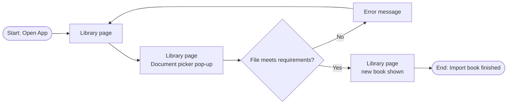
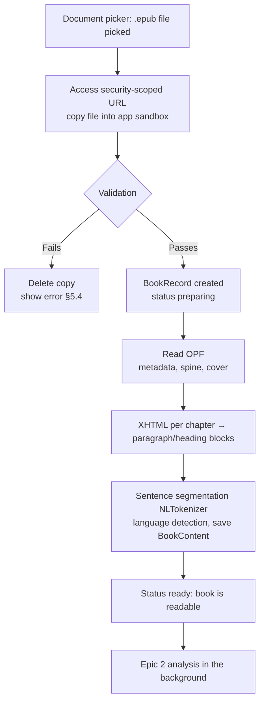

# 1.1 Import Book Files

> **Note:** Items marked **(\*)** are suggestions or predictions (target numbers, technical decisions, additional criteria). Validate them with the team before using them as a reference.

| | |
|---|---|
| **Epic** | 1. Library Management & Book Ingestion (see PRD 1.0) |
| **Story** | 1.1 Import Book Files |
| **Release target** | Demoable app |
| **Platform** | **iPadOS 26+ only**, SwiftUI (\*). iPhone (iOS) and macOS: **TBD**, not part of this release. |
| **Status** | Draft |
| **Book format** | DRM-free `.epub`. PDF comes in a later phase. |
| **Core technology** | SwiftUI `.fileImporter`, EPUB parser (ZIP + XML), NaturalLanguage (`NLTokenizer`, `NLLanguageRecognizer`) |
| **Owner / Designer / Tech Lead** | [TBD] |
| **Produces** | `BookRecord`, `BookContent` (used by 1.2, 1.3, 2.1) |

---

## 1. Feature Name

**Import Book Files**

Readers import `.epub` books through Apple's native document picker. The app copies the file, validates it, and turns it into structured text (chapters, paragraphs, sentences) in the background, so the book is readable right away and ready for the Reference Passage feature to analyse.

**User story**

> As a **reader**, I want to **import book files into the application** so that I know **the system can process the book**.

---

## 2. Problem

1. **Reference features need processable text.** The context resolution features (Epic 2) only work once a book is in the app as structured text. Readers need a clear way to import and to know whether the book was processed successfully.
2. **Unsupported formats are confusing.** Without clear error messages, readers don't know why a file failed to open (DRM, damaged file, another format).
3. **Importing must not make the app feel heavy.** Parsing long books and running NLP analysis takes time; if it runs in the foreground, the app feels stuck.

---

## 3. Goals

**Goals**

1. Readers can import `.epub` through Apple's native document picker in **≤ 3 taps**. (\*)
2. The book is **readable right after import**; parsing and NLP analysis run in the background without making the UI stutter.
3. Files outside the supported format are rejected with a **clear, actionable message**.
4. All files and book data are stored and processed **on-device**.

**Non-goals (this phase)**

- **PDF** (including text-layer PDFs and scanned PDFs / OCR). Planned for a later phase.
- Other formats (for example `.mobi`, `.azw`, `.txt`, `.docx`). (\*)
- DRM-protected EPUBs and books purchased in Apple Books.
- Importing from web links, the clipboard, the Share sheet, or "Open in". Import is through the document picker only. (\*)
- Editing book metadata (title, author, cover). (\*)

---

## 4. Success Metrics

### 4.1 Usability test

| Metric | Definition | Target |
|---|---|---|
| Import success | % of participants who import one book without help | ≥ 95% (\*) |
| Time to import | Time from opening the app to the book appearing in the library | ≤ 30 seconds (\*) |
| Error comprehension | % of participants who can explain why a file was rejected after reading the error message | ≥ 90% (\*) |
| Perceived ease | Single Ease Question (1 to 7 scale) | Average ≥ 6 (\*) |

### 4.2 Technical quality

| Metric | Definition | Target |
|---|---|---|
| EPUB parse success | % of valid DRM-free EPUBs parsed successfully (test: 50 public-domain EPUBs) | ≥ 99% (\*) |
| Metadata accuracy | % of books with title and author read correctly | ≥ 95% (\*) |
| Chapter accuracy | % of books with correct chapter splits and titles (from `nav`/`toc`) | ≥ 95% (\*) |
| Text cleanliness | % of paragraphs with no leftover markup, footnotes, or navigation text | ≥ 99% (\*) |
| False rejection | % of valid files wrongly rejected | 0% (\*) |

### 4.3 Post-launch (product)

| Metric | Definition | Target |
|---|---|---|
| Import completion rate | `LB_ImportDone_Event` / `LB_AddBook_Button` | ≥ 80% (\*) |
| Import failure rate | `LB_ImportError_Event` / import attempts, per `error_code` | < 5% (\*) |

### 4.4 Guardrails / performance

| Metric | Target |
|---|---|
| Book appears in the library after picking it | ≤ 1 second (`preparing` status) (\*) |
| Book readable after import (EPUB ~100k words) | ≤ 2 seconds (\*) |
| UI frame rate while import and analysis run | No visible frame drops (≥ 55 fps) (\*) |

Shared rules (offline, crash-free, main thread) are in PRD 1.0 §4.

### 4.5 Event tracking

| Event | When it fires | Properties |
|---|---|---|
| `LB_AddBook_Button` | Tap on "Add book" (header or empty state) | source (header / empty_state) |
| `LB_DocumentPicker_Shown` | Document picker appears | – |
| `LB_DocumentPicker_Cancel` | Picker closed without choosing a file | – |
| `LB_ImportDone_Event` | Book imported and readable | words, chapters, seconds, language |
| `LB_ImportError_Event` | Import failed | error_code (§5.4) |

---

## 5. Main Flow

### 5.1 User flow

| # | Screen | See | Do | System response |
|---|---|---|---|---|
| 1 | Library page | **"Add book"** button or visual cue | Tap "Add book" | Document picker appears |
| 2 | Library page (document picker) | Apple's native document picker modal with the user's files (Files, iCloud Drive) | Pick one file | Only `.epub` can be picked; other formats (including `.pdf`) are greyed out |
| 3a | Library page | Error message explaining the problem and the next step (§5.4) | Dismiss, or tap "Choose another file" | Back to Library page; no book added |
| 3b | Library page | New book appears at the top with a **"Preparing…"** status, then cover, title, author | Can tap the book once ready; can still tap "Add book" again | Parsing runs in the background; NLP analysis (Epic 2) starts once the status is `ready` |

### 5.2 Alternative flows

- **A1. Picker cancelled:** the picker closes and the Library page is unchanged.
- **A2. Book already in the library** (same file, checked by hash): not imported again; shows "Already in your library" with an "Open" button. (\*)
- **A3. Importing several files at once:** the picker allows multi-select; each file is processed in order and gets its own status. A failed file doesn't cancel the others. (\*)
- **A4. App closed during import:** files already copied stay with a `preparing` status; parsing resumes when the app reopens. Files not yet copied don't appear. (\*)
- **A5. Non-English book:** the book is still imported and readable as usual. Its language is stored in `BookRecord.language`; the Reference Passage feature is disabled for that book (PRD 2.1 AC-2.1-17). (\*)

### 5.3 System flow: ingestion

**Step 1: Copy and validate.**
- The picker (`.fileImporter`) filters on `UTType.epub` only. The app calls `startAccessingSecurityScopedResource()` on the picked URL and copies the file to `Books/<bookID>/` (layout in overview §3.3).
- Validation after copying, all before the `BookRecord` is created: the file is a ZIP whose `mimetype` entry is `application/epub+zip`; `META-INF/container.xml` and the OPF can be read (else `corrupted`); size ≤ 200 MB (\*); a SHA-256 hash for duplicate detection; and the DRM check.
- DRM check: `rights.xml`, or a `META-INF/encryption.xml` that encrypts content other than fonts, → `drm_protected`. An `encryption.xml` that only obfuscates fonts (the IDPF and Adobe font algorithms) is **not** DRM and the book is accepted.

**Step 2: EPUB parsing.**
- Read `META-INF/container.xml` → OPF path → metadata (`dc:title`, `dc:creator`, `dc:language`), manifest, spine, cover (`cover-image` or the `cover` meta).
- For each spine item (XHTML): take text from `p`, `h1`–`h6`, `blockquote`, `li`; skip `script`, `style`, images, footnotes, and navigation pages. Chapter titles from `nav` (EPUB 3) or `toc.ncx` (EPUB 2), or the first heading when neither exists.
- If the title metadata is empty, the title comes from the file name; if the author is empty, it shows as "Unknown author".

**Step 3: Structure and save.** Text blocks per chapter are split into sentences with `NLTokenizer` (unit `.sentence`); every paragraph and sentence gets a global index. The book language comes from `dc:language`, checked with `NLLanguageRecognizer`, and is stored in `BookRecord.language`. The result is saved as `BookContent`; status changes to `ready`.

**Step 4: Background.** Parsing runs in `Task.detached(priority: .userInitiated)`; Epic 2 analysis runs at `.utility`. The UI only receives status and progress updates.

> **Note for the PDF phase:** `BookContent` is designed to be format-independent, so a future PDF parser only needs to produce the same structure, with no changes to 1.2, 1.3, or Epic 2. (\*)

### 5.4 Error handling

| Code | Condition | User-facing message (\*) | Action |
|---|---|---|---|
| `unsupported_format` | File isn't a real EPUB (for example a renamed extension) | "This file isn't an EPUB. Choose a .epub file." | Choose another file |
| `drm_protected` | DRM-encrypted EPUB | "This book is copy-protected (DRM) and can't be opened. Try a DRM-free EPUB." | OK |
| `corrupted` | ZIP/OPF damaged or unreadable | "This file seems damaged and can't be opened." | Choose another file |
| `empty` | No chapter text after parsing | "This book has no readable text." | OK |
| `too_large` | Size above the limit | "This file is too large (max 200 MB)." | OK |
| `duplicate` | Same hash as a book in the library | "Already in your library." | Open |
| `storage_full` | Device storage full while copying | "Not enough storage to add this book." | OK |
| `access_denied` | File can't be accessed (iCloud file not downloaded, permissions) | "We couldn't access this file. Make sure it's downloaded and try again." | Choose another file |

Errors caught during validation (Step 1: `unsupported_format`, `drm_protected`, `corrupted` for an unreadable container or OPF, `too_large`, `duplicate`, `storage_full`, `access_denied`): the file copy is deleted and no `BookRecord` is created. Errors caught during parsing (Step 2: `empty`, and `corrupted` when chapter content can't be read): the `BookRecord` gets a `failed(error_code)` status and is handled in PRD 1.2. Every error logs `LB_ImportError_Event`. In code the codes are the cases of `ImportError` (naming guide `05-NAMING.md`).

### 5.5 Components (MVVM)

The app follows MVVM (PRD 1.0 §3.4).

| Layer | Component | Responsibility |
|---|---|---|
| Model | `ImportCtrl` (protocol), `ImportCtrlLive` | File copy, validation, duplicate detection, creating the `BookRecord`, import queue (multi-select), resume after the app reopens, triggering Epic 2 analysis |
| Model | `EPUBParseSvc` | Unzip, OPF, spine, metadata, cover, XHTML → text blocks. Also runs the Step 1 container and DRM checks. |
| Model | `StructureSvc` | Text blocks → chapters, paragraphs, sentences; language detection; saving `BookContent` |
| ViewModel | `ImportVM` | State: picker shown, import status per file, current alert (§5.4 message or duplicate). Intents: `addBookTapped(source:)`, `filesPicked(_:)`, `pickerCancelled()`, `alertDismissed()`, `chooseAnotherFileTapped()`, `openDuplicateTapped()`. Sends the §4.5 events. |
| View | Add book button, file importer, import alerts | "Add book" in the Library header and empty state; `.fileImporter` limited to `.epub` with multi-select; one alert per §5.4 code. Every action calls an `ImportVM` intent. |

The data model (`BookRecord`, `BookContent`) and status lifecycle are in PRD 1.0 §3.

---

## 6. Acceptance Criteria

| ID | Criteria (Given / When / Then) | Priority |
|---|---|---|
| AC-1.1-01 | **Given** the reader is on the Library page, **when** the page shows, **then** an "Add book" button or visual cue is visible. | P0 |
| AC-1.1-02 | **Given** the reader taps "Add book", **when** Apple's native document picker appears, **then** **only `.epub` files** can be picked. | P0 |
| AC-1.1-03 | **Given** a valid file is picked, **when** import runs, **then** the book appears in the library within 1 second with a "Preparing" status, and **parsing runs in the background without making the UI stutter** (including while NLP analysis runs). | P0 |
| AC-1.1-04 | **Given** parsing finishes, **when** the status changes to `ready`, **then** the book shows its cover, title, and author, and can be opened. | P0 |
| AC-1.1-05 | **Given** a file outside the requirements caught in Step 1 (not a real EPUB, DRM, damaged container, too large, inaccessible, storage full), **when** import is attempted, **then** the matching §5.4 error appears, no book is added, and the reader is back on the Library page. | P0 |
| AC-1.1-11 | **Given** parsing finds no readable text (`empty`) or chapter content that can't be read, **when** parsing finishes, **then** the book shows as `failed` with the matching §5.4 message and can be removed (PRD 1.2). | P0 |
| AC-1.1-06 | **Given** the reader cancels the document picker, **when** the picker closes, **then** the library is unchanged. | P0 |
| AC-1.1-07 | **Given** the same file is already in the library, **when** it is imported again, **then** there is no duplicate and "Already in your library" appears with an Open button. (\*) | P1 |
| AC-1.1-08 | **Given** several files are picked at once, **when** import runs, **then** each file is processed with its own status; one failure doesn't fail the others. (\*) | P1 |
| AC-1.1-09 | **Given** the app is closed while a book is still `preparing`, **when** the app reopens, **then** parsing continues until the book is `ready` or `failed`. (\*) | P1 |
| AC-1.1-10 | **Given** a book in a language other than English, **when** it is imported, **then** the book still becomes `ready` and readable, and its language is stored in `BookRecord.language`. (\*) | P0 |

---

## 7. Test Cases

| ID | Scenario | Precondition | Steps | Expected result | AC |
|---|---|---|---|---|---|
| TC-1.1-01 | Add book button | Library has books | Open the app | "Add book" button visible | AC-1.1-01 |
| TC-1.1-02 | Picker filter | .txt, .docx, .pdf, .epub files in Files | Tap Add book | Only .epub can be picked; .pdf is greyed out too | AC-1.1-02 |
| TC-1.1-03 | EPUB import | DRM-free EPUB, ~100k words | Pick the file | "Preparing" within 1 s; `ready` within 2 s; correct cover, title, author, and chapter titles | AC-1.1-03, AC-1.1-04 |
| TC-1.1-04 | EPUB 2 import | Version 2 EPUB (`toc.ncx`, no `nav`) | Pick the file | `ready`; chapter titles come from `toc.ncx` | AC-1.1-04 |
| TC-1.1-05 | UI stays smooth | Large EPUB being imported and analysed | Scroll the library, open another book | No visible frame drops; UI responsive | AC-1.1-03 |
| TC-1.1-06 | Fake extension | .txt renamed to .epub | Pick the file | `unsupported_format` error; no new book | AC-1.1-05 |
| TC-1.1-07 | DRM EPUB | EPUB whose `encryption.xml` encrypts chapter content | Pick the file | `drm_protected` error; no book added | AC-1.1-05 |
| TC-1.1-08 | Damaged file | EPUB with a truncated ZIP | Pick the file | `corrupted` error | AC-1.1-05 |
| TC-1.1-09 | EPUB with no text | EPUB containing only images | Pick the file | Book appears, then shows `failed(empty)` with the message; Remove works | AC-1.1-11 |
| TC-1.1-10 | File too large | EPUB > 200 MB | Pick the file | `too_large` error | AC-1.1-05 |
| TC-1.1-11 | iCloud file not downloaded | File only in iCloud, offline | Pick the file | `access_denied` error; no crash | AC-1.1-05 |
| TC-1.1-12 | Cancel picker | – | Tap Add book, then Cancel | Library unchanged | AC-1.1-06 |
| TC-1.1-13 | Duplicate | EPUB already imported | Import the same file | "Already in your library" + Open; no duplicate | AC-1.1-07 |
| TC-1.1-14 | Multi-select | 3 files: 2 valid EPUBs, 1 DRM EPUB | Pick all three | 2 books added; 1 error for the DRM EPUB | AC-1.1-08 |
| TC-1.1-15 | Import resume | Large EPUB import still `preparing` | Force quit, reopen the app | Parsing continues; book becomes `ready` | AC-1.1-09 |
| TC-1.1-16 | Non-English book | Indonesian-language EPUB | Import and open | Book is `ready` and readable; `language` = id | AC-1.1-10 |
| TC-1.1-17 | Airplane mode | Airplane mode on | Import an EPUB | Import succeeds; no network requests | AC-1.1-03 |
| TC-1.1-18 | Storage full | Device storage almost full | Pick a large EPUB | `storage_full` error; the partial copy is deleted; no new book | AC-1.1-05 |
| TC-1.1-19 | Font-obfuscated EPUB | EPUB with an `encryption.xml` that only obfuscates fonts | Pick the file | Imported normally; not rejected as DRM | AC-1.1-05 |

---

## 8. Open Questions & Risks

1. **EPUB variety.** EPUBs from different sources (Project Gutenberg, Standard Ebooks, publishers) have different XHTML structures, for example inline footnotes or chapters split across several files. A test set of EPUBs from several sources is needed early. (\*)
2. **File size limit.** 200 MB is a proposal; illustrated EPUBs can be large. Needs testing. (\*)
3. **Other import sources.** Readers often use the Share sheet and "Open in" to move books from other apps; decide whether these come after the demo. (\*)
4. **PDF phase.** When PDF is developed, it needs its own PRD for the PDF parser (text extraction, headers/footers, chapter detection, scanned PDFs). (\*)
5. **Own parser (decided).** The EPUB parser is built in-house (Index §6) so Epic 2 gets sentence-level positions. A third-party toolkit can be reconsidered later. (\*)
