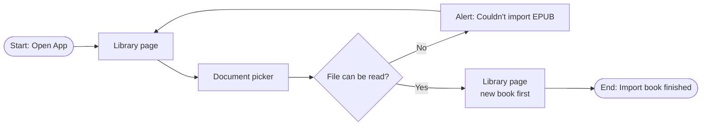
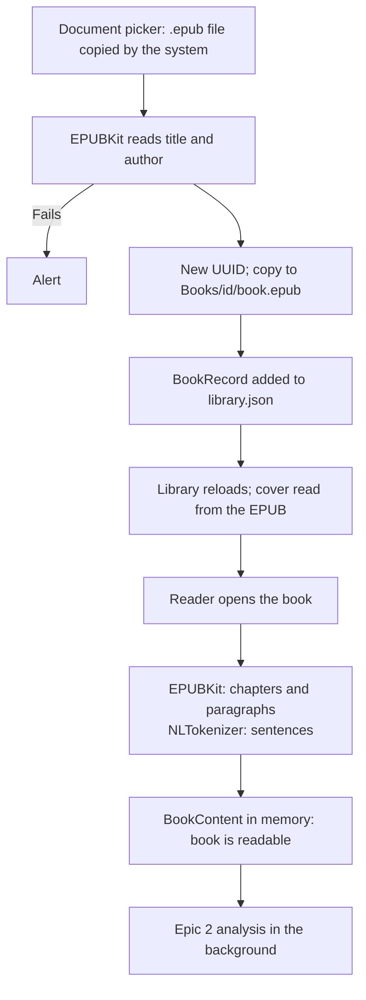

# 1.1 Import Book Files

> **Note:** Items marked **(\*)** are suggestions or predictions (target numbers, technical decisions, additional criteria). Validate them with the team before using them as a reference.

| | |
|---|---|
| **Epic** | 1. Library Management & Book Ingestion (see PRD 1.0) |
| **Story** | 1.1 Import Book Files |
| **Release target** | Demoable app |
| **Platform** | **iPadOS 26+ only**, SwiftUI (\*). iPhone (iOS) and macOS: **TBD**, not part of this release. |
| **Status** | Draft |
| **Book format** | DRM-free `.epub`. PDF comes in a later phase. |
| **Core technology** | `UIDocumentPickerViewController`, `EPUBKit` (ZIP + XML, on ZIPFoundation), NaturalLanguage (`NLTokenizer`) |
| **Owner / Designer / Tech Lead** | [TBD] |
| **App reference** | Branch `Underline-Engine`, commit `8066192`. Status columns come from reading the code, not from running the app. |
| **Produces** | `BookRecord`, the EPUB file on the device, `BookContent` when a book opens (used by 1.2, 1.3, 2.1) |

---

## 1. Feature Name

**Import Book Files**

Readers import `.epub` books through Apple's native document picker. The app reads the title and author, copies the file, and lists the book. When the book opens, the app turns it into structured text (chapters, paragraphs, sentences), so it is readable and ready for the Reference Passage feature to analyse.

**User story**

> As a **reader**, I want to **import book files into the application** so that I know **the system can process the book**.

---

## 2. Problem

1. **Reference features need processable text.** The context resolution features (Epic 2) only work once a book is in the app as structured text. Readers need a clear way to import and to know whether the book was processed successfully.
2. **Unsupported formats are confusing.** Without clear error messages, readers don't know why a file failed to open (DRM, damaged file, another format).
3. **Importing must not make the app feel heavy.** Parsing long books and running NLP analysis takes time; if it runs in the foreground, the app feels stuck.

---

## 3. Goals

**Goals**

1. Readers can import `.epub` through Apple's native document picker in **≤ 3 taps**. (\*)
2. The book is **readable right after import**; underline analysis runs in the background without making the UI stutter.
3. Files outside the supported format are rejected with a **clear, actionable message**. Today only unreadable files are caught, with a general message (§5.4).
4. All files and book data are stored and processed **on-device**.

**Non-goals (this phase)**

- **PDF** (including text-layer PDFs and scanned PDFs / OCR). Planned for a later phase.
- Other formats (for example `.mobi`, `.azw`, `.txt`, `.docx`). (\*)
- DRM-protected EPUBs and books purchased in Apple Books.
- Importing from web links, the clipboard, the Share sheet, or "Open in". Import is through the document picker only. (\*)
- Editing book metadata (title, author, cover). (\*)

---

## 4. Success Metrics

### 4.1 Usability test

| Metric | Definition | Target |
|---|---|---|
| Import success | % of participants who import one book without help | ≥ 95% (\*) |
| Time to import | Time from opening the app to the book appearing in the library | ≤ 30 seconds (\*) |
| Error comprehension | % of participants who can explain why a file was rejected after reading the error message | ≥ 90% (\*) |
| Perceived ease | Single Ease Question (1 to 7 scale) | Average ≥ 6 (\*) |

### 4.2 Technical quality

| Metric | Definition | Target |
|---|---|---|
| EPUB parse success | % of valid DRM-free EPUBs parsed successfully (test: 50 public-domain EPUBs) | ≥ 99% (\*) |
| Metadata accuracy | % of books with title and author read correctly | ≥ 95% (\*) |
| Chapter accuracy | % of books with correct chapter splits and titles (from `nav`/`toc`) | ≥ 95% (\*) |
| Text cleanliness | % of paragraphs with no leftover markup, footnotes, or navigation text | ≥ 99% (\*) |
| False rejection | % of valid files wrongly rejected | 0% (\*) |

### 4.3 Post-launch (product)

| Metric | Definition | Target |
|---|---|---|
| Import completion rate (needs §4.5) | `LB_ImportDone_Event` / `LB_AddBook_Button` | ≥ 80% (\*) |
| Import failure rate (needs §4.5) | `LB_ImportError_Event` / import attempts, per `error_code` | < 5% (\*) |

### 4.4 Guardrails / performance

| Metric | Target |
|---|---|
| Book appears in the library after picking it | ≤ 1 second (\*) |
| Book readable after import (EPUB ~100k words) | ≤ 2 seconds (\*) |
| UI frame rate while import and analysis run | No visible frame drops (≥ 55 fps) (\*) |

Shared rules (offline, crash-free, main thread) are in PRD 1.0 §4.

### 4.5 Event tracking

**Not built.** Import sends no events. Proposed (\*):

| Event | When it fires | Properties |
|---|---|---|
| `LB_AddBook_Button` | Tap on **+** | – |
| `LB_DocumentPicker_Shown` | Document picker appears | – |
| `LB_DocumentPicker_Cancel` | Picker closed without choosing a file | – |
| `LB_ImportDone_Event` | Book imported | seconds |
| `LB_ImportError_Event` | Import failed | error_code (§5.4) |

---

## 5. Main Flow

### 5.1 User flow

| # | Screen | See | Do | System response |
|---|---|---|---|---|
| 1 | Library page | **+** button at the top right | Tap **+** | Document picker opens full screen |
| 2 | Document picker | Apple's native document picker with the user's files (Files, iCloud Drive) | Pick one or more files | Only EPUB files can be picked; other formats (including `.pdf`) are greyed out |
| 3a | Library page | Alert "Couldn't import EPUB" with the system's message | Tap OK | Back to Library page. Books imported before the failure stay; the rest aren't tried. |
| 3b | Library page | The new book first in the library, with its cover, title, and author | Can tap the book; can tap **+** again | The book stays first until the reader changes the sort |

### 5.2 Alternative flows

- **A1. Picker cancelled:** the picker closes and the Library page is unchanged.
- **A2. Importing several files at once:** the picker allows multi-select, and files are imported in order. The first failure stops the rest, with one alert.
- **A3. Book already in the library (not built):** the same file is imported again as a second book. Requirement kept: "Already in your library" with an "Open" button. (\*)
- **A4. App closed during import (not built):** there is no resume. Requirement kept. (\*)
- **A5. Non-English book:** the book is imported and readable as usual. The app doesn't detect or store the language (PRD 2.1 A6).

### 5.3 System flow: ingestion

**Step 1: Pick and copy.** `EPUBDocumentPicker` wraps `UIDocumentPickerViewController` (`forOpeningContentTypes: [.epub]`, `asCopy: true`, multi-select). `LibRepo.importBook` reads the metadata first, so a file EPUBKit can't read stops here and nothing is copied. If the title is empty, it comes from the file name; if the author is empty, it shows "Unknown Author".

**Step 2: EPUB parsing (when the book opens).** `EPUBParseSvc` calls `EPUBKit`: `META-INF/container.xml` → OPF → metadata, manifest, spine, cover (the EPUB 3 `cover-image` property or the EPUB 2 `cover` meta tag). Text comes from the spine in reading order, split into chapters by the table of contents that the OPF's `spine toc` points to (`toc.ncx`). Text before the first entry goes into a chapter named after the book. An EPUB 3 `nav` file isn't read, so a book with no `toc.ncx` becomes one long chapter.

**Step 3: Structure.** Paragraphs are split into sentences with `NLTokenizer`, and every paragraph and sentence gets a global index. No-break spaces after "Mr." and "Dr." are treated as plain spaces, so they don't end a sentence. The result is `BookContent` with `parserVersion` 1, kept in memory by `BookContentRepo`. A book with no chapters throws `ContentError.unreadable`.

**Step 4: Sample books.** Five public-domain EPUBs are bundled in the app and listed in `BookRecord.samples`. They skip Step 1. Little Women starts at a mock 30% until the reader has progress of their own.

> **Note for the PDF phase:** `BookContent` is designed to be format-independent, so a future PDF parser only needs to produce the same structure, with no changes to 1.2, 1.3, or Epic 2. (\*)

### 5.4 Error handling

**Built today**

| Condition | What the reader sees | Action |
|---|---|---|
| EPUBKit can't read the file, or a file operation fails, during import | Alert "Couldn't import EPUB" with the system's message | OK |
| Failure while removing or sharing a book | Alert "Something went wrong" (PRD 1.2) | OK |
| Parsing fails when the book opens | Reading page shows "Can't Open Book" | Back |

Only two content errors exist in code: `ContentError.notFound` and `ContentError.unreadable`.

**Not built, requirement kept (\*)**

| Code | Condition | User-facing message | Action |
|---|---|---|---|
| `unsupported_format` | File isn't a real EPUB (for example a renamed extension) | "This file isn't an EPUB. Choose a .epub file." | Choose another file |
| `drm_protected` | DRM-encrypted EPUB. An `encryption.xml` that only obfuscates fonts is not DRM. | "This book is copy-protected (DRM) and can't be opened. Try a DRM-free EPUB." | OK |
| `corrupted` | ZIP/OPF damaged or unreadable | "This file seems damaged and can't be opened." | Choose another file |
| `empty` | No chapter text | "This book has no readable text." | OK |
| `too_large` | Size above the limit (200 MB) | "This file is too large (max 200 MB)." | OK |
| `duplicate` | Same hash as a book in the library | "Already in your library." | Open |
| `storage_full` | Device storage full while copying | "Not enough storage to add this book." | OK |
| `access_denied` | File can't be accessed | "We couldn't access this file. Make sure it's downloaded and try again." | Choose another file |

### 5.5 Components (MVVM)

| Layer | Component | Responsibility |
|---|---|---|
| Model | `LibRepo` | Reads metadata, copies the file, writes `library.json` |
| Model | `LibCtrl` | Import use case for the ViewModel |
| Model | `EPUBParseSvc` + `EPUBKit` | Metadata, cover, chapters; `BookContent` with sentences |
| Model | `BookContentRepo` | One parse per book, kept in memory; covers; finds the imported or bundled file |
| ViewModel | `LibVM` | `importFiles(_:)`, `importError`, `dismissImportError()`, pins the newest import to the top |
| View | `LibView` (**+** button, alert), `EPUBDocumentPicker` | Every action calls a `LibVM` intent |

The data model and storage are in PRD 1.0 §3.

---

## 6. Acceptance Criteria

| ID | Criteria (Given / When / Then) | Priority | Status |
|---|---|---|---|
| AC-1.1-01 | **Given** the reader is on the Library page, **when** the page shows, **then** a **+** button is visible. | P0 | Built |
| AC-1.1-02 | **Given** the reader taps **+**, **when** Apple's native document picker appears, **then** **only `.epub` files** can be picked. | P0 | Built |
| AC-1.1-03 | **Given** a valid file is picked, **when** import runs, **then** the book appears in the library within 1 second. (\*) | P0 | Built; time not measured |
| AC-1.1-04 | **Given** import finishes, **when** the library reloads, **then** the book shows its cover, title, and author, and can be opened. | P0 | Built |
| AC-1.1-05 | **Given** a file EPUBKit can't read, **when** import is attempted, **then** an alert appears, no book is added, and the reader is back on the Library page. | P0 | Built, with a general message |
| AC-1.1-06 | **Given** the reader cancels the document picker, **when** the picker closes, **then** the library is unchanged. | P0 | Built |
| AC-1.1-07 | **Given** several files are picked at once, **when** import runs, **then** each is imported in order; one failure doesn't fail the others. (\*) | P1 | Partly: the first failure stops the rest |
| AC-1.1-08 | **Given** a book in a language other than English, **when** it is imported, **then** it is readable. | P0 | Built |
| AC-1.1-09 | **Given** a book in a language other than English, **when** it is imported, **then** its language is stored. (\*) | P1 | Not built |
| AC-1.1-10 | **Given** a file outside the requirements (not a real EPUB, DRM, damaged, too large, inaccessible, storage full), **when** import is attempted, **then** the matching §5.4 message appears. (\*) | P0 | Not built |
| AC-1.1-11 | **Given** a book has no readable text, **when** it is imported, **then** it shows as failed with a message and can be removed. (\*) | P0 | Not built: "Can't Open Book" when opened |
| AC-1.1-12 | **Given** the same file is already in the library, **when** it is imported again, **then** there is no duplicate and "Already in your library" appears with an Open button. (\*) | P1 | Not built |
| AC-1.1-13 | **Given** the app is closed during import, **when** the app reopens, **then** import continues. (\*) | P1 | Not built |

---

## 7. Test Cases

| ID | Scenario | Precondition | Steps | Expected result | AC |
|---|---|---|---|---|---|
| TC-1.1-01 | Add button | Library has books | Open the app | **+** button visible | AC-1.1-01 |
| TC-1.1-02 | Picker filter | .txt, .docx, .pdf, .epub files in Files | Tap **+** | Only .epub can be picked; .pdf is greyed out too | AC-1.1-02 |
| TC-1.1-03 | EPUB import | DRM-free EPUB, ~100k words | Pick the file | Book first in the library; correct cover, title, author | AC-1.1-03, AC-1.1-04 |
| TC-1.1-04 | EPUB 2 chapters | Version 2 EPUB (`toc.ncx`) | Import and open | Chapter titles come from `toc.ncx` | AC-1.1-04 |
| TC-1.1-05 | EPUB 3 with no `toc.ncx` | EPUB with only a `nav` file | Import and open | Book opens as one chapter (known limit) | AC-1.1-04 |
| TC-1.1-06 | Fake extension | .txt renamed to .epub | Pick the file | Alert; no new book | AC-1.1-05 |
| TC-1.1-07 | Damaged file | EPUB with a truncated ZIP | Pick the file | Alert; no new book | AC-1.1-05 |
| TC-1.1-08 | Cancel picker | – | Tap **+**, then Cancel | Library unchanged | AC-1.1-06 |
| TC-1.1-09 | Multi-select | 3 files: 2 valid EPUBs, 1 damaged in the middle | Pick all three | First book added, alert shown (the third isn't tried today) | AC-1.1-07 |
| TC-1.1-10 | Non-English book | Indonesian-language EPUB | Import and open | Book is readable | AC-1.1-08 |
| TC-1.1-11 | Airplane mode | Airplane mode on | Import an EPUB | Import succeeds; no network requests | AC-1.1-03 |
| TC-1.1-12 | DRM EPUB | EPUB whose `encryption.xml` encrypts chapter content | Pick the file | `drm_protected` message; no book added | AC-1.1-10 |
| TC-1.1-13 | Font-obfuscated EPUB | EPUB with an `encryption.xml` that only obfuscates fonts | Pick the file | Imported normally; not rejected as DRM | AC-1.1-10 |
| TC-1.1-14 | File too large | EPUB > 200 MB | Pick the file | `too_large` message | AC-1.1-10 |
| TC-1.1-15 | iCloud file not downloaded | File only in iCloud, offline | Pick the file | `access_denied` message; no crash | AC-1.1-10 |
| TC-1.1-16 | Storage full | Device storage almost full | Pick a large EPUB | `storage_full` message; the partial copy is deleted | AC-1.1-10 |
| TC-1.1-17 | EPUB with no text | EPUB containing only images | Import and open | Book marked as failed; Remove works | AC-1.1-11 |
| TC-1.1-18 | Duplicate | EPUB already imported | Import the same file | "Already in your library" + Open; no duplicate | AC-1.1-12 |
| TC-1.1-19 | Import resume | Large EPUB import running | Force quit, reopen the app | Import continues | AC-1.1-13 |

---

## 8. Open Questions & Risks

1. **EPUB variety.** EPUBs from different sources (Project Gutenberg, Standard Ebooks, publishers) have different XHTML structures, for example inline footnotes or chapters split across several files. A test set of EPUBs from several sources is needed early. (\*)
2. **File size limit.** 200 MB is a proposal; illustrated EPUBs can be large. Needs testing. (\*)
3. **Validation is missing.** A file that opens as a ZIP with readable metadata passes, whatever is inside. DRM books will import and then fail or show garbled text. Decide whether the §5.4 checks are required for the demo. (\*)
4. **EPUB 3 chapters.** `nav` isn't read, and a single long chapter affects Reference Passage, which searches one chapter at a time. (\*)
5. **Other import sources.** Readers often use the Share sheet and "Open in" to move books from other apps; decide whether these come after the demo. (\*)
6. **PDF phase.** When PDF is developed, it needs its own PRD for the PDF parser (text extraction, headers/footers, chapter detection, scanned PDFs). (\*)
7. **Own parser (decided).** The EPUB parser (`EPUBKit`) is built in-house (Index §6) so Epic 2 gets sentence-level positions. A third-party toolkit can be reconsidered later. (\*)
