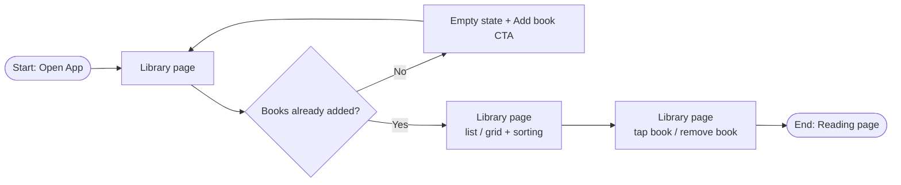

# 1.2 Central Library

> **Note:** Items marked **(\*)** are suggestions or predictions (target numbers, technical decisions, additional criteria). Validate them with the team before using them as a reference.

| | |
|---|---|
| **Epic** | 1. Library Management & Book Ingestion (see PRD 1.0) |
| **Story** | 1.2 Central Library |
| **Release target** | Demoable app |
| **Platform** | **iPadOS 26+ only**, SwiftUI (\*). iPhone (iOS) and macOS: **TBD**, not part of this release. |
| **Status** | Draft |
| **Depends on** | 1.1 (`BookRecord`), 1.3 (`ReadingProgress` for reading progress; `lastOpenedAt` updated when a book opens) |
| **Owner / Designer / Tech Lead** | [TBD] |
| **Produces** | `LibrarySettings`; removing a book with all its data |

---

## 1. Feature Name

**Central Library**

One page that shows every imported book in list or grid mode, can be sorted, and is the entry point to the reading page. From here readers can also add books (PRD 1.1) and remove books from the device.

**User story**

> As a **reader**, I want a **central library displaying all my imported books** so that I can **easily browse and select what to read**.

---

## 2. Problem

1. **Books are scattered.** EPUB files live in Files, iCloud Drive, or downloads. Without a central library, readers have to find the file again every time they want to read.
2. **A growing collection is hard to manage.** Without clear ordering and view modes, readers struggle to find a given book, and books they no longer need fill up storage.
3. **An empty page gives no direction.** A new user opening an empty library needs to know what to do first.

---

## 3. Goals

**Goals**

1. The library shows every book in **list or grid** mode, with each book's status clearly visible.
2. Books can be **sorted** by Recent, Title, or Author, and the choice is saved.
3. Readers open a book with **one tap**.
4. Books can be **removed from the device** with all their data, after confirmation.
5. An empty library shows a **clear CTA** to add a book.

**Non-goals (this release)**

- Collections/shelves, tags, and library search. (\*)
- Library sync across devices (iCloud sync). (\*)
- Editing book metadata (title, author, cover). (\*)
- Removing several books at once. (\*)

---

## 4. Success Metrics

### 4.1 Usability test

| Metric | Definition | Target |
|---|---|---|
| First action | % of new users who tap the "Add book" CTA from the empty state without help | ≥ 95% (\*) |
| Find & open | % of participants who find and open a given book in a 10-book library | ≥ 95% (\*) |
| Time to open | Average time to find and open a given book in a 10-book library | ≤ 10 seconds (\*) |
| Remove success | % of participants who remove a given book without help | ≥ 90% (\*) |
| Perceived ease | Single Ease Question (1 to 7 scale) | Average ≥ 6 (\*) |

### 4.2 Technical quality

| Metric | Definition | Target |
|---|---|---|
| Sort correctness | Sort results follow the §5.2 rules on test data (titles with articles, mixed case, no author) | 100% |
| Removal completeness | After removal, no file or book data remains in `Books/<bookID>/` | 100% |
| Settings persistence | View mode and sort are the same after the app is fully closed | 100% |

### 4.3 Post-launch (product)

| Metric | Definition | Target |
|---|---|---|
| Books per user | Average books in the library after 2 weeks | Measure as baseline (\*) |
| View mode share | % of users using list vs grid | Measure as baseline (\*) |
| Removal rate | `LB_RemoveBook_Button` / books imported | Measure as baseline (\*) |

### 4.4 Guardrails / performance

| Metric | Target |
|---|---|
| Library shown on app launch (100 books) | ≤ 500 ms (\*) |
| Library scrolling (100 books, covers loaded) | No visible frame drops (≥ 55 fps) (\*) |
| Tap a book → reading page shown | ≤ 1 second (\*) |

Shared rules (offline, crash-free, main thread) are in PRD 1.0 §4.

### 4.5 Event tracking

| Event | When it fires | Properties |
|---|---|---|
| `LB_Book_Tap` | A book in the library is tapped | source (latest_read / list / grid), position_in_list, status |
| `LB_Sort_Change` | Sort order changed | sort (recent / title / author) |
| `LB_ViewMode_Change` | View mode changed | mode (list / grid) |
| `LB_RemoveBook_Button` | Book removal confirmed | format, had_progress |

`LB_AddBook_Button` from the empty state is defined in PRD 1.1 §4.5.

---

## 5. Main Flow

### 5.1 User flow

| # | Screen | See | Do | System response |
|---|---|---|---|---|
| 1 | Library page (empty) | **Empty state**: illustration or icon, short text ("Your library is empty"), **"Add book"** CTA button | Tap the CTA | Document picker appears (PRD 1.1) |
| 2 | Library page (with books) | Header: "Library" title, "Add book" button, list/grid toggle, sort menu. Below it the Continue reading card (PRD 1.3), then the book list. | – | – |
| 3 | Library page (list) | Each row: small cover, title, author, reading progress (%), status (§5.3) | Switch to grid | Mode saved in `LibrarySettings` |
| 4 | Library page (grid) | Each cell: cover, title, progress bar, status | Switch to list | Mode saved in `LibrarySettings` |
| 5 | Library page (sorting) | Sort menu with **Recent**, **Title**, **Author**, and a check on the active option | Pick an order | List reorders (§5.2); choice saved |
| 6 | Library page | Book list | Tap a `ready` book | Reading page opens at the last position (PRD 1.3), or at the start if never read |
| 7 | Library page | Book context menu (long press on iPad, secondary click with a connected pointer, or a "…" button) with **"Remove from device"** | Tap "Remove", then confirm | The book and all its data are deleted (§5.4) |

### 5.2 Sorting rules (\*)

| Sort | Order | Tie-breaker |
|---|---|---|
| Recent (default) | Latest `lastOpenedAt` first; never-opened books use `addedAt` | Title A–Z |
| Title | A–Z, ignoring leading articles ("The", "A", "An"), case-insensitive | Author A–Z |
| Author | A–Z by the first author's last name; "Unknown author" last | Title A–Z |

Books with `preparing` and `failed` status are sorted by the same rules.

### 5.3 Book status in the library and alternative flows

How each status looks follows PRD 1.0 §3.2.

- **A1. Book still `preparing`:** the book shows a progress indicator and can't be opened yet; tapping it shows "Still preparing this book".
- **A2. Book `ready` but Epic 2 analysis not finished:** the book can be opened; a small indicator shows analysis is still running.
- **A3. Book `failed`:** the book shows an error icon and a short message matching its `error_code` (PRD 1.1 §5.4); tapping it shows a "Remove" option. (\*)
- **A4. Removal cancelled:** the confirmation dialog closes with no change.

### 5.4 Removing a book

1. The reader chooses "Remove from device" from the context menu.
2. Confirmation dialog: "Remove '[title]'? Your reading progress, symbols, and corrections for this book will be deleted." with **Remove** (destructive) and **Cancel** buttons. (\*)
3. Once confirmed: any running analysis for the book is cancelled, the `Books/<bookID>/` folder is deleted (original file, `BookContent`, `ReadingProgress`, `BookState`), then the `BookRecord` entry is removed from `library.json`.
4. If the book is in the Continue reading card, the card updates per PRD 1.3 §5.2.

### 5.5 Components (MVVM)

The app follows MVVM (PRD 1.0 §3.4).

| Layer | Component | Responsibility |
|---|---|---|
| Model | `LibraryStore` (`LibraryRepository`, `SettingsRepository`) | `BookRecord` list as a stream, removing a book and its folder, cancelling running analysis, saving `viewMode` and `sort` |
| Model | `LibrarySorter` | Sorting rules from §5.2 as a pure function |
| Model | Cover cache | Loading and caching cover thumbnails for smooth scrolling |
| ViewModel | `LibraryViewModel` | State: `.empty` or `.books([BookCellModel])` (title, author or "Unknown author", progress %, status per overview §3.2), `viewMode`, `sort`, `pendingRemoval`, `message` ("Still preparing this book"). Intents: `onAppear()`, `viewModeChanged(_:)`, `sortChanged(_:)`, `bookTapped(_:)`, `removeTapped(_:)`, `removeConfirmed()`, `removeCancelled()`. Owns the child `BookImportViewModel` (PRD 1.1) and `ContinueReadingViewModel` (PRD 1.3). Sends the §4.5 events and opens the Reader through `Navigating`. |
| View | `LibraryView`, `BookGrid`, `BookList`, `EmptyStateView`, remove confirmation dialog | Layout from §5.1; every action calls a `LibraryViewModel` intent |

The data model and storage layout are in PRD 1.0 §3.

---

## 6. Acceptance Criteria

| ID | Criteria (Given / When / Then) | Priority |
|---|---|---|
| AC-1.2-01 | **Given** the library is empty, **when** the Library page shows, **then** an empty state with an **icon/illustration and an "Add book" CTA** appears, and the CTA opens the document picker. | P0 |
| AC-1.2-02 | **Given** the library has books, **when** the Library page shows, **then** books appear in **list or grid** mode, and the chosen mode persists after the app closes. | P0 |
| AC-1.2-03 | **Given** the library has books, **when** the reader picks Recent, Title, or Author sort, **then** the list is ordered by the §5.2 rules and the choice persists after the app closes. | P0 |
| AC-1.2-04 | **Given** a book is `ready`, **when** the reader taps it, **then** the reading page opens at the last position (PRD 1.3), or at the start if never read. | P0 |
| AC-1.2-05 | **Given** the reader chooses "Remove from device" and confirms, **when** removal finishes, **then** the book disappears from the library and its file, `BookContent`, `ReadingProgress`, and `BookState` are deleted from the device. | P0 |
| AC-1.2-06 | **Given** the remove confirmation dialog is shown, **when** the reader chooses Cancel, **then** nothing changes. | P0 |
| AC-1.2-07 | **Given** a book is `preparing`, **when** the reader taps it, **then** it doesn't open and "Still preparing this book" appears. | P0 |
| AC-1.2-08 | **Given** the library has books, **when** the Library page shows, **then** each book shows its cover, title, author (list), reading progress, and status per overview §3.2. | P0 |
| AC-1.2-09 | **Given** a book is `failed`, **when** the library shows, **then** the book shows an error icon and a short message, and the reader can remove it. (\*) | P1 |
| AC-1.2-10 | **Given** the library has 100 books, **when** the app opens, **then** the library shows within 500 ms and scrolling stays smooth. (\*) | P1 |

---

## 7. Test Cases

| ID | Scenario | Precondition | Steps | Expected result | AC |
|---|---|---|---|---|---|
| TC-1.2-01 | Empty state | Empty library | Open the app | Icon + text + "Add book" CTA | AC-1.2-01 |
| TC-1.2-02 | Empty state CTA | Empty library | Tap the CTA | Document picker appears | AC-1.2-01 |
| TC-1.2-03 | List/grid persists | Library with 5 books | Switch to grid, close the app, reopen | Still grid | AC-1.2-02 |
| TC-1.2-04 | Title sort | Books "The Hobbit", "Anne", "a Tale" | Sort by Title | Order: Anne, The Hobbit, a Tale (articles ignored: "Anne", "Hobbit", "Tale") | AC-1.2-03 |
| TC-1.2-05 | Author sort | Authors "Jane Austen", "Mark Twain", no author | Sort by Author | Austen, Twain, then "Unknown author" | AC-1.2-03 |
| TC-1.2-06 | Recent sort | Book A opened yesterday, B today, C never opened (added just now) | Sort by Recent | Ordered by latest `lastOpenedAt`/`addedAt` | AC-1.2-03 |
| TC-1.2-07 | Sort persists | Author sort active | Close the app, reopen | Still Author | AC-1.2-03 |
| TC-1.2-08 | Open a new book | `ready` book, never read | Tap the book | Reading page opens at the start | AC-1.2-04 |
| TC-1.2-09 | Open a book read before | Book read to Chapter 3 | Tap the book in the list | Reading page opens at the last position | AC-1.2-04 |
| TC-1.2-10 | Remove a book | Book with progress, symbols, and corrections | Remove → confirm | Book gone; `Books/<bookID>/` folder deleted | AC-1.2-05 |
| TC-1.2-11 | Remove during analysis | `ready` book, Epic 2 analysis not finished | Remove → confirm | Analysis stops; folder deleted; no crash | AC-1.2-05 |
| TC-1.2-12 | Cancel removal | – | Remove → Cancel | No change | AC-1.2-06 |
| TC-1.2-13 | Preparing book | Import in progress | Tap the book | "Still preparing this book" message | AC-1.2-07 |
| TC-1.2-14 | Item display | A `ready` book at 40% progress, a `preparing` book, a `ready` book with analysis running | Open the library in list and grid | Each book shows the elements and status per overview §3.2 | AC-1.2-08 |
| TC-1.2-15 | Failed book | Book that failed during parsing (`failed(empty)`) | Open the library, tap the book | Error icon + message; Remove option works | AC-1.2-09 |
| TC-1.2-16 | Large library | 100 books | Open the app, scroll | Shown within 500 ms; smooth scrolling | AC-1.2-10 |

---

## 8. Open Questions & Risks

1. **iPad layout.** The design references are iPhone layouts. On iPad, the grid can use more columns and the library can use a sidebar. Design decision needed. iPhone and Mac layouts are **TBD**. (\*)
2. **Default sort.** Recent is the default because it's the most common way to continue reading; confirm with usability testing. (\*)
3. **Undo removal.** Removal is permanent; decide whether a short undo (for example a 5-second "Undo" toast) comes after the demo. (\*)
