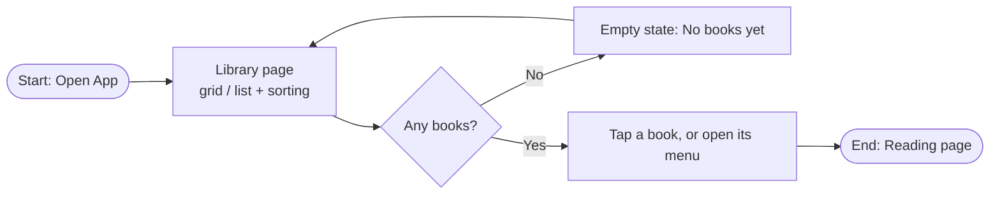

# 1.2 Central Library

> **Note:** Items marked **(\*)** are suggestions or predictions (target numbers, technical decisions, additional criteria). Validate them with the team before using them as a reference.

| | |
|---|---|
| **Epic** | 1. Library Management & Book Ingestion (see PRD 1.0) |
| **Story** | 1.2 Central Library |
| **Release target** | Demoable app |
| **Platform** | iPad and iPhone, iOS and iPadOS 26+, SwiftUI. iPhone is portrait only. Multi-device on one iCloud account (PRD 1.4). [TBD: iPhone screen designs, and whether multi-device is in the demo]. macOS: **TBD**. |
| **Status** | Draft |
| **Depends on** | 1.1 (`BookRecord`), 1.3 (`ReadingProgress` for the progress bar, Latest Read sort, and finished state) |
| **Owner / Designer / Tech Lead** | [TBD] |
| **App reference** | Branch `dev`, commit `1d1e28e` (6 Nov 2026). Status columns come from reading the code, not from running the app. |
| **Produces** | Hidden sample list; removing a book with all its data |

---

## 1. Feature Name

**Central Library**

One page that shows the sample books and every imported book in grid or list mode, can be sorted, and is the entry point to the reading page. From here readers can also add books (PRD 1.1), mark it finished, reset its progress, and remove it.

**User story**

> As a **reader**, I want a **central library displaying all my imported books** so that I can **easily browse and select what to read**.

---

## 2. Problem

1. **Books are scattered.** EPUB files live in Files, iCloud Drive, or downloads. Without a central library, readers have to find the file again every time they want to read.
2. **A growing collection is hard to manage.** Without clear ordering and view modes, readers struggle to find a given book, and books they no longer need fill up storage.
3. **An empty page gives no direction.** A new user opening an empty library needs to know what to do first.

---

## 3. Goals

**Goals**

1. The library shows every book in **grid or list** mode, with its reading progress clearly visible.
2. Books can be **sorted** by Title, Author, Date Added, Latest Read, or Read Progress.
3. Readers open a book with **one tap**.
4. Books can be **removed** with all their data, after confirmation.
5. An empty library tells the reader how to add a book.

**Non-goals (this release)**

- Collections/shelves and tags. (\*)
- Editing book metadata (title, author, cover). (\*)
- Removing several books at once. (\*)

---

## 4. Success Metrics

### 4.1 Usability test

| Metric | Definition | Target |
|---|---|---|
| First action | % of new users who add a book with **+** without help | ≥ 95% (\*) |
| Find & open | % of participants who find and open a given book in a 10-book library | ≥ 95% (\*) |
| Time to open | Average time to find and open a given book in a 10-book library | ≤ 10 seconds (\*) |
| Remove success | % of participants who remove a given book without help | ≥ 90% (\*) |
| Perceived ease | Single Ease Question (1 to 7 scale) | Average ≥ 6 (\*) |

### 4.2 Technical quality

| Metric | Definition | Target |
|---|---|---|
| Sort correctness | Sort results follow the §5.2 rules on test data (mixed case, no author, never read) | 100% |
| Removal completeness | After removal, no file or book data remains in `Books/<bookID>/` | 100% |

### 4.3 Post-launch (product)

| Metric | Definition | Target |
|---|---|---|
| Books per user | Average books in the library after 2 weeks | Measure as baseline (\*) |
| View mode share | % of users using list vs grid | Measure as baseline (\*) |
| Removal rate | `LB_RemoveBook_Button` / books imported (needs §4.5) | Measure as baseline (\*) |

### 4.4 Guardrails / performance

| Metric | Target |
|---|---|
| Library shown on app launch (100 books) | ≤ 500 ms (\*) |
| Library scrolling (100 books, covers loaded) | No visible frame drops (≥ 55 fps) (\*) |
| Tap a book → reading page shown | ≤ 1 second (\*) |

Shared rules (offline, crash-free, main thread) are in PRD 1.0 §4.

### 4.5 Event tracking

**Not built.** The library sends no events. Proposed (\*):

| Event | When it fires | Properties |
|---|---|---|
| `LB_Book_Tap` | A book in the library is tapped | source (list / grid), position_in_list |
| `LB_Sort_Change` | Sort order changed | sort (title / author / date_added / latest_read / read_progress) |
| `LB_ViewMode_Change` | View mode changed | mode (list / grid) |
| `LB_RemoveBook_Button` | Book removal confirmed | format, had_progress |

---

## 5. Main Flow

### 5.1 User flow

| # | Screen | See | Do | System response |
|---|---|---|---|---|
| 1 | Library page | Top bar: "Search Book" field (no action yet) and **+**. Header: "Library", grid/list button, sort button. Then the books. | – | – |
| 2 | Library page (first launch) | 5 sample books: Little Women, Anne of Green Gables, Moby Dick, Pride and Prejudice, The Adventures of Sherlock Holmes | – | Bundled in the app |
| 3 | Library page (grid, default) | Each cell: cover, progress bar, title, author, "…" menu. 3 columns on iPad and 2 on iPhone, in every orientation. | Switch to list | Mode changes until the app restarts |
| 4 | Library page (list) | Each row: small cover, progress bar, title, author, "…" menu | Switch to grid | Mode changes until the app restarts |
| 5 | Library page (sorting) | Sort menu: **Title**, **Author**, **Date Added**, **Latest Read** (default), **Read Progress**, with a check on the active option | Pick an order | Books reorder (§5.2) until the app restarts |
| 6 | Library page | Books | Tap a book | Reading page opens at the last position (PRD 1.3), or at the start if never read |
| 7 | Library page | "…" menu on a book: **Mark as Finished** / **Mark as Still Reading**, **Reset Progress**, **Remove** | Choose one | §5.3 and §5.4 |
| 8 | Library page (empty) | "No books yet" and "Tap the + button to import an EPUB". Only when every sample book is removed and nothing is imported. | Tap **+** | Document picker (PRD 1.1) |

### 5.2 Sorting rules

| Sort | Order |
|---|---|
| Latest Read (default) | Latest `lastReadAt` first; never-read books last |
| Title | A–Z, case-insensitive, by the full title |
| Author | A–Z, case-insensitive, by the full author text |
| Date Added | Newest first. Sample books count as oldest. |
| Read Progress | Highest progress first. A finished book counts as 100%. |

A newly imported book stays first until the reader changes the sort.

**Not built, requirement kept (\*):** ignoring leading articles in Title, sorting Author by last name, a "Recent" sort based on `lastOpenedAt`, and tie-breakers.

### 5.3 Book menu and alternative flows

- **A1. Share Book (removed on `dev`):** the menu no longer has it.
- **A2. Mark as Finished / Still Reading:** sets or clears `finishedAt` and keeps the reading position. A finished book shows a full progress bar.
- **A3. Reset Progress:** sets the position and frontier back to the start and clears `finishedAt`. It is saved as a 0% record, so a sample book doesn't return to its mock progress. There is no confirmation.
- **A4. Removal cancelled:** the confirmation dialog closes with no change.

**Not built, requirement kept (\*):** book statuses in the library: `preparing` ("Still preparing this book"), analysis still running, and `failed` with an error icon (PRD 1.0 §3.2).

### 5.4 Removing a book

1. The reader chooses **Remove** from the "…" menu.
2. Confirmation dialog: "Remove Book?", "'[title]' and your reading progress will be removed from this iPad." with **Remove** (destructive) and **Cancel** buttons.
3. Once confirmed:
   - **Imported book:** its `BookRecord` is removed from `library.json` and its `Books/<bookID>/` folder is deleted (EPUB, `ReadingProgress`, `BookState`, saved underlines).
   - **Sample book:** its ID is added to `hidden-samples.json`. It lives in the app bundle, so nothing is deleted, and its reading files stay. There is no way to bring it back in the app.
4. If removal fails: alert "Something went wrong".

### 5.5 Components (MVVM)

| Layer | Component | Responsibility |
|---|---|---|
| Model | `LibRepo` | Loads samples + imported books; imports; removes and hides books |
| Model | `LibrarySorter` | Sorting rules from §5.2 as a pure function, with a pinned new book |
| Model | `LibCtrl` | Library use cases; merges `ReadingProgress` into each book; finished and reset through `ProgRepo`; remove also forgets the parse |
| Model | `BookContentRepo` | Covers from the EPUB |
| ViewModel | `LibVM` | State: `books`, `visibleBooks`, `searchText`, `viewMode`, `sortOption`, `covers`, `bookToRemove`, `importError`, `bookActionError`. Intents: `onAppear()`, `toggleViewMode()`, `sortChanged(_:)`, `bookTapped(_:)`, `finishedToggled(_:)`, `resetProgressTapped(_:)`, `removeTapped(_:)`, `removeConfirmed()`, `removeCancelled()`. Covers are shrunk once to thumbnails, so scrolling doesn't decode full images. |
| View | `LibView`, `BookGridView`, `BookRowView`, `BookMenu`, `ProgressBar`, `LibrarySortMenu`, `LibraryIconButton` | Layout from §5.1; every action calls a `LibVM` intent |

The data model and storage layout are in PRD 1.0 §3.

---

## 6. Acceptance Criteria

| ID | Criteria (Given / When / Then) | Priority | Status |
|---|---|---|---|
| AC-1.2-01 | **Given** the library is empty, **when** the Library page shows, **then** an empty state tells the reader to tap **+**. | P0 | Built |
| AC-1.2-02 | **Given** the library has books, **when** the Library page shows, **then** books appear in **grid or list** mode. | P0 | Built |
| AC-1.2-03 | **Given** the library has books, **when** the reader picks a sort, **then** books are ordered by the §5.2 rules. | P0 | Built |
| AC-1.2-04 | **Given** a book in the library, **when** the reader taps it, **then** the reading page opens at the last position (PRD 1.3), or at the start if never read. | P0 | Built |
| AC-1.2-05 | **Given** the reader chooses Remove on an imported book and confirms, **when** removal finishes, **then** the book disappears and its file, `ReadingProgress`, and `BookState` are deleted. Its saved underlines are kept under the fingerprint, so a re-import reuses them. | P0 | Built |
| AC-1.2-06 | **Given** the remove confirmation dialog is shown, **when** the reader chooses Cancel, **then** nothing changes. | P0 | Built |
| AC-1.2-07 | **Given** the library has books, **when** the Library page shows, **then** each book shows its cover, title, author, and reading progress. | P0 | Built |
| AC-1.2-08 | **Given** the reader removes a sample book, **when** the library reloads, **then** the book stays hidden, also after the app restarts. | P0 | Built |
| AC-1.2-09 | **Given** the "…" menu, **when** the reader chooses Mark as Finished or Reset Progress, **then** the progress bar updates, and Mark as Still Reading returns to the old position. | P1 | Built |
| AC-1.2-10 | **Given** the "…" menu, **when** the reader chooses Share Book, **then** the share sheet opens with the EPUB named after the title. | P1 | Not built: removed on `dev` |
| AC-1.2-11 | **Given** a view mode or sort is chosen, **when** the app is fully closed and reopened, **then** it is still chosen. (\*) | P0 | Not built |
| AC-1.2-12 | **Given** a book is `preparing`, **when** the reader taps it, **then** it doesn't open and "Still preparing this book" appears. (\*) | P0 | Not built |
| AC-1.2-13 | **Given** a book is `failed`, **when** the library shows, **then** the book shows an error icon and a short message, and the reader can remove it. (\*) | P0 | Not built |
| AC-1.2-14 | **Given** the library has 100 books, **when** the app opens, **then** the library shows within 500 ms and scrolling stays smooth. (\*) | P1 | Not measured |

---

## 7. Test Cases

| ID | Scenario | Precondition | Steps | Expected result | AC |
|---|---|---|---|---|---|
| TC-1.2-01 | Empty state | All samples removed, nothing imported | Open the app | "No books yet" + the **+** hint | AC-1.2-01 |
| TC-1.2-02 | First launch | Fresh install | Open the app | 5 sample books in a grid | AC-1.2-02 |
| TC-1.2-03 | Switch view | Library with books | Switch to list and back | Books shown in each mode | AC-1.2-02 |
| TC-1.2-04 | Title sort | Books "the Hobbit", "Anne", "Zorro" | Sort by Title | Anne, the Hobbit, Zorro (case ignored) | AC-1.2-03 |
| TC-1.2-05 | Author sort | Authors "Jane Austen", "Mark Twain", "Unknown Author" | Sort by Author | Jane Austen, Mark Twain, Unknown Author | AC-1.2-03 |
| TC-1.2-06 | Latest Read sort | Book A read yesterday, B today, C never | Sort by Latest Read | B, A, C | AC-1.2-03 |
| TC-1.2-07 | Read Progress sort | Book at 40%, a finished book, a new book | Sort by Read Progress | Finished, 40%, new | AC-1.2-03 |
| TC-1.2-08 | New import pinned | Sorted by Title | Import a book, then change the sort | New book first, until the sort changes | AC-1.2-03 |
| TC-1.2-09 | Open a new book | Never read | Tap the book | Reading page opens at the start | AC-1.2-04 |
| TC-1.2-10 | Open a book read before | Book read to Chapter 3 | Tap the book | Reading page opens at the last position | AC-1.2-04 |
| TC-1.2-11 | Remove a book | Imported book with progress and underlines | Remove → confirm | Book gone; `Books/<bookID>/` folder deleted | AC-1.2-05 |
| TC-1.2-12 | Remove after reading | Imported book, opened, then back to the library | Remove → confirm | Book gone; `Books/<bookID>/` deleted; its underlines remain under the fingerprint | AC-1.2-05 |
| TC-1.2-13 | Cancel removal | – | Remove → Cancel | No change | AC-1.2-06 |
| TC-1.2-14 | Item display | A book at 40% progress | Open the library in list and grid | Cover, title, author, progress bar | AC-1.2-07 |
| TC-1.2-15 | Remove a sample | Sample book | Remove → confirm, restart the app | Still hidden | AC-1.2-08 |
| TC-1.2-16 | Finished and back | Book at 40% | Mark as Finished, then Mark as Still Reading, then open | Bar full, then 40%; opens at the old position | AC-1.2-09 |
| TC-1.2-17 | Reset progress | Book at 40% | Reset Progress, then open | Bar empty; opens at the start | AC-1.2-09 |
| TC-1.2-18 | Share (removed on `dev`) | Any book | Open the "…" menu | No Share Book item | AC-1.2-10 |
| TC-1.2-19 | Settings persist | Author sort, list view | Close the app, reopen | Still Author and list | AC-1.2-11 |
| TC-1.2-20 | Preparing book | Import in progress | Tap the book | "Still preparing this book" | AC-1.2-12 |
| TC-1.2-21 | Failed book | Book that failed during parsing | Open the library | Error icon + message; Remove works | AC-1.2-13 |
| TC-1.2-22 | Large library | 100 books | Open the app, scroll | Shown within 500 ms; smooth scrolling | AC-1.2-14 |

---

## 8. Open Questions & Risks

1. **Save view mode and sort?** They reset at each launch. The first PRD required saving them. (\*)
2. **Removed books leave their underlines.** They stay in `Underlines/<fingerprint>/` and in the reader's iCloud after removal. Decide whether removal should delete them, or keep them so a re-import is instant.
3. **Sample books.** They mix mock data into the library (Little Women's 30%), and a removed sample can't be brought back. Decide whether they stay after the demo. (\*)
4. **Search bar.** It filters the library by title and author as the reader types.
5. **Reset Progress has no confirmation**, and it can't be undone. (\*)
6. **Layouts.** The grid has a fixed 3 columns on iPad and 2 on iPhone. The remove dialog says "from this iPad" on iPhone too. Mac layout is **TBD**. (\*)
7. **Default sort.** Latest Read is the default because it brings the current book to the top; confirm with usability testing. (\*)
8. **Undo removal.** Removal is permanent; decide whether a short undo (for example a 5-second "Undo" toast) comes after the demo. (\*)
9. **Multi-device library (PRD 1.4).** The library lists the same books on every device on one iCloud account. What happens when a book is removed on one device is still open (PRD 1.4 §5.5).
