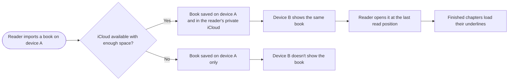

# 1.4 Cloud Configuration

> **Note:** Items marked **(\*)** are suggestions or predictions (target numbers, technical decisions, additional criteria). Validate them with the team before using them as a reference.
>
> **Status of this version:** partly built on branch `dev`. Underlines sync through the reader's private iCloud (record type `ChapterUnderlines`), and shared ratings go to the public database (`UnderlineRating`). Books, reading position, and reading settings don't sync yet. Several states are still open and are listed in §5.5.

| | |
|---|---|
| **Epic** | 1. Library Management & Book Ingestion (see PRD 1.0) |
| **Story** | 1.4 Cloud Configuration |
| **Release target** | [TBD: whether multi-device is in the demo. PRD 0.0 says the demo runs on iPad.] |
| **Platform** | Multi-device with one iCloud account: iPad and iPhone, iOS and iPadOS 26+. iPhone is portrait only. [TBD: iPhone screen designs, which no PRD covers yet] |
| **Status** | Draft |
| **Depends on** | 1.1 (imported file), 1.3 (`ReadingProgress`, `ReadingSettings`), 2.1 (`ChapterUnderlines`, `UnderlineRating`) |
| **Owner / Designer / Tech Lead** | [TBD] |
| **Produces** | CloudKit container and schema, `fingerprint`, sync rules for every feature PRD |

---

## 1. Feature Name

**Cloud Configuration**

Readers sign in to nothing inside the app. If a device uses an iCloud account, the reader's books, reading position, reading settings, and underlines follow that account to their other devices. Thumbs answers from Reference Sentences (PRD 2.1 §5.7) go to a separate database that the team can read.

**User stories**

> As a **reader with more than one device**, I want to **open the same book at the same position with the same reading settings** so that I can **continue reading on any device.**

> As a **product team member**, I want to **read the thumbs answers readers send** so that I can **see how often readers find a reference wrong.**

---

## 2. Problem

1. **Everything stays on one device.** Books, positions, settings, and underlines are local files (PRD 1.0 §3.3). On a second device the reader starts with nothing.
2. **Underlines are expensive to repeat.** Each device analyses a book on its own, and results can differ: chapter 1 of Little Women gives 60 underlines on a Mac and 121 on an iPad (PRD 2.1 §9 #5).
3. **Thumbs answers have nowhere to go.** The team can't read data that stays on a reader's device.

[TBD: evidence that readers with aphantasia read on more than one device]

---

## 3. Goals

**Goals**

1. A book imported on one device appears on the reader's other devices, as long as both use the same iCloud account.
2. The reader continues from the same position. The page number may differ, because layout differs per device.
3. Theme and text size are the same on every device.
4. A chapter processed on one device loads on the others without being processed again.
5. The app keeps working on the device when iCloud isn't available.
6. The team can read thumbs answers, and can't read anything from a reader's private iCloud.

**Non-goals (this release)**

- A login screen or an iRead account.
- Android, web, or any device outside Apple's ecosystem.
- Sharing books or data between iCloud accounts.
- Running analysis in the cloud. Processing stays on the device.
- Turning thumbs answers into golden set items. Thumbs are a post-launch metric (PRD 2.1 §4.4).

---

## 4. Success Metrics

[TBD: usability, technical quality, and post-launch metrics for multi-device reading]

**Guardrails**

| Metric | Target |
|---|---|
| Book text in the public database or in a thumbs export | 0 |
| Reader's private iCloud data the team can read | 0 |

---

## 5. Main Flow

### 5.1 User flow



| # | Device | User action | App response |
|---|---|---|---|
| 1 | Device A | Imports an EPUB | The book is saved locally and to the reader's private iCloud |
| 2 | Device B | Opens the library | The same book is listed |
| 3 | Device B | Opens the book | It opens at the last read position, with the same theme and text size, in this device's layout |
| 4 | Device B | Reads a chapter processed on device A | Underlines load from iCloud, with no processing |
| 5 | Device B | Reads a chapter not processed yet | The device processes it and saves the result (\*) |

### 5.2 What is stored where

| Data | Writer | Where | Team can read? |
|---|---|---|---|
| `book.epub`, `BookRecord` | PRD 1.1 | Reader's private iCloud | No |
| `ReadingProgress` | PRD 1.3 | Reader's private iCloud | No |
| `ReadingSettings` | PRD 1.3 | Reader's private iCloud | No |
| `ChapterUnderlines` | PRD 2.1 | Reader's private iCloud | No |
| `UnderlineRating` | PRD 2.1 §5.7 | CloudKit public database | Yes |
| `BookContent` | PRD 1.1 | Device memory only, parsed from the EPUB | No |
| `BookState`, hidden sample IDs | PRD 1.2, 1.3, 2.1 | [TBD: synced or local] | No |

**Book text rule.** Book text never reaches the public database, a thumbs export, or any server of ours. It may be stored only on the device and in the reader's private iCloud.

**`fingerprint`.** `BookContent.fingerprint`, a hash of the book's text, made when the book is parsed. `bookID` is a random ID made per import, so it differs per device. Records in iCloud use the fingerprint to find the same book on every device.

### 5.3 Sync rules

| Case | Rule | Decided by |
|---|---|---|
| Two reading positions | The most recently read position wins, not the furthest. A reader who reached chapter 5 on an iPad and then read chapter 3 on an iPhone continues at chapter 3. | Product owner |
| How "most recent" is compared | `lastReadAt` in `ReadingProgress` | (\*) |
| `readingFrontier` | Never moves backwards (PRD 1.3), so it keeps chapter 5 | (\*) |
| New position arrives during reading | The page doesn't move. The new position applies when the book is next opened. | (\*) |
| Theme and text size | The latest change wins | (\*) |
| Chapter already processed on another device | Load it, don't process it again | Product owner |
| Chapter not processed anywhere | The device reading it processes it and saves the result | (\*) |
| Two devices process the same chapter | The result saved first stays, so underlines don't change during reading | (\*) |
| `engineVersion` or `parserVersion` differs | Process the chapter again (PRD 2.1 §5.3) | (\*) |
| Device without Apple Intelligence | Loads results made by a device that has it | (\*) |
| Thumbs status | The same status shows on every device (PRD 2.1 §5.7) | (\*) |

### 5.4 When iCloud isn't available

| Case | Device in use | Other devices |
|---|---|---|
| Offline, or not signed in to iCloud | Everything works locally, with no message | Nothing changes. Data syncs once the device is connected. |
| iCloud full during import | The book is saved locally only. [TBD: what the reader is told] | The book doesn't appear at all |

### 5.5 States still to discuss

These are open on purpose. Each one needs a decision before this PRD can be built.

1. [TBD: a book removed on one device: is it removed everywhere?]
2. [TBD: space frees up after "iCloud full": does the book upload by itself?]
3. [TBD: the book is listed on device B but its file hasn't downloaded yet: what does the reader see?]
4. [TBD: the same file imported on two devices: one book or two? `fingerprint` makes one book possible.]
5. [TBD: the reader signs out of iCloud or changes account: what happens to local books and data?]
6. [TBD: the reader turns off iCloud for this app: same as not signed in?]
7. [TBD: a reader upgrades from local data to iCloud: how existing books and progress move]
8. [TBD: a finished or reset book (PRD 1.2): how the status syncs]

### 5.6 CloudKit configuration

| Item | Setting |
|---|---|
| Container owner | Shanon Giuly Istanto's team (`X7WUH4Z65U`), from `docs/ICLOUD.md` on branch `dev` |
| Container ID | `iCloud.com.aftrhours.reader`. Containers can't be deleted. |
| Requirements | Paid Apple Developer Program, iCloud capability with CloudKit in the app (\*) |
| Public database | `UnderlineRating`, fields in PRD 2.1 §5.7 |
| Private database | Books, progress, settings, and underlines (§5.2). It counts against the reader's iCloud storage. |
| Book file | Stored as a CloudKit asset (\*) |
| Security roles | Readers can create and change only their own `UnderlineRating`, and can't read other readers' records (\*) |
| Schema | Deployed from Development to Production before any TestFlight build, because TestFlight uses Production |
| Sync method | [TBD: tech lead. `CKSyncEngine` is a candidate for the private database (\*)] |
| Export for the team | CloudKit Web Services with a server-to-server key → JSON → CSV → positions matched to our EPUB. Public database only. Not tested yet. |

### 5.7 Layers

Dependencies point down, as in PRD 1.0 §3.4: `View → VM → Ctrl → Repo / Svc → Models`. All component names are proposals. (\*)

| Layer | Contains | Rule | Example: sync | Example: thumbs |
|---|---|---|---|---|
| **UI** | `View`, `VM` | Shows state and sends intents. Knows nothing about CloudKit. | `LibVM` lists books from `LibRepo` | Thumb buttons, `ReferenceVM.thumbTapped` |
| **Business logic** | `Ctrl`, `Rules` | Decides what should happen. Pure rules have no I/O. | `SyncConflictRule` picks the latest `lastReadAt` | `VoteStatusRule` follows the status table, `ProvidedBookRule` checks `fingerprint` |
| **Data** | `Repo`, `Svc`, `Models` | Reads and writes. Only this layer imports CloudKit. | `CloudSyncSvc`, `BookRecord` with `fingerprint` | `VoteRepo` saves locally and queues, `CloudVoteSvc` sends `UnderlineRating` |

### 5.8 Data structure

One book is identified by `fingerprint`, and the other data attaches to it.

```text
Reader (iCloud ID)
├── ReadingSettings         one for the whole app
└── Book (fingerprint)
    ├── BookRecord          one per book
    ├── book.epub           one per book
    ├── ReadingProgress     one per book
    ├── ChapterUnderlines    one per chapter
    │   └── Underline       many per chapter
    └── UnderlineRating       one per phrase and reference pair
```

| Name on the team board | Model | Fields | Unique by |
|---|---|---|---|
| UserData | [TBD: what this holds. There is no login screen, and the only identity is the anonymous iCloud ID.] | [TBD] | iCloud ID |
| BookData (library) | `BookRecord` | id, `fingerprint`, title, author, dateAdded | `fingerprint` (\*) |
| BookData (reading) | `BookContent` | chapters, paragraphs, sentences, parserVersion. Memory only. | Not stored |
| BookAnalyze | `ChapterUnderlines` | chapter, engineVersion, parserVersion, usedModel, underlines, dropped | `fingerprint` + chapter (\*) |
| Reading Position | `ReadingProgress` | position (paragraph, charOffset), chapterIndex, progress, lastReadAt, readingFrontier, finishedAt | `fingerprint` (\*) |
| Reading Preference | `ReadingSettings` | textSizeIndex, lineSpacingPercent, theme | iCloud ID (\*) |
| Not on the board | `UnderlineRating` | PRD 2.1 §5.7 | iCloud ID + phrase and reference pair |

`ReadingProgress` uses `bookID` today, which differs per device, so it needs `fingerprint` once it syncs. (\*)

---

## 6. Acceptance Criteria

| ID | Criteria (Given / When / Then) | Priority | Status |
|---|---|---|---|
| AC-1.4-01 | **Given** two devices on one iCloud account, **when** a book is imported on the first, **then** it appears on the second and can be opened. | [TBD] | Not built |
| AC-1.4-02 | **Given** a position saved on one device, **when** the book opens on another, **then** it opens at the same sentence, and the page number may differ. | [TBD] | Not built |
| AC-1.4-03 | **Given** a changed theme or text size, **when** another device opens the app, **then** it uses the same setting. | [TBD] | Not built |
| AC-1.4-04 | **Given** a chapter processed on one device, **when** another device reads it, **then** underlines load with no model calls. | [TBD] | Built |
| AC-1.4-05 | **Given** two devices hold different positions, **when** they sync, **then** the most recently read position is used, even if it is earlier in the book. | [TBD] | Not built |
| AC-1.4-06 | **Given** the reader is on a page, **when** a newer position arrives, **then** the page doesn't move. (\*) | [TBD] | Not built |
| AC-1.4-07 | **Given** a device is offline or not signed in to iCloud, **when** the reader uses the app, **then** it works locally with no message and syncs once connected. | [TBD] | Partly: underlines and ratings only |
| AC-1.4-08 | **Given** iCloud is full, **when** the reader imports a book, **then** the book is saved on that device and doesn't appear on other devices. | [TBD] | Not built |
| AC-1.4-09 | **Given** a chapter not processed anywhere, **when** a device reads it, **then** that device processes and saves it. (\*) | [TBD] | Built |
| AC-1.4-10 | **Given** the engine or parser version differs, **when** a saved chapter loads, **then** it is processed again. (\*) | [TBD] | Built |
| AC-1.4-11 | **Given** a device without Apple Intelligence, **when** a chapter was processed by a device with it, **then** the saved underlines load. (\*) | [TBD] | Built |
| AC-1.4-12 | **Given** the team exports data, **when** the export is inspected, **then** it holds thumbs answers only and no book text. | [TBD] | Not built: ratings hold book text (PRD 2.1 §9 #25) |
| AC-1.4-13 | **Given** a team member uses their own account in CloudKit Console, **when** they look for a reader's books or progress, **then** they can't see them. | [TBD] | Built: private database |

---

## 7. Test Cases

| ID | Scenario | Precondition | Steps | Expected result | AC |
|---|---|---|---|---|---|
| TC-1.4-01 | Book on a second device | Two devices, one iCloud account | Import an EPUB on the first, open the library on the second | Book is listed and opens | AC-1.4-01 |
| TC-1.4-02 | Same position | Reading on the first device | Open the book on the second | Same sentence; page number may differ | AC-1.4-02 |
| TC-1.4-03 | Same settings | Two devices | Change theme and text size on one, open the other | Same theme and text size | AC-1.4-03 |
| TC-1.4-04 | Loaded underlines | Chapter processed on the first device | Read it on the second, check the debug screen | Underlines appear; no model calls | AC-1.4-04 |
| TC-1.4-05 | Latest position wins | iPad offline at chapter 5, then iPhone reads chapter 3 | Reconnect the iPad, open the book | Opens at chapter 3 | AC-1.4-05 |
| TC-1.4-06 | No jump during reading | Reader on a page, newer position saved elsewhere | Wait for sync | Page stays; the new position applies on next open | AC-1.4-06 |
| TC-1.4-07 | Offline | Airplane mode on | Read, change settings, reconnect | No message; changes reach the other device after reconnecting | AC-1.4-07 |
| TC-1.4-08 | Not signed in | Device not signed in to iCloud | Import and read a book | Works locally with no message | AC-1.4-07 |
| TC-1.4-09 | iCloud full | iCloud storage full | Import a book, open the library on the other device | Book on this device only | AC-1.4-08 |
| TC-1.4-10 | New chapter | Chapter not processed anywhere | Read it on one device, then open it on the other | First device processes it; second loads it | AC-1.4-04, AC-1.4-09 |
| TC-1.4-11 | Version change | Saved chapter from an older engine version | Open it | Chapter is processed again | AC-1.4-10 |
| TC-1.4-12 | No Apple Intelligence | iPhone without it, chapter processed on an iPad with it | Read the chapter | Saved underlines load | AC-1.4-11 |
| TC-1.4-13 | Export has no book text | Thumbs answers sent | Run the export | Only positions, IDs, versions, votes | AC-1.4-12 |
| TC-1.4-14 | Private data stays private | Reader data in private iCloud | Open CloudKit Console with a team account | Reader's data isn't visible | AC-1.4-13 |

---

## 8. Open Questions & Risks

**Open**

1. **Scope for the demo.** Multi-device adds sync, a second screen size, and many new states to a release planned for one iPad. Decide what the demo needs. [TBD]
2. **Priorities.** All criteria above have no priority yet. [TBD]
3. **States in §5.5.** They need their own discussion.
4. **Minimum answers.** How many thumbs answers an engine version needs before its thumbs-down rate is trusted (PRD 2.1 §9 #17). [TBD]

**Risks**

5. **Book text now leaves the device.** It stays in the reader's private iCloud. PRD 0.0 and AC-2.1-14 are reworded for this, and the wording needs checking against what readers are told.
6. **Consent.** Thumbs answers still need consent before a TestFlight pilot or the App Store (Guideline 5.1.1, PRD 2.1 §9 #20).
7. **Underlines on a second device depend on the first.** Results differ between devices today (PRD 2.1 §9 #5), so the chapter saved first decides what the reader sees. The cause is still unknown.
8. **Sync is tested by hand.** Unit tests replace CloudKit with a fake and never reach iCloud. Cases that need two devices on one account stay manual checks.
9. **Last upload wins.** On `dev`, if two devices underline the same chapter at the same time, the later upload replaces the first, while §5.3 plans that the first saved result stays (\*).
