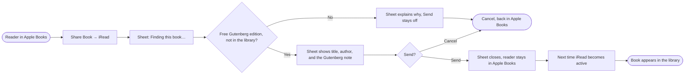

# 1.5 Share from Apple Books

> **Note:** Items marked **(\*)** are suggestions or predictions (target numbers, technical decisions, additional criteria). Validate them with the team before using them as a reference.
>
> **Source of this version:** branch `Share-from-iBook` (commit `18d3be3`, 8 Nov 2026), which isn't merged into `dev` yet. The data flow is documented in `docs/DFD-share-import.md` on that branch. Status columns come from reading the code, not from running the app.

| | |
|---|---|
| **Epic** | 1. Library Management & Book Ingestion (see PRD 1.0) |
| **Story** | 1.5 Share from Apple Books |
| **Release target** | [TBD: whether this is in the demo] |
| **Platform** | iPad and iPhone, iOS and iPadOS 26+, SwiftUI. iPhone is portrait only. |
| **Status** | Draft |
| **Depends on** | 1.1 (import, `BookRecord`), 1.2 (library, hidden samples) |
| **Owner / Designer / Tech Lead** | [TBD] |
| **App reference** | Branch `Share-from-iBook`, commit `18d3be3` |
| **Produces** | A Share extension (`iReadShare`), "Open in iRead" for EPUB files, duplicate checks for every import |

---

## 1. Feature Name

**Share from Apple Books**

A reader finds a book in Apple Books and shares it to iRead. Apple Books shares only a store link, never the file, so iRead looks for the free Project Gutenberg edition of that book and adds it to the library. The same branch also lets any app open an EPUB file in iRead.

**User stories**

> As a **reader**, I want to **share a book from Apple Books to iRead** so that I can **read it in iRead without finding the file myself.**

> As a **reader**, I want to **open an EPUB from Files, Safari, Mail, or AirDrop in iRead** so that I **don't have to go through the library's + button.**

**Limitations**

- **Shared from an e-reader app only.** Today that means Apple Books. Links from Kindle, Google Play Books, or any other store are refused.
- **Project Gutenberg books only.** These are public-domain books, mostly older classics, with an EPUB of 100 MB or less. Most modern books, including DRM-free ones, aren't there.
- **The Gutenberg edition, not Apple's file.** The text can differ from what the reader saw in Apple Books.
- **Needs a network connection** to Apple's iTunes Lookup and to Project Gutenberg.
- **The built-in import isn't limited.** Any DRM-free EPUB can still come in through the + button or "Open in iRead" (§5.7).

---

## 2. Problem

1. **Apple Books doesn't share files.** Share Book in Apple Books sends a store link, for example `https://books.apple.com/id/book/dream-psychology/id395687522P`. A test on 8 Nov 2026 confirmed this.
2. **Store-bought books are copy-protected.** Even with the file, a purchased Apple Books title is DRM-protected, and iRead reads DRM-free EPUBs only (PRD 1.1).
3. **Finding a free EPUB by hand takes several steps.** The reader has to search Project Gutenberg, download the file, and import it through the document picker.

---

## 3. Goals

**Goals**

1. A reader can share an Apple Books link to iRead and get the free Project Gutenberg edition, without leaving Apple Books.
2. The share sheet tells the reader clearly when a book can't be added, and why. Every error shows in the sheet, not only in the app's log.
3. The reader knows the book is the Project Gutenberg edition, not Apple's file.
4. The same book is never added twice, however it arrives. A book with the same title as one in the library counts as the same book, even in another edition.
5. Any app can open an EPUB file in iRead.

**Non-goals (this release)**

- Reading Apple Books' own files or any DRM-protected book.
- Links from other stores, such as Kindle or Google Play Books.
- Sources other than Project Gutenberg.

---

## 4. Success Metrics

[TBD: usability and post-launch metrics, for example how many shares find a Gutenberg edition]

**Limits set in the code**

| Limit | Value |
|---|---|
| Time to find and download a book | 30 seconds, then "couldn't reach" |
| Largest EPUB | 100 MB |
| Measured example | Dream Psychology: 3.3 s from link to downloaded file, on a Mac on Wi-Fi |

---

## 5. Main Flow

### 5.1 User flow

| # | Screen | User action | App response |
|---|---|---|---|
| 1 | Apple Books | Share Book → iRead | The iRead sheet opens and shows "Finding this book…" |
| 2 | iRead sheet | Waits, 30 seconds at most | The title, the author, and "Free Project Gutenberg edition. Apple Books doesn't share its own files." Send turns on. |
| 3 | iRead sheet | Taps **Send** | The sheet closes, and the reader stays in Apple Books |
| 4 | iRead sheet | Taps **Cancel** | Nothing is saved |
| 5 | iRead | Opens iRead, or returns to it | The book is added to the library |

**Open in iRead.** An EPUB opened with iRead from Files, Safari, Mail, or AirDrop is imported straight away, with the same checks as a picked file (PRD 1.1). A problem shows in the library's alert.

### 5.2 What the sheet says

| Case | Sheet | Send |
|---|---|---|
| Found | Title, author, "Free Project Gutenberg edition. Apple Books doesn't share its own files." | On |
| Not an Apple Books link | "Only Apple Books links can be shared to iRead for now." | Off |
| Not on Project Gutenberg | "“X” isn't available as a free Project Gutenberg book, so it can't be opened in iRead." | Off |
| Already in the library, including another edition with the same title | "“X” is already in your iRead library." | Off |
| No answer, or over 30 seconds | "iRead couldn't reach Project Gutenberg. Try again later." | Off |
| Over 100 MB | "This book is larger than 100 MB." | Off |
| Saving fails after Send | "iRead couldn't save this book. Try again." | |
| The EPUB can't be read, or any other import error | The error, in plain words. [TBD: exact text] | Off |

**Errors belong in the sheet.** The reader decides in the sheet, so every reason a book can't be added must show there, not only in the app's log. Today the app finds some problems later, after the sheet has closed (§5.4). To catch them in time, the sheet would check the downloaded EPUB before Send turns on: that it can be read, and that it isn't already in the library. (\*) [TBD: what the reader sees for a problem found after Send]

### 5.3 Finding the free edition

1. **Read the link.** Only `apple.com` links count. The listing ID is the number after "id", and the store country is the two-letter part of the path, else "us".
2. **Look up the listing.** Apple's iTunes Lookup gives the title and author.
3. **Search Project Gutenberg.** First the title and the author's last name, then the title alone if nothing matches.
4. **Match the edition.** The first result with an EPUB whose title matches. After the title-only search, the author must match too. The sheet keeps Apple's author name, for example "Sun Tzu" instead of Gutenberg's "Sunzi".
5. **Check duplicates** against the app's library index (§5.5). A matching title is enough, even when the edition, the Gutenberg number, or the author's name differs. Today the code also needs the author to match.
6. **Download** the Gutenberg EPUB with images.

### 5.4 Adding the book in the app

Shared books wait in a folder that the app and the extension share (App Group `group.com.aftrhours.reader`), because the extension can't write to the library.

| Step | Rule |
|---|---|
| When | Each time the app becomes active, for every waiting book |
| Order | One import at a time, for shared, opened, and picked files alike |
| Duplicates | Same Gutenberg number, same text fingerprint, or the same title, against the books the library shows now. Today the code needs title and author together. |
| Removed sample | If the book is a sample the reader removed, the sample is shown again instead of adding a copy |
| Save | Like PRD 1.1: `Books/<bookID>/book.epub` and a `BookRecord`, now with `gutenbergNumber` and `fingerprint` |
| After | The waiting folder is deleted, whatever happened |
| Failure | Today only logged (OSLog category `storage`), because the reader left the sheet long ago. Target: the sheet catches these before Send (§5.2). |

### 5.5 Data and storage

| Data | Where | Written by | Read by |
|---|---|---|---|
| `PendingImports/<id>/book.epub`, `edition.json` | App Group | Share extension, on Send | App, when it becomes active |
| `library-index.json` (title and identity of each visible book) | App Group | App, after every import or removal | Share extension, to check duplicates |
| `BookRecord.gutenbergNumber`, `BookRecord.fingerprint` | `Books/library.json` | App, at import | Duplicate checks |

`edition.json` holds the Gutenberg number, title, author, and EPUB address. Until the app has opened once there is no index, so the sheet can't find duplicates; the app still checks.

The sheet sends the Apple Books listing ID to Apple's iTunes Lookup, and the title and author to Project Gutenberg. No book text and no reader identity are sent.

### 5.6 Components

| Layer | Component | Responsibility |
|---|---|---|
| View | `ShareView` (extension) | The sheet: searching, found, or the reason |
| ViewModel | `ShareVM` (extension) | Sheet state and text; `onAppear(link:)`, `sendTapped()`, `cancelTapped()` |
| Ctrl | `ShareCtrl` (shared) | `findFreeEdition(for:)`, with the 30 s timeout; `saveForApp(_:file:)` |
| Ctrl | `ImportCtrl` (app) | `importPending()`, `importBook(from:)`, `refreshIndex()` |
| Svc | `BookLookupSvc`, `DownloadSvc` (shared) | iTunes Lookup, Gutenberg search, EPUB download |
| Repo | `PendingImportRepo`, `LibraryIndexRepo` (shared) | Files in the App Group |
| Rules | `AppleBooksLink`, `EditionMatcher`, `DuplicateRules`, `GutenbergNumber` (shared) | Pure rules for links, matching, and duplicates |
| ViewModel | `LibVM` (app) | `appBecameActive()`, `fileOpened(_:)`, one import at a time |

Code in `Shared/` is compiled into both the app and the extension. They never call each other and only share the App Group folder.

### 5.7 Effect on the built-in import

The branch routes the + button, onboarding, and "Open in iRead" through the same `ImportCtrl.importBook(from:)` as shared books. Picking a file works as before, with these changes:

| Change | Before, on `dev` | On branch `Share-from-iBook` |
|---|---|---|
| Duplicates | The same book is added again | Refused with "“X” is already in your library." |
| Removed sample | Imported as a new copy | The sample shows again, no copy |
| Several files | The first failure stops the rest | Every file is tried; problems are listed together at the end |
| Reading the file | Metadata only | The whole book is parsed, to get the text fingerprint |
| Two imports at once | Could overlap | One at a time |

The full parse makes each import slower, most on long books. AC-1.1-03 (in the library within 1 second) needs measuring again on this branch. (\*)

---

## 6. Acceptance Criteria

| ID | Criteria (Given / When / Then) | Priority | Status |
|---|---|---|---|
| AC-1.5-01 | **Given** a reader shares a book from Apple Books to iRead, **when** the sheet opens, **then** it shows "Finding this book…" until it has an answer. | [TBD] | Built on branch |
| AC-1.5-02 | **Given** the book is on Project Gutenberg and not in the library, **when** the search ends, **then** the sheet shows the title, the author, and the Gutenberg note, and Send turns on. | [TBD] | Built on branch |
| AC-1.5-03 | **Given** the shared link isn't from Apple Books, **when** the sheet opens, **then** it says only Apple Books links work, and Send stays off. | [TBD] | Built on branch |
| AC-1.5-04 | **Given** the book isn't on Project Gutenberg, **when** the search ends, **then** the sheet says so by title, and Send stays off. | [TBD] | Built on branch |
| AC-1.5-05 | **Given** the book is already in the library, **when** the search ends, **then** the sheet says so, and Send stays off. | [TBD] | Built on branch |
| AC-1.5-06 | **Given** no network or no answer within 30 seconds, **when** the search ends, **then** the sheet says iRead couldn't reach Project Gutenberg. | [TBD] | Built on branch |
| AC-1.5-07 | **Given** the EPUB is over 100 MB, **when** it downloads, **then** the sheet says it is too large. | [TBD] | Built on branch |
| AC-1.5-08 | **Given** the reader taps Send, **when** the sheet closes, **then** the reader stays in Apple Books, and the book appears in the library the next time iRead becomes active. | [TBD] | Built on branch |
| AC-1.5-09 | **Given** the reader taps Cancel, **when** the sheet closes, **then** nothing is saved. | [TBD] | Built on branch |
| AC-1.5-10 | **Given** an EPUB opened with iRead from another app, **when** iRead opens, **then** the book is imported, or the library's alert says why not. | [TBD] | Built on branch |
| AC-1.5-11 | **Given** a book already in the library, **when** the same book arrives by share, "Open in iRead", or the picker, **then** no copy is added. Picked and opened files show "“X” is already in your library." | [TBD] | Built on branch |
| AC-1.5-12 | **Given** the arriving book is a sample the reader removed, **when** it is imported, **then** the sample shows again and no copy is added. | [TBD] | Built on branch |
| AC-1.5-13 | **Given** a book is imported or removed, **when** it finishes, **then** the library index for the sheet is updated. | [TBD] | Built on branch |
| AC-1.5-14 | **Given** a book with the same title as one in the library, in another edition, **when** it is shared, opened, or picked, **then** it isn't added and the reader is told it is already in iRead. | [TBD] | Partly: built only when the author matches too |
| AC-1.5-15 | **Given** any reason a shared book can't be added, **when** the sheet knows it, **then** the sheet shows it and Send stays off. | [TBD] | Partly: the downloaded EPUB isn't checked in the sheet; app-side failures are only logged |

---

## 7. Test Cases

| ID | Scenario | Precondition | Steps | Expected result | AC |
|---|---|---|---|---|---|
| TC-1.5-01 | Book found | Dream Psychology in Apple Books, not in the library | Share Book → iRead | "Finding this book…", then the title, Sigmund Freud, the Gutenberg note; Send on | AC-1.5-01, AC-1.5-02 |
| TC-1.5-02 | Author differs on Gutenberg | The Art of War in Apple Books | Share Book → iRead | Found; the author shows as "Sun Tzu" | AC-1.5-02 |
| TC-1.5-03 | Not an Apple Books link | A web page shared from Safari | Share → iRead | "Only Apple Books links…"; Send off | AC-1.5-03 |
| TC-1.5-04 | Not on Gutenberg | A recent bestseller in Apple Books | Share Book → iRead | "…isn't available as a free Project Gutenberg book…"; Send off | AC-1.5-04 |
| TC-1.5-05 | Already in the library | Little Women in the library, app opened once | Share Little Women from Apple Books | "…is already in your iRead library."; Send off | AC-1.5-05 |
| TC-1.5-06 | Offline | Airplane mode on | Share Book → iRead | "iRead couldn't reach Project Gutenberg…" | AC-1.5-06 |
| TC-1.5-07 | Send | Book found | Tap Send, then open iRead | Sheet closes in Apple Books; the book is in the library | AC-1.5-08 |
| TC-1.5-08 | Cancel | Book found | Tap Cancel, then open iRead | No new book | AC-1.5-09 |
| TC-1.5-09 | Open in iRead | EPUB in Files | Share → Open in iRead | Book in the library | AC-1.5-10 |
| TC-1.5-10 | Duplicate by picker | Book in the library | Import the same EPUB with + | "“X” is already in your library."; no copy | AC-1.5-11 |
| TC-1.5-11 | Removed sample comes back | Pride and Prejudice removed | Share it from Apple Books, Send, open iRead | The sample shows again; no second copy | AC-1.5-12 |
| TC-1.5-12 | Index after removal | Book shared before, then removed | Share it again | Found again, not "already in your library" | AC-1.5-13 |
| TC-1.5-13 | Same title, other edition | An EPUB of Little Women from another source, sample still in the library | Import it with +, or share Little Women | "Already in your library"; no copy | AC-1.5-14 |
| TC-1.5-14 | Unreadable EPUB | A shared book whose download is damaged | Share Book → iRead | The sheet shows the error; Send off | AC-1.5-15 |

---

## 8. Open Questions & Risks

1. **Not merged.** This PRD follows branch `Share-from-iBook`. PRD 0.0 to 2.1 follow `dev`, which doesn't have it yet.
2. **A different edition from the one in Apple Books.** The Gutenberg text may differ from what the reader saw in Apple Books. The sheet says so, but readers may still expect Apple's edition.
3. **Same title, different book.** A matching title now counts as already in the library, so a different book that happens to share a title with one in the library can't be added. Decide whether that is acceptable. (\*)
4. **Errors after Send.** The decision is that errors show in the sheet. Problems found only after the sheet closes still need a way to reach the reader. [TBD]
5. **Stale index.** The sheet checks duplicates against an index the app writes. Before the app opens once, or while a book still waits to be imported, the sheet can't see it.
6. **English and Gutenberg only.** Most Apple Books titles, and every recent book, aren't on Project Gutenberg, so many shares end in "isn't available". [TBD: how often, from real shares]
7. **External services.** The sheet depends on Apple's iTunes Lookup and Project Gutenberg's search and download. A change on either side breaks it.
8. **Gutenberg front matter.** Gutenberg EPUBs start and end with license pages, which PRD 2.1 §9 #12 already flags for underlines.
9. **Simulator.** [TBD: whether the share flow was tested on a real iPhone and iPad, or only on a Mac]
