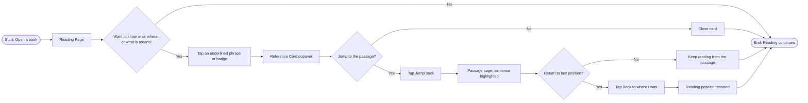
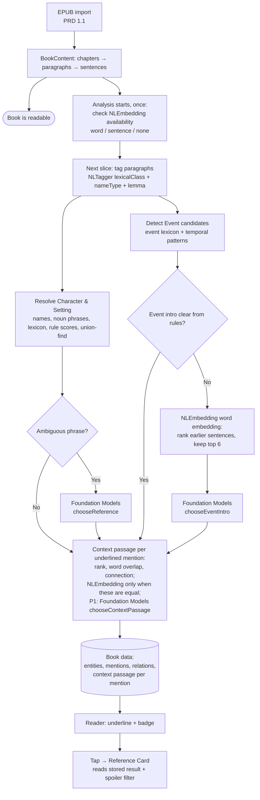

# 2.1 Reference Passage

> **Note:** Items marked **(\*)** are suggestions or predictions (target numbers, technical decisions, additional criteria). Validate them with the team before using them as a reference.

| | |
|---|---|
| **Epic** | 2. Reference Passage |
| **Product** | Fiction reading app for readers with aphantasia |
| **Release target** | Demoable app |
| **Platform** | **iPadOS 26+ only**, SwiftUI (\*). iPhone (iOS) and macOS: **TBD**, not part of this release. |
| **Status** | Draft |
| **Book language** | English (Indonesian in a later phase) |
| **Book format** | `.epub`, imported through PRD 1.1 (PDF in a later phase) |
| **Entity types** | Character, Setting, Event |
| **Core technology** | NaturalLanguage framework (primary, including `NLEmbedding` for ranking; §5.6) + on-device Apple Foundation Models (ambiguous phrases and Events) |
| **Owner / Designer / Tech Lead** | [TBD] |
| **Depends on** | Epic 1: PRD 1.1 (`BookContent`, book language), PRD 1.3 (`ReadingProgress.readingFrontier`) |
| **Related features** | Symbols (character/place badges), relation map, reading buddy (share the same entity data) |

---

## 1. Feature Name

**Reference Passage** (Tap-to-Reference)

Readers can tap a phrase on the page (for example *"the red-haired girl"*, *"the rusty door"*, *"the night of the fire"*) to see which character, setting, or event it refers to, together with the author's original passage that **gives the best context** for that phrase (usually where the author first introduced it, but a later passage when it explains the phrase better). The information appears on the same page, with an option to jump to that passage and then return to the last reading position.

**User story**

> As a **fiction reader with aphantasia**, I want to **tap descriptions like "the red haired girl" to see who they refer to** so that I can **easily find context of the characters, settings, and events without searching through previous pages.**

**Entity types**

| Type | Definition | Example tappable phrases |
|---|---|---|
| **Character** | A person or creature in the story, named or only described | "Mira", "the red-haired girl", "the old ferryman" |
| **Setting** | A place or location object in the story | "Gull Harbour", "the rusty door", "the old lighthouse" |
| **Event** | Something that happens in the story and is **referred to again** later | "the fire", "the night of the storm", "the wedding" |

---

## 2. Problem

1. **Visual descriptions don't trigger recall.** Readers with aphantasia don't form mental images. When an author refers to a character, place, or event by description ("the red-haired girl", "the night of the fire") instead of by name, the reader can't match it to what was told earlier.
2. **Existing solutions don't fit:**
   - **In-book search** needs the exact words, and shows results from pages not yet read (spoilers).
   - **Kindle X-Ray** works by name only, not by description, and doesn't cover events.
   - **Flipping back manually** breaks the reading flow and immersion.
3. **Impact:** Predicted: readers lose track of the story, reread repeatedly, or stop reading descriptive fiction. (\*)

---

## 3. Goals

**Goals**

1. Readers learn what a phrase refers to (character, setting, or event) in **one tap**, without leaving the page.
2. The context shown is the **author's original passage**, not an AI-generated summary, to avoid hallucination. It is the passage that explains the **tapped phrase** best, not automatically the entity's earliest mention (§5.1, "Which passage is shown").
3. **Zero spoilers:** no information (names, other descriptions, or involvement in events) from parts of the book not yet read. This includes **story updates**: when a later passage, even the very next page, adds to, changes, or reveals new information about a character, setting, or event, the card keeps showing the earlier state until the reader has actually reached that passage (§5.4).
4. Readers can **jump to the referenced passage** and **return to the last reading position** with one tap.
5. All processing of book text runs **on-device**.
6. **The book is readable immediately** when opened; reference aids appear progressively in the background.

**Non-goals (this release)**

- Books in languages other than English. (\*)
- Events that are never referred to again (ordinary actions are not turned into Events). (\*)
- Typed relations (for example "sister of"). Relations between characters and settings use co-occurrence; Events use "involves" and "happened at" relations. (\*)
- Pronouns ("she", "he", "it"). (\*)
- AI-generated summaries, images, or illustrations.
- Cloud processing (including Private Cloud Compute).
- DRM-protected books (purchased Apple Books titles), comics, audiobooks.

---

## 4. Success Metrics

Metrics are split into four parts: demo readiness, usability testing, model quality (offline), and post-launch.

### 4.1 Demo readiness

| Metric | Definition | Target |
|---|---|---|
| Demo scenario passes | The §6.2 scenario runs start to finish without errors, on iPad | 5 out of 5 consecutive runs (\*) |
| Entity type coverage | The demo book shows at least one tappable Character, Setting, and Event reference | 3 out of 3 types |
| Without Apple Intelligence | The Character, Setting, and repeated-phrase Event demo steps (2 to 4) still work with Foundation Models turned off | Pass |
| Zero spoilers in the demo book | No card in the demo book shows information from an unread part, including later updates to a character, setting, or event | 0 cases |
| Updates in the demo book | The demo book contains at least one later update for each entity type (§5.4), so the no-spoiler behaviour can be shown | 3 out of 3 types (\*) |

### 4.2 Usability test

Task scenarios, compared against a baseline (built-in search / flipping pages), using the demo book and one public-domain English novel (\*):
- *"Who is 'the red-haired girl' on this page?"* (Character)
- *"Where is 'the rusty door' mentioned here?"* (Setting)
- *"What happened on 'the night of the fire'?"* (Event)

| Metric | Definition | Target |
|---|---|---|
| Task success rate | % of participants who correctly identify the referent using the feature, per entity type | ≥ 90% Character and Setting, ≥ 80% Event (\*) |
| Time to referent | Time from task start to correct answer, vs baseline | ≥ 50% faster than baseline (\*) |
| Return success | % of participants who return to their last reading position without help | 100% (\*) |
| Perceived ease | Single Ease Question (1 to 7 scale) | Average ≥ 6 (\*) |
| Interruption feel | Score for "This feature doesn't interrupt my reading flow" (Likert 1 to 5) | Average ≥ 4 (\*) |
| Spoiler incident | Participant sees information from an unread part of the book | 0 |

### 4.3 Model quality (offline, golden set)

Golden set: **English novels** in EPUB format (public domain, for example from Project Gutenberg), manually annotated by 2 annotators for all three entity types, Cohen's kappa ≥ 0.8. For every tapped phrase the annotators also mark the best context passage and any acceptable alternatives. The annotation also marks, for every entity, the position and type of each later update (§5.4), so the spoiler check can run per update type. Number of books/chapters: [TBD] (\*). Evaluation runs with the Analysis Harness (§5.5).

| Metric | Definition | Target |
|---|---|---|
| Reference precision | Of the underlined phrases, % that point to the correct entity | ≥ 90% Character and Setting, ≥ 85% Event (\*) |
| Recall: names | % of name mentions detected and resolved | ≥ 90% (\*) |
| Recall: descriptive | % of descriptive Character and Setting phrases detected and resolved | ≥ 70% (\*) |
| Recall: Event | % of Event back-references detected and resolved | ≥ 60% (\*) |
| Entity type accuracy | Character / Setting / Event classification is correct | ≥ 90% (\*) |
| Context passage accuracy | The passage shown is the one the annotators marked as giving the best context for the tapped phrase (§5.1, "Which passage is shown") | ≥ 90% Character and Setting, ≥ 80% Event (\*) |
| Event involvement accuracy | Characters and settings shown as "involved" were actually involved in the event | ≥ 85% (\*) |
| Ambiguity rate (rules) | % of phrases the rules can't settle and pass to the LLM | Measure as baseline (\*) |
| LLM uplift | Recall gain with Foundation Models on vs NaturalLanguage only, with no drop in precision | +10 recall points, precision does not drop (\*) |
| Embedding uplift | Event candidate recall (the correct sentence is among the 6 passed on) and context passage accuracy, with `NLEmbedding` on vs rules only | Measure as baseline (\*) |
| **Spoiler leak rate** | % of cards showing a name, description, relation, involvement, or **story update** (merged identity, changed state, newly revealed detail) from a position after the reading frontier. Measured in total and per update type. | **0% (hard requirement)** |
| Update visibility | Of the updates whose sentence is at or before the frontier, % that the card reflects once the reader has passed them | ≥ 90% (\*) |

Principle: **precision matters more than recall.** A wrong reference does more harm than a phrase that can't be tapped.

### 4.4 Post-launch (product)

| Metric | Definition | Target |
|---|---|---|
| Adoption | % of reading sessions with ≥ 1 `RF_Phrase_Tap` | ≥ 30% (\*) |
| Engagement | Average taps per 100 pages (feature users), split by entity type | Baseline in month one, then monitor (\*) |
| Wrong-match rate | `RF_WrongMatch_Button` / `RF_Phrase_Tap`, per entity type | < 2% Character and Setting, < 4% Event (\*) |
| Jump-back rate | `RF_JumpBack_Button` / `RF_Phrase_Tap` | Measure as baseline (\*) |
| Return rate | `RF_BackToWhereIWas_Button` / `RF_JumpBack_Button` | ≥ 80% (\*) |
| Book completion rate | % of books finished, feature users vs non-users | +10 percentage points (\*) |

**Guardrails / performance**

| Metric | Target |
|---|---|
| First reference aids appear (first slice) | ≤ 3 seconds after a book opens at the start, or after a book analysed before is reopened (\*) |
| NaturalLanguage analysis of the whole book (~100k words) | ≤ 60 seconds in the background (\*) |
| Card latency after tap (p95) | ≤ 100 ms (data lookup, no LLM) (\*) |
| Latency of one LLM call (p95) | ≤ 1.5 seconds (\*) |
| "Back to where I was" accuracy | ≥ 99% return to the same page (\*) |
| Crash-free sessions | ≥ 99.5% (\*) |
| Network calls containing book text | 0 |

Import guardrails and time-to-readable are in PRD 1.1 §4.4.

### 4.5 Event tracking

Naming convention: `<PREFIX>_<Name>_<Type>` (RF = reference lookup, LB = library, RD = reader).

| Event | When it fires | Properties |
|---|---|---|
| `RF_Phrase_Tap` | Reader taps a phrase or badge | source (phrase / badge), entity_kind (character / setting / event) |
| `RF_Card_Shown` | Card finishes appearing | latency_ms, entity_kind, mention_kind (intro / name / reference), context_kind (link / description / first_appearance) |
| `RF_Card_Dismiss` | Card is closed | dwell_ms |
| `RF_JumpBack_Button` | Tap on "Jump back" | entity_kind, distance_pages |
| `RF_BackToWhereIWas_Button` | Tap on "Back to where I was" | restored_ok |
| `RF_WrongMatch_Button` | A "Wrong match" correction is saved | entity_kind, not_reference |
| `LB_AnalysisDone_Event` | Analysis of a book finishes | characters, settings, events, seconds, engine, ambiguous, llm_calls, llm_resolved, embedding (word / sentence / none) |

Events must not contain book text, only IDs and numbers. For the demo and usability tests, events are logged locally (OSLog) and can be exported from test devices. Sending to a server (opt-in) is for post-launch metrics. (\*)

---

## 5. Main Flow

### 5.1 User flow



| # | Screen | User action | App response |
|---|---|---|---|
| 1 | Reading Page | Reads and meets a phrase referring to a character, setting, or event | Phrases resolved to an entity introduced earlier are underlined. Character and setting names get a symbol badge. |
| 2 | Reading Page | **No**, doesn't need more: keeps reading | Done |
| 3 | Reading Page | **Yes**: taps the phrase or badge | Reference Card appears as a popover (content per type, see table below) |
| 4 | Reference Card | **No** jump: closes the card | Back to Reading Page, position unchanged |
| 5 | Reference Card | **Yes**: taps **"Jump back"** | Reading position is saved; the app opens the passage page with the context passage highlighted |
| 6 | Passage page | **No** return: keeps reading from here | Done |
| 7 | Passage page | **Yes**: taps **"Back to where I was"** | Last reading position is restored |

**Reference Card content per type**

| Section | Character | Setting | Event |
|---|---|---|---|
| Header | Symbol, name (or descriptive label if the name isn't revealed yet), "Character" | Symbol, name or descriptive label, "Setting" | Event icon, label ("The fire"), "Event" |
| Passage label | "Context from [chapter]" | "Context from [chapter]" | "Happened in [chapter]" |
| Quote | Original context passage for the tapped phrase | Original context passage for the tapped phrase | Original sentence that best narrates the event |
| Extra info | "Also described as" | "Also described as" | "Involved": characters and settings involved |
| Actions | Jump back, Edit symbol, Wrong match | Jump back, Edit symbol, Wrong match | Jump back, Wrong match |

All extra info shows only data positioned at or before the reading frontier (§5.4), including story updates: the card always shows the entity **as the reader knows it so far**, never its latest state in the book.

**Which passage is shown (context passage).** The card shows the passage that gives the **best context for the tapped phrase**, not automatically the entity's earliest mention. The choice is made for each tapped phrase, among sentences **at or before the phrase** (phrase boundary, §5.4), so it never contains anything the reader has not read.

Candidate sentences are ranked (\*):

| Rank | Candidate | Example for the tapped phrase "the doctor" |
|---|---|---|
| 1 | A sentence that **links the tapped description to the entity**: apposition ("Mira, the village doctor"), "X was/is Y", "called/named X" | Ch. 4: "Mira, the village doctor, ran to the barn." |
| 2 | A sentence that **first gives that description** of the entity | Ch. 3: "The doctor had come from the city." |
| 3 | The entity's **first appearance** | Ch. 1: "A girl with red hair stood at the gate." |

A lower-ranked sentence is used only when no higher rank exists. Within a rank, the winner is decided by **similarity and connection to the tapped phrase**, not by how near the passage is. A nearer passage is not better just because it is nearer, and an earlier one is not better just because it is first. Signals (\*):

- **Word overlap:** how many of the phrase's head and modifier lemmas the sentence shares ("the village doctor" shares more with "Mira, the village doctor" than with "Mira, the doctor").
- **Connection strength:** the sentence contains both the entity's name and the tapped description in one link (apposition, "X was Y"), or the description is only mentioned in passing.
- **Semantic closeness:** word-embedding distance between the tapped description and the description in the candidate sentence (`NLEmbedding`, §5.6), used only when the first two signals are equal. If embeddings are unavailable, this signal is skipped.

If the signals are still equal, the **earliest** passage is kept so the result is stable.

Worked example: Ch. 1 "Mira, a girl with red hair"; Ch. 4 "Mira, the village doctor"; Ch. 6 "the doctor frowned". Tapping "the doctor" in Ch. 6 shows the Ch. 4 passage, not Ch. 1. Tapping "the red-haired girl" in Ch. 6 still shows Ch. 1, because the choice depends on the tapped phrase. For a tapped *name*, the quote is the entity's first appearance unless a later sentence introduces the name better. For an Event, the same ranking applies to sentences that narrate it, and the earliest one wins ties.

**Alternative flows**

- **A1. First appearance (Characters and Settings, through the symbol badge):** the introducing phrase itself is not underlined (§5.4), so it is reached through its symbol badge (P1). When the tapped badge sits in the entity's introducing sentence, the card shows "Introduced right here" without a Jump back button. When the sentence is the context passage for that phrase but not the first appearance, the card shows "Explained right here" and also has no Jump back button. Events have no badge, so A1 does not apply to them.
- **A2. Low confidence:** the phrase is not underlined.
- **A3. Part of the book not analysed yet** (`ready` status, analysis running; see PRD 1.0 §3.2): the book stays readable; a progress pill shows the analysis stage. Underlines appear when a slice finishes, without shifting the page. An open card is not closed.
- **A4. Foundation Models unavailable / turned off in Settings:** Character and Setting still work with NaturalLanguage only. Events are recognised only from repeated phrases (for example "the great fire" → "the fire"); events first narrated through verbs are not recognised.
- **A5. Wrong match:** the card has a "Wrong match" button that opens a list of same-type candidates introduced before the phrase, plus "Not a reference". Corrections are saved per book and survive re-analysis.
- **A6. Repeated Jump back:** "Back to where I was" still points to the first origin.
- **A7. Non-English book:** the reference feature is disabled for that book with a short message; the book stays readable. The language comes from `BookRecord.language` (PRD 1.1). Analysis does not run for that book, so there is no analysis indicator (PRD 1.0 §3.2).

### 5.2 System flow



**When `NLEmbedding` is used in this flow** (details in §5.6)

| When | Where in the flow | What it does | If unavailable |
|---|---|---|---|
| Once, when analysis starts | Availability check | Records whether the English word / sentence embedding exists on this iPad | Records `none`; both uses below fall back to rules |
| Each slice, only for Event phrases the rules can't settle | Step 4, before Step 5 (`chooseEventIntro`) | Ranks earlier sentences by embedding distance to the event head and keeps the top 6 | Ranks by the event lexicon and closeness to the phrase |
| Each slice, after resolving, once per underlined mention | Step 7 (context passage) | Breaks ties between equally ranked candidates by semantic closeness to the tapped description | Skips the signal; the earliest candidate wins ties |
| Never | Tapping a card, matching Character and Setting phrases (Step 3), the anti-spoiler filter (§5.4), building LLM prompts | Not used | Not applicable |

At tap time nothing is embedded: the card reads the context passage stored with the mention, so the card latency target (p95 ≤ 100 ms) holds.

**Step 1: Structure (done by PRD 1.1).** Analysis uses the `BookContent` produced by the EPUB import (PRD 1.1 §5.3): chapters, paragraphs, and sentences with global indexes. Epic 2 never reads book files directly. Analysis starts when the book's status is `ready`.

**Step 2: Tagging per slice (NaturalLanguage).** `NLTagger` with the `.lexicalClass`, `.nameType`, and `.lemma` schemes. Provide a heuristic fallback (capitalisation, determiner and function-word lists) when the NaturalLanguage models aren't installed. Hyphenated tokens such as "red-haired" are stitched back together.

**Step 3: Resolve Character and Setting (rules).**
- **Name candidates:** capitalised tokens, `personalName` / `placeName` / `organizationName`. Names are kept if they appear ≥ 2 times. Short forms merge into long forms ("Mara" → "Mara Voss"). Ignore Roman numerals and chapter-heading words.
- **Descriptive noun phrases:** determiner (the/a/an) + adjective/participle + head noun. The head is classified with a lexicon: `personHeads` → Character, `placeHeads` → Setting. Include synonym groups (for example girl/lass/child, cottage/house/hut).
- **Prepositional descriptions:** "a girl with red hair" and "a man in a grey coat" are read as head + modifiers (here: girl; red, hair). Modifiers are compared by lemma with hyphenated adjectives, so "the red-haired girl" (red, hair) matches "a girl with red hair". (\*)
- **Match score against earlier entities:** same head = 2, synonym = 1.5, each shared modifier = 2. **Strong match** if the modifier score is ≥ 2 and the total is ≥ 3.5. Anything else goes to the *weak* list. (\*)
- Weak with one candidate and no modifiers: settled by the rules. Everything else counts as **ambiguous** and goes to step 5.
- **Merging** with union-find: appositions ("Mira, a girl with red hair"), "X was/is Y", "called/named X", and "Her/His name was X" (names the descriptive entity just mentioned). Every merge records the sentence that causes it (`mergedAtSentence`), so a merge revealed later never affects what an earlier card shows (§5.4).
- Descriptive entities are kept only if they have ≥ 2 mentions.

**Step 4: Event detection (rules).** (\*)
- **Event phrase candidates:** definite noun phrases whose head is in `eventHeads`, for example *fire, storm, flood, wedding, funeral, battle, fight, accident, attack, party, feast, festival, trial, escape, shipwreck, murder, ceremony, quarrel, raid*.
- **Temporal patterns:** "the night/day/morning/winter of the X", "the X at/in [Setting]", "what happened at [Setting]".
- **Events from repeated phrases:** when an event phrase appears again with a matching head and modifiers ("the great fire" → "the fire"), the rules link it to the first occurrence directly. The first occurrence becomes the introducing sentence.
- **Events first narrated through verbs:** for example Chapter 4 "The barn burned until dawn." and later Chapter 7 "Since the fire, …". The rules can't confirm the source sentence, so the candidate sentences are ranked with `NLEmbedding` (next bullet) and the phrase goes to step 5 (`chooseEventIntro`) with the top ones.
- **Candidate sentences** are ranked with `NLEmbedding.wordEmbedding(for: .english)`: the distance between the event head ("fire") and the verb/noun lemmas in earlier sentences ("burn", "flame", "smoke"). Keep at most the top 6 sentences. Details, fallback, and limits are in §5.6.
- **Involvement:** characters and settings named in the event's introducing sentence and the sentence after it are recorded as `involves` (Character) and `happened at` (Setting) relations. Details of the event revealed in later sentences (cause, who did it, outcome) are recorded as updates with their own position (§5.4).
- An Event is kept only if it has **≥ 2 mentions** (introduction + at least one back-reference).

**Step 5: Tie-breaker (Foundation Models).** Only for cases the rules can't settle, and only when `ModelAvailSvc` reports `SystemLanguageModel.default.availability == .available` and the user hasn't turned it off in Settings.
- `chooseReference`: for ambiguous Character or Setting phrases. Outputs a candidate index, `-1` if none fits.
- `chooseEventIntro`: for Event phrases with no matching earlier occurrence. Outputs a sentence index, `-1` if no sentence narrates the event.
- Instructions: *"You resolve references in fiction. Be conservative. Answer -1 when unsure."* Prompt size follows the token budget in §5.3.

<!-- ```swift
@Generable
struct ReferenceChoice {
    @Guide(description: "Index of the candidate the phrase refers to, or -1 when none clearly fits",
           .range(-1...4))
    var index: Int
}

@Generable
struct EventIntroChoice {
    @Guide(description: "Index of the sentence that narrates this event, or -1 when none clearly does",
           .range(-1...5))
    var sentenceIndex: Int
}
``` -->

**Step 6: Relations.** Co-occurrence between Characters and Settings in the same sentence (weight 2) and in the next sentence of the same paragraph (weight 1); a relation is kept if its weight is ≥ 2. Labels: "appears with" (Character–Character), "near" (Setting–Setting), "appears at" (Character–Setting). Events use `involves` and `happened at` from step 4.

**Step 7: Evidence and context passage.** (\*)
- **Evidence:** while resolving, every sentence that mentions an entity is stored as evidence for one description (or for the name) with a link kind: `link` (apposition, "X was/is Y", "called/named X"), `description`, or `first_appearance`, plus its position. Merges from Step 3 supply most `link` evidence.
- **When it is computed:** the score of each candidate is computed during analysis, once per underlined mention, using only evidence at or before that mention (phrase boundary). The chosen context passage is stored with the mention (including its `context_kind`). At tap time `RefCtrl` only reads it, with no embedding or LLM call, so the card latency target (p95 ≤ 100 ms) still holds. After a Wrong match correction, the candidates of the new entity are scored on demand (§5.6).
- **Score:** within a rank, candidates are scored by word overlap and connection strength; `NLEmbedding` semantic closeness is used only when those two are equal (§5.1, §5.6). Position and distance from the phrase are not part of the score; they only break exact ties (earliest wins).
- **Tie-breaker (P1):** when two or more `link` candidates are close in score, Foundation Models may choose one with `chooseContextPassage` (at most 5 candidate sentences, same token budget and phrase boundary as Step 5). The result is cached per entity and description. Without Foundation Models, the rules choose the highest-scoring candidate, and the earliest one if scores are equal.

### 5.3 Runtime chunking configuration

There are two chunking layers with different purposes. Both are configured from runtime conditions, not fixed numbers.

#### A. NaturalLanguage analysis slices

Analysis runs progressively so the book is readable right away. Each slice tags new text, then resolve rebuilds entities from the start of the book up to the slice boundary. This keeps names, merges, and introducing sentences consistent, and because slice size grows geometrically there are only about log(n) rebuilds.

| Parameter | Value | Reason |
|---|---|---|
| Slice unit | **Word count** | Paragraph length varies a lot between books |
| First slice | `max(2,000 words, through the end of the open chapter + 1 chapter)` (\*) | Tagging can start at the open chapter, but resolving needs the entities from earlier in the book, so it still runs in order from the start. A book that was never analysed gets underlines on the current page once analysis reaches it; once results are saved, a reopened book resumes immediately. |
| Next step | Adaptive: `step = words_per_second_throughput × 1.5 seconds`, at most ×2 per step (\*) | Fast devices finish sooner; slow devices stay responsive |
| Step cap | 50,000 words (\*) | Limits the duration of one slice |
| Throttling | Increase target duration and pause between slices when `ProcessInfo.thermalState ≥ .serious` or Low Power Mode is on | Protects battery and temperature |
| Task priority | `.utility` | Doesn't affect the UI |
| Persist | Save results every ≥ 4 seconds and on the last slice; resume analysis when the app reopens | No restart from the beginning after the app closes |

#### B. Token budget for Foundation Models

1. **Read the model capacity at runtime.** Context size differs between model versions (Apple lists separate model versions for OS 26.0–26.3, 26.4, and 27.0). Use `SystemLanguageModel.default.contextSize` and measure prompts with `tokenCount(for:)`. `tokenCount(for:)` is available from iPadOS 26.4; on iPadOS 26.0 to 26.3, estimate tokens conservatively from the character count (about 1 token per 3 characters) and enlarge the safety margin. (\*)
2. **Budget per call:**

   ```
   budget = contextSize
          − tokenCount(instructions)
          − tokenCount(output schema)
          − reserveOutput (≈ 32 tokens)
          − safetyMargin (≈ 10% of contextSize)
   ```

3. **Fill the prompt in order until the budget runs out:**

   | Order | `chooseReference` (Character, Setting) | `chooseEventIntro` (Event) |
   |---|---|---|
   | 1 (required) | Sentence containing the phrase + the phrase | Sentence containing the phrase + the phrase |
   | 2 | 1 sentence before the phrase's sentence (the phrase's own sentence is cut at the end of the phrase) | Same |
   | 3 | Candidate cards: index, name, type, top 3 descriptors, introducing sentence (cut to ~40 words) | Numbered candidate sentences (cut to ~40 words), with chapter label |
   | Maximum | 5 candidates | 6 sentences |

   Only information positioned at or before the phrase may enter the prompt. If it still doesn't fit, drop the lowest-scoring candidates first, then shorten candidate text.
4. **Handle `exceededContextWindowSize`:** halve the candidates and retry once. If it fails again, leave the phrase unresolved with no error in the UI. Other errors (guardrails, model not ready) also end as unresolved.
5. **Priority queue:**
   - Priority 1: phrases in the chapter being read and the next chapter, run as soon as their slice finishes.
   - Priority 2: the rest of the book, in order, in the background.
   - Limit of 20 calls per minute; stop when the thermal state is serious. (\*)
6. **Persistent cache:** LLM results are stored with the book data (key: `entityKey + paragraph:location`), so calls aren't repeated after the app closes or after resolve rebuilds entities.
7. **One call at a time**, with a new `LanguageModelSession` per call so the transcript doesn't grow. Call `prewarm()` when the priority-1 queue starts.
8. **Log** call count, resolved count, and latency to `LB_AnalysisDone_Event`.

<!-- ```swift
struct ChunkConfig {
    // A. NaturalLanguage slices
    var firstSliceWords = 2_000
    var targetSliceSeconds: Double = 1.5
    var maxStepWords = 50_000
    var maxGrowthFactor = 2.0
    var persistIntervalSeconds: Double = 4

    // B. Foundation Models budget
    var maxCandidates = 5                // chooseReference
    var maxEventSentences = 6            // chooseEventIntro
    var descriptorsPerCandidate = 3
    var candidateTextMaxWords = 40
    var outputReserveTokens = 32
    var safetyMarginRatio = 0.10
    var maxCallsPerMinute = 20
}
``` -->

### 5.4 Anti-spoiler rules

`readingFrontier` = the furthest sentence ever shown to the reader, stored in `ReadingProgress` (PRD 1.3 §5.3) and never moving backwards. Two boundaries are used:

- **Phrase boundary** = the position of the tapped phrase's sentence. It decides what the phrase refers to: the underline, the context passage, Wrong match candidates, and LLM prompt content.
- **Display boundary** = `max(phrase position, readingFrontier)`. It decides what extra information the card may show: name, "Also described as", relations, "Involved", and story updates (§5.4.1).

| Card content | Rule |
|---|---|
| Context passage | Always at or before the tapped phrase (phrase boundary); candidates after the phrase are never considered |
| Underline | Phrase boundary: only if the entity's introducing sentence is before the phrase's sentence, for all three types |
| Entity name | Store the position where the name first appears (`nameRevealSentence`). While it is after the display boundary, show the descriptive label ("The red-haired girl"), even if the entity has been merged with a name that appears later. |
| "Also described as" | Store each description's position; show only those at or before the display boundary |
| Relations | Not shown on cards in this release (reserved for the relation map). When a feature shows them, only relations with `firstSentence ≤ display boundary`. |
| "Involved" (Event) | Only characters and settings whose relation has `firstSentence ≤ display boundary`, with names following the name rule above |
| "Wrong match" candidates | Phrase boundary: only same-type entities whose introducing sentence is before the phrase's sentence |
| LLM prompt content | Phrase boundary: only names, descriptors, and sentences at or before the phrase |
| Story updates | Every update is stored with its position and only applied when `position ≤ display boundary` (see §5.4.1) |

#### 5.4.1 Story updates (no spoilers from later changes) (\*)

Analysis runs ahead of the reader (and eventually covers the whole book), so the stored data can already contain what happens later. A later passage can **update** what the reader knows about a character, setting, or event. Until the reader has reached that passage, the card must behave as if the update does not exist.

**What counts as an update**

| Update type | Example (reader is before the update) | Applies to |
|---|---|---|
| Name reveal | "the red-haired girl" is named "Mira" on the next page | Character, Setting |
| Identity merge | The next page shows "the stranger" and "the old ferryman" are the same person | Character, Setting |
| New description or alias | The next page calls Mira "the princess" | Character, Setting |
| Change of state | The next page says the rusty door was torn off, the lighthouse collapsed, or the girl dyed her hair | Character, Setting |
| New relation | The next page shows Mira and the King are siblings | Character, Setting, Event |
| Event detail | The next page reveals who started the fire, what caused it, or how it ended | Event |
| New involvement | The next page adds that Tom was at the barn when it burned | Event |

**Requirements**

1. **Boundary.** Updates use the display boundary. Each update is stored with the position of the sentence that causes it (`firstSentence`). A card applies an update only if that position is at or before `max(phrase position, readingFrontier)`. The next page, the next paragraph, and the next sentence all count as "not yet read" until the frontier reaches them.
2. **Earlier state, not latest state.** If an update changes or contradicts earlier information, the card shows the version that was valid at the boundary (for example "the rusty door", not "the torn-off door"). It never merges later facts into earlier ones.
3. **Merges depend on position.** Before `mergedAtSentence`, the two entities are separate: each phrase resolves to its own card, and neither card mentions the other. The merged entity appears on cards only after the display boundary passes the merge sentence.
4. **Updates are not hidden for good.** Once the reader has moved past the update (the frontier is at or after its position), later taps show the updated card. Hiding an update that has been read counts as a defect (Update visibility metric, §4.3).
5. **"Shown" means visible on screen.** The frontier only moves when a sentence is actually displayed to the reader. A page that is pre-rendered, prefetched, or being analysed but not visible does not move it (PRD 1.3 §5.3). On iPad in landscape, if the app shows a two-page spread, both visible pages count as shown. (\*)
6. **Underlines follow the same rule.** A phrase is underlined and resolves only to the entity as it is known at the phrase boundary. An update that would link a phrase to a different entity, or remove its match, takes effect only after the reader has passed it.
7. **Caches and corrections.** LLM results and Wrong match corrections use stable entity keys. A merge that happens later does not rewrite a result that was valid before the merge sentence.
8. **Re-analysis and slices.** New analysis slices (§5.3 A) add updates with their positions. They must not change what an already-open card shows.

### 5.5 Components (MVVM) and data

**Components**

The app follows MVVM (PRD 1.0 §3.4).

| Layer | Component | Responsibility |
|---|---|---|
| Model | Book import and structure | Done by Epic 1: PRD 1.1 (EPUB through the document picker, `BookContent`, book language) |
| Model | `AnalysisScheduleSvc` | Runs slices (§5.3 A), throttling, persistence, and resume; publishes snapshots; updates `BookRecord.analysisProgress` |
| Model | `EntityResolveSvc` | Tagging, lexicon, scoring, union-find for Character and Setting (§5.2 steps 2–3) |
| Model | `EventDetectSvc` | Event candidates, repeated phrases, sentence ranking, involvement (§5.2 step 4) |
| Model | `RelationBuildSvc` | Co-occurrence relations and Event relations (§5.2 step 6) |
| Model | `LLMSvc` (implementation `LLMSvcFoundation`) | Foundation Models wrapper: token budget, queue, cache (§5.3 B) |
| Model | `ModelAvailSvc` | Foundation Models availability check (§5.2 Step 5) |
| Model | `EmbeddingSvc` | `NLEmbedding` access: availability check, cached lemma vectors, distances (§5.6) |
| Model | `RefCtrl` (protocol), `RefCtrlLive`, with `SpoilerFilter` (pure rule) | Card content, underline decisions, and Wrong match candidates under the §5.4 rules. Chooses the context passage for the tapped phrase (§5.1, Step 7). Builds the entity "as of" the boundary: applies only updates and merges with `position ≤ display boundary` (§5.4.1). |
| ViewModel | `ReaderVM` (reference part) | State: underlines and badges for visible pages, analysis pill, English-only banner, highlighted sentence, `canReturn`, presented card. Intents: `phraseTapped(_:)`, `badgeTapped(_:)`, `backToWhereIWasTapped()`. Holds new snapshots while a card is open and applies them on close. Jump back uses `BookState.returnPosition`; reads `readingFrontier` from PRD 1.3. |
| ViewModel | `RefCardVM` | State: kind, header (symbol, visible name, kind label), passage label, quote, extras ("Also described as" or "Involved"), available actions, Wrong match candidates. Intents: `jumpBackTapped()`, `editSymbolTapped()`, `wrongMatchTapped()`, `candidatePicked(_:)`, `dismissed()`. |
| ViewModel | `SettingsVM` | Apple Intelligence, underline, and badge toggles; usage log export. Font size is owned by `ReaderVM` (PRD 1.3); Settings only shows the control. |
| ViewModel | All of the above | Send the §4.5 events |
| View | `ReaderView` marks overlay, `RefCardView`, `WrongMatchPickerView`, `SettingsView` | Layout per §5.1; every action calls a ViewModel intent; page position doesn't change when new analysis data arrives |
| Tool | Analysis Harness (`AnalysisCLI`) | Runs the Model pipeline on an EPUB and prints entities, references, relations for golden-set evaluation and performance testing |

**Per-book data**

| Data | Key fields |
|---|---|
| `BookAnalysis` (owned here, stored in `analysis.json`, can be rebuilt; reads `BookContent` from PRD 1.1 and never writes it) | entities, mentions, relations, analyzedParagraphs, isAnalysisComplete, analysisMethod, llmCache |
| `ReferenceSettings` (owned here, stored in `settings.json`; PRD 1.0 §3.3) | Apple Intelligence on/off, underline on/off, badge on/off |
| `Entity` | stable key, kind (character / setting / event), name, isNamed, nameRevealSentence, introSentence, descriptions (each with its first sentence and evidence sentences: link kind and position; Step 7), updates (type, value, `firstSentence`; §5.4.1), mergeEdges (other entity key, `mergedAtSentence`), aliasKeys, mentionCount |
| `Mention` | paragraph, location, length, sentence, entity, kind (intro / name / reference) |
| `Relation` | a, b, label, weight, firstSentence, examples |
| `BookState` (owned by the reader, never overwritten by analysis) | returnPosition, overrides (Wrong match), symbols, customNames |
| `ReadingProgress` (owned by PRD 1.3, read only) | position, readingFrontier, lastReadAt |

All reader decisions are stored with **stable entity keys**, not indexes, so they survive re-analysis that changes entity order.

### 5.6 Use of NLEmbedding (\*)

`NLEmbedding` is a NaturalLanguage tool, not an Apple Intelligence feature. It runs on the device, needs no network, and works with Foundation Models turned off. In this release it is used for **ranking only**. It never decides alone which entity a phrase refers to.

| # | Use | Embedding | What is compared | Result | When it runs |
|---|---|---|---|---|---|
| 1 | Event candidate sentences (§5.2 Step 4) | `NLEmbedding.wordEmbedding(for: .english)` | The event head lemma ("fire") against the noun and verb lemmas of each earlier sentence ("burn", "flame", "smoke") | A sentence score = the average of its 3 smallest cosine distances. The 6 best sentences go to `chooseEventIntro` (§5.3 B). | Analysis, only for event phrases the rules can't settle |
| 2 | Context passage, third signal (§5.1, §5.2 Step 7) | `NLEmbedding.wordEmbedding(for: .english)` | The tapped description (head and modifier lemmas) against the description span the candidate sentence attaches to the entity (for example "village doctor" vs "doctor"). Each side is the average of its lemma vectors. | A cosine distance. The signal counts only when word overlap and connection strength are equal. | Analysis, per underlined mention; on demand after a Wrong match correction (at most 20 candidates) |

**Rules**

1. **Distance:** cosine distance; smaller is closer. Two candidates whose distances differ by less than 0.05 are treated as equal (\*), and the earliest passage wins.
2. **Language:** English only in this release. Indonesian needs its own check (§9).
3. **Words without a vector** (rare words, invented names) are skipped. If a side has no usable lemma, the embedding signal is skipped for that pair.
4. **Availability check:** at the start of analysis `EmbeddingSvc` asks for the English embedding once and records the result (`word`, `sentence`, or `none`). `NLEmbedding.wordEmbedding(for:)` and `sentenceEmbedding(for:)` can return `nil` (the Index lists a forum report of this on some devices).
5. **Fallback when it is `nil`:**
   - Event candidates are ranked by the event lexicon (§5.2 Step 4) and sentences closest before the phrase, and the analysis engine is logged as `rules_only`.
   - Context passage scoring skips the semantic signal, so rank, word overlap, and connection strength decide, and the earliest passage wins ties.
   - Nothing crashes, and no error appears in the UI.
6. **Spoilers:** only sentences at or before the phrase boundary are compared (§5.4). No text after the phrase is ever embedded for that mention.
7. **Cost:** word vectors are cached per lemma in memory during analysis. Vectors are not stored on disk; only the resulting scores and the chosen passage are saved in `BookAnalysis`. Sentence embeddings (`sentenceEmbedding(for:)`) are **not** required in this release; whether they improve ties is for the developers to test (\*).
8. **Not used for:** matching Character and Setting phrases to entities (that stays lexicon, synonym groups, and score rules in §5.2 Step 3), or deciding what is a spoiler.

<!-- ```swift
struct EmbeddingConfig {
    var language: NLLanguage = .english
    var eventNearestLemmas = 3          // distances averaged per sentence
    var maxContextCandidates = 20       // on-demand scoring after Wrong match
    var equalityEpsilon = 0.05          // distances closer than this count as equal
}
``` -->

---

## 6. Demo Scope

### 6.1 Priorities

| Priority | Content |
|---|---|
| **P0 (required for the demo)** | Progressive analysis once the book is `ready` (import is in PRD 1.1); underlines and cards for Character and Setting; Events from repeated phrases; Jump back and Back to where I was; §5.4 anti-spoiler rules, including story updates (§5.4.1); non-English books disabled with a message (A7); Wrong match; works without Foundation Models |
| **P1 (should be in the demo)** | `chooseReference` and `chooseEventIntro` with token budget; "Involved" on Event cards; first slice follows reading position (resume); symbol badges |
| **P2 (after the demo)** | Event tracking to a server; full Analysis Harness with golden set; thermal throttling; non-English books |

### 6.2 Demo scenario (\*)

Uses one purpose-written English demo book (5–8 chapters) so all three entity types appear and can be tested. The book plants at least one later update per entity type (for example: the girl is named in Chapter 5, the rusty door is torn off at the start of a page, and Chapter 6 reveals who started the fire):

1. Import the demo book (PRD 1.1). It opens immediately; the progress pill shows analysis running. The full scenario from the library to this feature is in PRD 1.0 §5.2.
2. In Chapter 3, tap **"the red-haired girl"** → Character card with the passage from Chapter 1 that describes her. The name isn't shown yet because it is only revealed in Chapter 5.
   - **2b (context passage):** in Chapter 6, tap **"the doctor"** → the card quotes the Chapter 4 passage "Mira, the village doctor, …" (a later passage that explains the phrase better), not the Chapter 1 sentence.
3. Tap **"the rusty door"** → Setting card → **Jump back** to Chapter 2 → **Back to where I was**.
4. In Chapter 4, tap **"the fire"** → Event card with the sentence from Chapter 2 that first narrates "the great fire" (an event from a repeated phrase, P0).
   - **4b (P1, Apple Intelligence on):** the fire card also shows the "Involved" list. In Chapter 6, tap **"the flood"** → Event card with "The river rose over the lower fields until dawn." from Chapter 3 (an event first narrated through a verb).
5. Tap a mismatched phrase → **Wrong match** → pick another entity; close and reopen the app, the correction is still there.
6. Turn off the Apple Intelligence option in the app's Settings → repeat steps 2–4; still works. Step 4b no longer applies: "the flood" is not underlined and the fire card has no "Involved" list.
7. **Story update, no spoiler:** on the last page before the page where the rusty door is torn off, tap **"the rusty door"** → the card does not mention the damage. Turn to the next page, read the update, then tap the door again → the card now includes it.

---

## 7. Acceptance Criteria

| ID | Criteria (Given / When / Then) | Priority |
|---|---|---|
| AC-2.1-01 | **Given** a phrase refers to a character or setting introduced earlier, **when** the page is shown, **then** the phrase is underlined and tappable. | P0 |
| AC-2.1-02 | **Given** a phrase refers to an event narrated earlier, **when** the page is shown, **then** the phrase is underlined and tappable. | P0 (repeated phrase) / P1 (from a verb) |
| AC-2.1-03 | **Given** the reader taps an underlined phrase, **when** the card appears, **then** it shows the entity type, the original passage that gives the best context for the tapped phrase (§5.1), and its chapter. | P0 |
| AC-2.1-04 | **Given** the reader taps an Event phrase, **when** the card appears, **then** it shows the characters and settings involved, only those already read. | P1 |
| AC-2.1-05 | **Given** the reader taps a phrase, **when** the card appears, **then** it appears on the same page without changing the reading position. | P0 |
| AC-2.1-06 | **Given** a card is open, **when** the reader taps "Jump back", **then** the app opens the passage page with the context passage highlighted. | P0 |
| AC-2.1-07 | **Given** the reader is on the passage page, **when** they tap "Back to where I was", **then** the app returns to the original page, including after several Jump backs. | P0 |
| AC-2.1-08 | **Given** an entity has a name, description, involvement, or other update (or a relation, when a feature shows it) that first appears after the reading frontier, **when** the card appears, **then** that information is not shown. | P0 |
| AC-2.1-09 | **Given** the tapped phrase is the entity's introduction, **when** the card appears, **then** it shows "Introduced right here" without a Jump back button. Applies to Characters and Settings, reached through the symbol badge (A1). | P1 |
| AC-2.1-10 | **Given** a phrase doesn't strongly match any entity and the rules (or Foundation Models, when available) can't settle it, **when** the page is shown, **then** the phrase is not underlined. | P0 |
| AC-2.1-11 | **Given** Foundation Models is unavailable or turned off, **when** the book is analysed, **then** Character and Setting still work with NaturalLanguage, Events come only from repeated phrases, and the app doesn't crash. | P0 |
| AC-2.1-12 | **Given** a card is open, **when** the reader chooses "Wrong match", **then** they can pick another entity of the same type or "Not a reference", and the correction survives re-analysis. | P0 |
| AC-2.1-13 | **Given** the book is being analysed, **when** the reader reads, **then** the page doesn't shift when new underlines appear and an open card doesn't close. | P0 |
| AC-2.1-14 | No book text is sent off the device. | P0 |
| AC-2.1-15 | **Given** a book was analysed before and its results are saved, **when** it is opened in the middle (resume), **then** the current page has underlines within 3 seconds. For a book never analysed, underlines appear as soon as analysis reaches the current page (whole book ≤ 60 seconds). (\*) | P1 |
| AC-2.1-16 | **Given** an LLM prompt exceeds the token budget, **when** the call is made, **then** candidates are reduced until it fits; if it still fails, the phrase stays unresolved with no error in the UI. | P1 |
| AC-2.1-17 | **Given** the book's language is detected as non-English, **when** the book opens, **then** the reference feature is disabled with a short message, analysis does not run, and the book stays readable. | P0 |
| AC-2.1-18 | **Given** the next page or a later passage updates a character, setting, or event (changed state, new description, revealed event detail), **when** the reader taps the phrase before reaching that passage, **then** the card shows only the earlier state and no part of the update. | P0 |
| AC-2.1-19 | **Given** a later passage reveals that two entities are the same, **when** the reader taps either phrase before reaching that passage, **then** each card stays separate and neither mentions the other. | P0 |
| AC-2.1-20 | **Given** the reader has passed an update, **when** they tap the phrase again, **then** the card reflects the update. | P1 |
| AC-2.1-21 | **Given** the next page is pre-rendered or analysed but not visible, **when** the reader taps a phrase, **then** the card ignores everything on that page. | P0 |
| AC-2.1-22 | **Given** an entity first appears on page 3 without a description and is described on page 5, **when** the reader taps the description phrase on page 40, **then** the card quotes the page-5 sentence, not the page-3 sentence. | P0 |
| AC-2.1-23 | **Given** the entity is first described on Ch. 1 and a later passage before the tapped phrase links the tapped description to it more clearly (for example "Mira, the village doctor" in Ch. 4), **when** the reader taps "the doctor" in Ch. 6, **then** the card quotes the Ch. 4 passage, not the Ch. 1 one. | P0 |
| AC-2.1-24 | **Given** the same entity is tapped through a different phrase ("the red-haired girl"), **when** the card appears, **then** the quote is the best context for that phrase (Ch. 1), not the one chosen for "the doctor". | P0 |
| AC-2.1-25 | **Given** a passage after the tapped phrase would explain it better, **when** the card appears, **then** that passage is not used. | P0 |
| AC-2.1-26 | **Given** two candidate passages are equally good, **when** the card appears, **then** the earliest one is shown. | P1 |
| AC-2.1-27 | **Given** several close `link` candidates and Foundation Models is available, **when** the card is built, **then** the model may choose among them; without Foundation Models, the highest-scoring candidate (earliest if equal) is shown and nothing breaks. | P1 |
| AC-2.1-28 | **Given** two passages of the same rank explain the tapped phrase, **when** one is nearer to the phrase and the other is more similar or better connected to it, **then** the more similar or better connected one is shown, regardless of distance. | P1 |
| AC-2.1-29 | **Given** `NLEmbedding` returns `nil` or has no vector for a word, **when** the book is analysed and a card is built, **then** Event candidates fall back to lexicon ranking, context passages are chosen without the semantic signal, nothing crashes, and no error shows. | P0 |

---

## 8. Test Cases

| ID | Scenario | Precondition | Steps | Expected result | AC |
|---|---|---|---|---|---|
| TC-2.1-01 | Descriptive Character | Ch. 1: "A girl with red hair stood at the gate." (named Mira only in Ch. 5) | Open Ch. 3 with "the red-haired girl", tap | Underlined; card: Character, "Context from Ch. 1", the Ch. 1 sentence | AC-2.1-01, AC-2.1-03 |
| TC-2.1-02 | Descriptive Setting | Ch. 2: "the old lighthouse" | In Ch. 5 tap "the lighthouse" | Card: Setting, "Context from Ch. 2", the Ch. 2 sentence | AC-2.1-01, AC-2.1-03 |
| TC-2.1-03 | Event from repeated phrase | Ch. 2: "the great fire"; Ch. 4: "the fire" | Tap "the fire" in Ch. 4 | Card: Event, "Happened in Ch. 2", sentence from Ch. 2 | AC-2.1-02, AC-2.1-03 |
| TC-2.1-04 | Event from a verb, with LLM | Ch. 3: "The river rose over the lower fields until dawn."; Ch. 6: "since the flood"; FM on | Tap "the flood" | Card points to "The river rose over the lower fields until dawn." | AC-2.1-02, AC-2.1-03 |
| TC-2.1-05 | Event involvement | Ch. 2 event sentence mentions the red-haired girl and "the barn"; her name is revealed only in Ch. 5 | Tap "the fire" in Ch. 4 | "Involved: the red-haired girl, the barn" (not her name yet) | AC-2.1-04 |
| TC-2.1-06 | Card doesn't move the page | On page 120 | Tap a phrase, close the card | Still on page 120 | AC-2.1-05 |
| TC-2.1-07 | Jump back | Card open | Tap "Jump back" | Passage page, sentence highlighted, "Back to where I was" button shown | AC-2.1-06 |
| TC-2.1-08 | Back to where I was | Jumped from page 120 | Tap "Back to where I was" | Back on page 120 | AC-2.1-07 |
| TC-2.1-09 | Repeated Jump back | Jump from p. 120 to p. 10, then to p. 3 | Tap "Back to where I was" | Back on p. 120 | AC-2.1-07 |
| TC-2.1-10 | Return after changing font size | Jump from p. 120, then change font | Tap "Back to where I was" | Back at the same paragraph (page number may change) | AC-2.1-07 |
| TC-2.1-11a | Spoiler: future relation (model level, no UI) | Mira–King relation first appears in Ch. 7; reader in Ch. 3 | Ask `SpoilerFilter` for the relations of the Mira entity | Relation not returned (cards don't show relations in this release) | AC-2.1-08 |
| TC-2.1-11b | Spoiler: name revealed later | "the red-haired girl" is only named "Mira" in Ch. 5 | In Ch. 3 tap the phrase | Card shows "The red-haired girl", not "Mira" | AC-2.1-08 |
| TC-2.1-11c | Spoiler: Also described as | Ch. 8 calls Mira "the princess" | In Ch. 3 tap the phrase | "the princess" not shown | AC-2.1-08 |
| TC-2.1-11d | Spoiler: event involvement | Ch. 6 reveals Tom started the fire; reader in Ch. 4 | Tap "the fire" | Tom not listed under "Involved" | AC-2.1-08 |
| TC-2.1-11e | Spoiler: changed state on the next page | Page 50: "the rusty door". First sentence of page 51: "The door had been torn off its hinges." Reader on page 50 | Tap "the rusty door" | Card shows the context passage and no mention of the door being torn off | AC-2.1-08, AC-2.1-18 |
| TC-2.1-11f | Spoiler: identity merge on the next page | Page 50: "the stranger" and "the old ferryman" appear as separate entities. Page 51 reveals they are the same man. Reader on page 50 | Tap each phrase | Two separate cards; neither mentions the other nor the shared name | AC-2.1-08, AC-2.1-19 |
| TC-2.1-11g | Spoiler: event detail on the next passage | Ch. 2: "the great fire"; Ch. 4: "the fire". The next page reveals Tom set it on purpose | Reader on the last sentence before that page, tap "the fire" | Card shows the event sentence; no cause and no "Tom" | AC-2.1-08, AC-2.1-18 |
| TC-2.1-11h | Spoiler: pre-rendered next page | Reader on page 50 in portrait; page 51 (with the update) is prefetched but not visible | Tap a phrase affected by the update | Update not shown; `readingFrontier` unchanged | AC-2.1-21 |
| TC-2.1-11i | Update shows after it is read | Same as TC-2.1-11e | Turn to page 51, read the sentence, tap "the rusty door" again | Card now includes the torn-off state | AC-2.1-20 |
| TC-2.1-11j | Update arrives during analysis | Card for "the rusty door" is open; a new analysis slice finishes and contains a later update | Keep the card open, then close and reopen it | Open card does not change; reopened card still hides the update until it is read | AC-2.1-18 |
| TC-2.1-12 | Spoiler after jumping back | Frontier at Ch. 6; jump to Ch. 1 | Tap a phrase in Ch. 1 | Info up to Ch. 6 may show, nothing after Ch. 6 | AC-2.1-08 |
| TC-2.1-13 | First appearance | The red-haired girl's introducing sentence | Tap the badge in that sentence | "Introduced right here", no Jump back | AC-2.1-09 |
| TC-2.1-14 | Ambiguous without LLM | Two red-haired girls; FM off | Look at "the girl" | Not underlined | AC-2.1-10, AC-2.1-11 |
| TC-2.1-15 | Ambiguous with LLM | Two candidates, only one red-haired; FM on | Look at "the red-haired girl" | Resolves to the red-haired candidate | AC-2.1-10 |
| TC-2.1-16 | Event without LLM | Same as TC-2.1-04, FM off | Look at "the flood" | Not underlined; no crash | AC-2.1-11 |
| TC-2.1-17 | Wrong match | Reference card open | Wrong match → pick another entity | List contains only the same type; card points to the new entity; persists after reopening the app | AC-2.1-12 |
| TC-2.1-18 | Not a reference | Reference card open | Wrong match → "Not a reference" | Underline removed | AC-2.1-12 |
| TC-2.1-19 | Reading during analysis | Book just imported | Read and tap immediately | Page doesn't shift when underlines appear; open card stays open | AC-2.1-13 |
| TC-2.1-20 | Airplane mode | Airplane mode on | Import, analyse, tap | Everything works; no network requests | AC-2.1-14 |
| TC-2.1-21a | Resume mid-book, analysed before | Large book (~100k words), analysis results saved, last position in Ch. 20 | Open the book | Current page underlined within 3 seconds | AC-2.1-15 |
| TC-2.1-21b | Resume mid-book, never analysed | Same book, no saved results | Open the book | Current page underlined once analysis reaches it; whole book ≤ 60 seconds | AC-2.1-15 |
| TC-2.1-22 | Token budget | 30 candidates with long introducing sentences | Force an LLM call | `tokenCount` ≤ budget; no `exceededContextWindowSize` reaches the UI | AC-2.1-16 |
| TC-2.1-23 | Non-English book | Indonesian-language EPUB | Open the book | Feature-disabled message; book readable | AC-2.1-17 |
| TC-2.1-24 | Analysis performance | Large book | Run the Analysis Harness with timing logs | First slice ≤ 3 seconds; whole book ≤ 60 seconds | Guardrail |
| TC-2.1-25 | Golden set accuracy | English golden set annotated for 3 types | Run the Analysis Harness, compare with annotations | §4.3 targets met; spoiler leak 0% | Model metrics |
| TC-2.1-26 | Demo scenario | Demo book from §6.2 | Run the §6.2 scenario on iPad | All steps pass, 5 times in a row | §4.1 |
| TC-2.1-27 | Quoted sentence for a description | Page 3: "Mira arrived at the station."; page 5: "Mira, a girl with short red hair, pushed through the crowd."; page 40: "The red short hair girl smiled." | Tap "red short hair girl" on page 40 | Card quotes the page-5 sentence | AC-2.1-22 |
| TC-2.1-28 | Later passage gives better context | Ch. 1: "A girl with red hair stood at the gate."; Ch. 4: "Mira, the village doctor, ran to the barn."; Ch. 6: "The doctor frowned." | Tap "The doctor" in Ch. 6 | Card quotes the Ch. 4 sentence; label "Context from Ch. 4" | AC-2.1-23 |
| TC-2.1-29 | Context depends on the tapped phrase | Same book as TC-2.1-28; Ch. 6 also has "the red-haired girl" | Tap "the red-haired girl" in Ch. 6 | Card quotes the Ch. 1 sentence | AC-2.1-24 |
| TC-2.1-30 | Better passage lies ahead | Same book; the page after the reader's position says "Mira, the town doctor, was a widow." | Tap "the doctor" before that page | The ahead passage is not used; the Ch. 4 passage is shown | AC-2.1-25 |
| TC-2.1-31 | Tie goes to the earliest | Ch. 3 and Ch. 5 both say "Mira, the doctor" in nearly the same words | Tap "the doctor" in Ch. 6 | Card quotes the Ch. 3 sentence | AC-2.1-26 |
| TC-2.1-32 | Close candidates, with and without LLM | Two similar `link` sentences; run once with FM on and once with FM off | Tap the phrase | FM on: the chosen sentence is one of the candidates; FM off: earliest top-ranked candidate; no crash | AC-2.1-27 |
| TC-2.1-33 | Similarity beats distance | Ch. 3: "Mira, the village doctor, ran to the barn."; Ch. 5: "Mira, the doctor, rested."; Ch. 6: "the village doctor" | Tap "the village doctor" in Ch. 6 | Card quotes the Ch. 3 sentence, although Ch. 5 is nearer | AC-2.1-28 |
| TC-2.1-34 | Embedding unavailable | `NLEmbedding.wordEmbedding(for: .english)` forced to return `nil`; book with TC-2.1-04 and TC-2.1-33 setups | Analyse the book, tap "the flood" and "the village doctor" | No crash and no UI error; analysis engine logged as `rules_only`; context passage chosen by rank, overlap, and connection (Ch. 3), ties to the earliest | AC-2.1-29 |
| TC-2.1-35 | Embedding signal as tie-breaker | Two `link` sentences with equal word overlap and connection; embedding distances differ by more than 0.05 | Tap the phrase | The sentence with the smaller distance is shown | AC-2.1-28 |
| TC-2.1-36 | Embedding ranking of event candidates | 40 earlier sentences, 3 of them about the fire ("burned", "smoke", "flames") | Run Event ranking for "the fire" | The 6 sentences passed on include the 3 fire sentences | Model metrics |

---

## 9. Open Questions & Risks

1. **Event granularity.** The team needs to agree on limits: only events that are referred to again, and how to handle long events (for example "the war" spanning several chapters). Proposal: the introducing sentence is the first sentence that narrates the start of the event. (\*)
2. **Lexicon coverage.** `personHeads`, `placeHeads`, and `eventHeads` are fixed lists. Heads outside the lists (for example "the blacksmith", "the orchard", "the eclipse") won't be detected. Options: expand the lists from the golden set, or use `NLEmbedding` to score how close a head is to each category (not part of this release; §5.6 point 8). (\*)
3. **Events depend heavily on the LLM.** Without Foundation Models, only events from repeated phrases are recognised. Event recall on devices without Apple Intelligence needs to be measured separately.
4. **Device coverage.** Foundation Models is only available on devices with Apple Intelligence. Demo iPads must support it to show the P1 steps.
5. **Model version changes with OS updates.** Prompts and results can shift. Rerun the golden set for every model version.
6. **Update detection.** Spotting that a later sentence updates an earlier entity (changed state, event cause) is harder than spotting a name. If an update isn't detected, the card simply shows the earlier state, so the failure is safe. The risk is the opposite: facts attached to the wrong position. The golden set must annotate update positions (§4.3). (\*)
7. **Frontier granularity.** The frontier counts everything visible on the current page as read, so an update later on the **same page** as the tapped phrase can show. Option: stricter rule where only text before the tapped phrase counts. Needs a product decision. (\*)
8. **iPad display modes.** Two-page spread in landscape, Split View, and Stage Manager change how many sentences are visible at once, which changes the frontier (§5.4.1 point 5). Confirm with PRD 1.3 how the frontier is computed in each mode. (\*)
9. **What counts as "better context".** The ranking in §5.1 (link > description > first appearance) is a proposal to calibrate with the golden set (§4.3). Decided: within a rank, similarity and connection to the tapped phrase decide, not distance; the earliest passage only breaks exact ties. The exact signals and weights are for the developers to tune. (\*)
   - **Second link to the first appearance:** optional. The card may offer a secondary link to the entity's first appearance; whether to build it is left to the development team and it is not required for the demo.
10. **When "Back to where I was" disappears (D-30).** Proposal: it stays until the reader taps it or closes the book, and survives an app restart through `BookState.returnPosition`; paging forward from the passage page does not remove it. Needs a decision. (\*)
11. **Format of the stable entity key (D-32).** Keys must survive re-analysis (§5.5). Proposal: `kind` + normalised head or name + the sentence index of the first mention; on re-analysis, match keys by kind and introducing sentence. Needs a decision. (\*)
12. **Embedding quality.** Word embeddings are trained on general text, so fiction names, rare words, and archaic words may have no vector or a weak one (§5.6 point 3). Measure the uplift on the golden set and decide whether `sentenceEmbedding(for:)` is worth adding. (\*)
13. **Indonesian (next phase).** Needs an Indonesian lexicon, a different noun phrase pattern (head first: "gadis berambut merah"), and verification of `NLTagger` support and the model's `supportedLanguages`.

---

**Sources**

- [SystemLanguageModel (contextSize, tokenCount(for:), supportedLanguages), Apple Developer](https://developer.apple.com/documentation/foundationmodels/systemlanguagemodel.md)
- [Apple Foundation Models context APIs, InfoQ](https://infoq.com/news/2026/03/apple-foundation-models-context)
