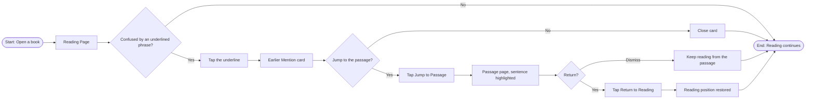
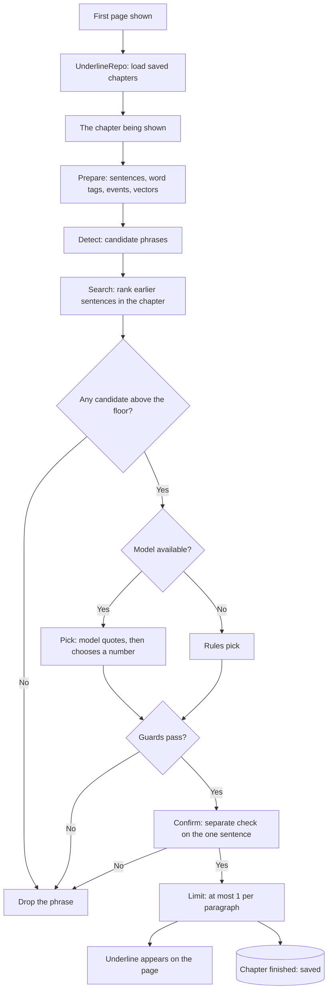

# 2.1 Reference Sentences

> **Note:** Items marked **(\*)** are suggestions or predictions (target numbers, technical decisions, additional criteria). Validate them with the team before using them as a reference.
>
> **Source of this version:** the iRead app on branch `dev` (commit `1d1e28e`, 6 Nov 2026) with the UnderlineEngine package pinned at `a70465e`. "Status" in §7 comes from reading the code, not from running the app.

| | |
|---|---|
| **Epic** | 2. Reference Sentences |
| **Product** | Fiction reading app for readers with aphantasia |
| **Release target** | Demoable app |
| **Platform** | iPad and iPhone, iOS and iPadOS 26+, SwiftUI. iPhone is portrait only. Multi-device on one iCloud account (PRD 1.4). [TBD: iPhone screen designs, and whether multi-device is in the demo]. macOS: **TBD**. |
| **Status** | Draft |
| **Book language** | English. The app doesn't check the language yet (A6). |
| **Book format** | `.epub`, imported through PRD 1.1 (PDF in a later phase) |
| **Underline kinds** | Action, Reaction, Feeling, Outcome, Place, Thing, Person |
| **Core technology** | UnderlineEngine package: NaturalLanguage (`NLTagger`, `NLEmbedding`) + on-device Apple Foundation Models. Rules only when the model is unavailable. |
| **Owner / Designer / Tech Lead** | [TBD] |
| **Depends on** | Epic 1: PRD 1.1 (`BookContent`), PRD 1.3 (reading page, paging), PRD 1.4 (CloudKit) |
| **Related features** | 3.1 Symbols (removed on this branch; see §9) |

---

## 1. Feature Name

**Reference Sentences** (Tap-to-Reference)

Some phrases on the page are underlined. They are phrases a skimming reader may not follow, such as *"began to whistle"* or *"facing a rebel or two down South"*. iRead underlines a phrase only if it can point to **the author's own earlier sentence that explains it**. The reader taps the underline, reads that sentence on the same page, and can jump to it and return.

**Underline and highlight.** The underline marks a phrase. The highlight marks the reference sentence on the passage page. A reference is always exactly one sentence.

**User story**

> As a **fiction reader with aphantasia**, I want to **tap an underlined phrase and see the author's earlier sentence that explains it** so that I can **understand the phrase without searching through previous pages.**

**Underline kinds**

The underlined thing is usually an **event**, not only a character. A person is one kind among several.

| Kind | Example phrase | Reader's likely confusion |
|---|---|---|
| **Action** | began to whistle | Why did they do that? |
| **Reaction** | immediately sat up | What set this off? |
| **Feeling** | felt cross | Why do they feel this? |
| **Outcome** | lost the prize | How did this come about? |
| **Place / Thing** | a rebel or two down South | What is this, where does it come from? |
| **Person** | Meg | Who is this? |

**What "explains" means.** A sentence explains a phrase when a skimming reader, shown it after the phrase, would say "ah, that's why" or "ah, that's what that is". It must be specific to this phrase: it names the same person, thing, place, or situation, or states the cause, goal, or earlier event the phrase depends on. A sentence that is only on the same topic, or uses similar words, does not explain it.

---

## 2. Problem

1. **Skimmed text comes back later.** Readers with aphantasia skim, long descriptive passages above all. When a later phrase depends on what they skimmed, they can't follow it.
2. **Existing solutions don't fit:**
   - **In-book search** needs the exact words, and shows results from pages not yet read (spoilers).
   - **Kindle X-Ray** works by name only, not by description, and doesn't cover events.
   - **Flipping back manually** breaks the reading flow and immersion.
3. **Asking takes too much effort for a skimming reader.** They would have to notice the confusion, tap, choose or type a question, and read. Underlines move that work to the engine.
4. **Impact:** Predicted: readers lose track of the story, reread repeatedly, or stop reading descriptive fiction. (\*)

---

## 3. Goals

**Goals**

1. Readers see what explains an underlined phrase in **one tap**, without leaving the page and without typing a question.
2. The text shown is the **author's own sentence**, never AI-written text.
3. **Zero spoilers:** the sentence comes only from text **before** the underlined sentence.
4. **No underline is better than a wrong one.** The reader didn't ask for an underline, so a wrong one is an unprompted wrong claim.
5. Readers can **jump to the passage** and **return to their reading position** with one tap.
6. All processing of book text runs **on-device**.
7. **The book is readable immediately** when opened; underlines appear in the background as they are found.

**Non-goals (this release)**

- References from another chapter. One chapter in, one chapter searched.
- Knowing who a character is: character names on the card, "Also described as", "Involved", relations, and story updates.
- Correcting a reference (Wrong match).
- Symbols and symbol badges (PRD 3.1).
- Typed or picked questions. That was tried in the separate TextEngine package, which the app doesn't use.
- A reference longer than one sentence, or more than one reference per underline. A phrase that needs more than one sentence to be explained is not underlined.
- Word meanings and knowledge from outside the book.
- Books in languages other than English.
- AI-generated summaries, images, or illustrations.
- Cloud processing in the app. Only the offline test harness may use Apple's Private Cloud Compute for its model judge (§4.3).
- DRM-protected books (purchased Apple Books titles), comics, audiobooks.

---

## 4. Success Metrics

Metrics are split into four parts: demo readiness, usability testing, model quality (offline), and post-launch.

### 4.1 Demo readiness

| Metric | Definition | Target |
|---|---|---|
| Demo scenario passes | The §6.2 scenario runs start to finish without errors, on iPad | 5 out of 5 consecutive runs (\*) |
| Without Apple Intelligence | Underlines still appear through the rules path, in fewer numbers | Pass |
| Zero spoilers in the demo book | No card shows a sentence at or after the underlined sentence | 0 cases |

### 4.2 Usability test

Task scenarios, compared against a baseline (built-in search / flipping pages), using one public-domain English novel (\*):
- *"Why did Jo begin to whistle?"*
- *"What set off this reaction?"* (on an underlined reaction)

| Metric | Definition | Target |
|---|---|---|
| Task success rate | % of participants who answer correctly using the feature | ≥ 90% (\*) |
| Time to answer | Time from task start to correct answer, vs baseline | ≥ 50% faster than baseline (\*) |
| Return success | % of participants who return to their reading position without help | 100% (\*) |
| Perceived ease | Single Ease Question (1 to 7 scale) | Average ≥ 6 (\*) |
| Interruption feel | Score for "This feature doesn't interrupt my reading flow" (Likert 1 to 5) | Average ≥ 4 (\*) |
| Spoiler incident | Participant sees a sentence from after the underlined sentence | 0 |

### 4.3 Model quality (offline, golden set)

Golden set: `Dataset/underline-gold.json` in the UnderlineEngine repo, on Little Women chapter 1. It has 67 items, and every label is **provisional until the product owner reviews it**. Each item is a phrase in a sentence, with either the acceptable earlier sentences or `none` and a reason. The harness runs on Apple's Evaluations framework and also writes a CSV per run for review. Thumbs answers (§5.7) don't enter the golden set.

| Metric | Definition | Target |
|---|---|---|
| **Mismatch rate** | Of underlines shown, % with a wrong reference, or on a phrase labelled `none`. Reported first in every run. | ≤ 5% (\*) |
| **Spoiler leaks** | Any scored, candidate, or prompted sentence at or after the underlined sentence | **0 (hard requirement)** |
| Reference precision | Of underlines shown on phrases expected to have one, % with an acceptable reference | ≥ 90% (\*) |
| Underline recall | Of phrases expected to have an underline, % underlined correctly | Measure as baseline |
| Candidate recall | Of those phrases, % where an acceptable sentence reached the model | Measure as baseline |
| Judge pass rate | Of underlines shown, % a separate model judge says explain the phrase | Measure as baseline |
| Confirm agreement | Of picks rejected by Confirm (§5.2), % that were actually wrong | Measure as baseline |
| Density | Underlines per 100 sentences and per paragraph | Report |

**Current result: the targets are not met.** On the unreviewed golden set (model path, run of 30 Oct 2026), **7 of the 10 references shown were wrong**. On chapter 1 as a whole, a Mac shows 60 underlines and an iPad shows 121, and the cause isn't known yet (§9).

Principle: **precision matters more than recall.** A wrong reference does more harm than a phrase with no underline.

### 4.4 Post-launch (product)

Not built: these need the §4.5 events.

| Metric | Definition | Target |
|---|---|---|
| Adoption | % of reading sessions with ≥ 1 `RF_Phrase_Tap` | ≥ 30% (\*) |
| Engagement | Average taps per 100 pages (feature users), split by kind | Baseline in month one, then monitor (\*) |
| Jump rate | `RF_JumpToPassage_Button` / `RF_Phrase_Tap` | Measure as baseline (\*) |
| Return rate | `RF_ReturnToReading_Button` / `RF_JumpToPassage_Button` | ≥ 80% (\*) |
| Book completion rate | % of books finished, feature users vs non-users | +10 percentage points (\*) |
| **Thumbs-down rate** | Of thumbs answers, % that are thumbs down, per `engineVersion`. Comes from `UnderlineRating` (§5.7), not from events. | [TBD] |
| Thumbs answers | Number of answers per `engineVersion`, to show whether a rate rests on enough answers | Report (\*) |

**Guardrails / performance**

| Metric | Target |
|---|---|
| Card appears after a tap (p95) | ≤ 100 ms (data lookup, no model call) (\*) |
| Time to finish one chapter on iPad | [TBD: not measured yet] |
| "Return to Reading" accuracy | ≥ 99% return to the same page (\*) |
| Crash-free sessions | ≥ 99.5% (\*) |
| Book text sent anywhere except the reader's private iCloud (PRD 1.4) | 0 |

Import guardrails are in PRD 1.1 §4.4.

### 4.5 Event tracking

**Not built.** The app logs engine progress to OSLog (categories `storage`, `model`, `ratings`, and `events`) but sends no reference events. Proposed (\*):

| Event | When it fires | Properties |
|---|---|---|
| `RF_Phrase_Tap` | Reader taps an underline | kind |
| `RF_Card_Shown` | Card finishes appearing | latency_ms, kind |
| `RF_Card_Dismiss` | Card is closed | dwell_ms |
| `RF_JumpToPassage_Button` | Tap on "Jump to Passage" | kind, distance_pages |
| `RF_ReturnToReading_Button` | Tap on "Return to Reading" | restored_ok |

Events must not contain book text, only IDs and numbers. `UnderlineRecord` from the engine contains book text, so it stays in the DEBUG sheet and is never saved.

---

## 5. Main Flow

### 5.1 User flow

| # | Screen | User action | App response |
|---|---|---|---|
| 1 | Reading Page | Reads | Phrases with an earlier explanation get a **dotted underline**. New underlines appear while reading, without moving the text. |
| 2 | Reading Page | Isn't confused: keeps reading | Done |
| 3 | Reading Page | Taps the underline | "Earlier Mention" card opens as a popover at the phrase |
| 4 | Earlier Mention card | Closes the card | Back to Reading Page, position unchanged |
| 5 | Earlier Mention card | Taps **"Jump to Passage"** | The current position is saved. The passage page opens with the sentence highlighted in yellow. **"Return to Reading"** and a dismiss (X) button appear below the text. In books on the provided list, thumbs appear next to "Return to Reading" (§5.7). |
| 6 | Passage page | Taps the X | Buttons and highlight go away; the reader stays here and the saved position is cleared |
| 7 | Passage page | Taps **"Return to Reading"** | The saved page opens, and a toast says "Returned to page N" for 2 seconds |

**Card content**

| Part | Content | Example |
|---|---|---|
| Title | "Earlier Mention" | Earlier Mention |
| Phrase | The underlined phrase | facing a rebel or two down South |
| Location | Chapter title and page of the passage | Chapter One • Page 3 |
| Quote | The author's earlier sentence, in quotation marks | "…thinking of Father far away, where the fighting was." |
| Action | **Jump to Passage** | |
| Feedback | Thumbs up and thumbs down, left of "Jump to Passage", in books on the provided list (§5.7) | |

The card shows no character name, because the engine doesn't know who anyone is.

**Alternative flows**

- **A1. No explanation found:** the phrase is not underlined. This covers no good candidate, a model answer that fails a check, and a Confirm that disagrees (§5.2).
- **A2. Explained close by:** if the chosen sentence is in the phrase's own paragraph, the phrase is not underlined, because the reader has just read it. A reason in the same sentence ("…because…") isn't underlined either.
- **A3. Part of the book not analysed yet:** the book stays readable. Underlines appear as each paragraph finishes. There is no progress indicator for readers; debug builds show progress on the debug screen.
- **A4. Foundation Models unavailable:** the rules path picks and confirms, with fewer and more cautious underlines. There is no setting to turn the model off.
- **A5. Repeated jumps:** "Return to Reading" still points to the first origin. It survives closing the app until the reader returns or dismisses it.
- **A6. Non-English book (not built):** PRD 1.1 doesn't store a language, so the engine runs on every book with English language tools. Requirement kept: the feature should be disabled with a short message. (\*)

### 5.2 System flow

**Step 1: Prepare (once per chapter).** Split sentences exactly like the app's parser, tag words (`NLTagger`), split each sentence into events with a causal role (setting, initiating event, internal response, goal, attempt, reaction, outcome), and embed every sentence (`NLEmbedding`).

**Step 2: Detect (rules).** The candidates are each sentence's events and person names. Dropped: phrases under 3 words or made only of general words, causes and goals whose reason is in the same sentence, and names mentioned in the last 20 sentences.

**Step 3: Search (rules).** Rank only sentences **before** the phrase's sentence, in the same chapter. Meaning counts first (0.65) and shared words second (0.35), with bonuses for role links and nearness. For a person name, only sentences that mention the name count. Candidates below a floor are dropped before any model call.

**Step 4: Pick (Foundation Models).** The model gets the sentence, the phrase, a role hint, and numbered candidates, and answers with a **quote first, then a number**; 0 means none. `UnderlineGuard` rejects a number not offered, a sentence not earlier, or a quote not in that sentence. A sentence in the phrase's own paragraph drops the phrase (A2). If the prompt is too large, the candidates are halved and tried once more, then the rules path takes over. Any other model failure drops the phrase.

**Step 5: Confirm (Foundation Models, new session).** The model sees only the phrase, its sentence, and the one picked sentence, and says whether it explains the phrase. Pick and Confirm must agree. Without a model, `RulesPicker` needs a shared content word, the same person name, or a role link.

**Step 6: Limit (rules).** At most **1 underline per paragraph**, highest score first.

### 5.3 Runtime configuration

**Background work (`UnderlineRepo`)**

| Rule | Behaviour |
|---|---|
| Start | When a page shows, its chapter is underlined from the first sentence on that page, then from the chapter's start |
| Order | Only the chapter being read. Moving to a page in another chapter (turning, Contents, search, Jump to Passage) stops the running chapter and starts that one. No chapter is worked on ahead of the reader. |
| Stop | When the app goes to the background, the reader goes back to the library, or another chapter is shown |
| Resume | When the app returns, the shown chapter starts again from the shown page. Underlines found earlier in this session keep showing. |
| Throttling | Not built: removed on `dev` |
| Priority | No set priority; one task at a time in the `UnderlineRepo` actor |
| Save | `Underlines/<fingerprint>/chapter-N.json`, only when a chapter finishes with no failed model call, and the same result to the reader's private iCloud |
| Reuse | A saved chapter is used only if `engineVersion` and `parserVersion` match |
| Reuse from another device | A chapter not on the device is looked up in the reader's private iCloud before the engine runs, and used if `engineVersion` and `parserVersion` match (PRD 1.4 §5.3) |
| Silent model failure | One test call to the model before the first chapter. If it fails, the engine uses rules only. A chapter where a model call fails isn't saved and is underlined again next time. |

Every chapter the reader shows is processed, including front matter and license pages (§9).

**Token budget.** Candidates are trimmed to fit the model's context size, which is read at runtime (`TokenBudget`: output reserve 32 tokens, margin 10%). Each candidate is cut to 40 words. Sampling is greedy.

**Tuning values** (`…Knobs` at the top of each engine file)

| Value | Setting |
|---|---|
| `maxPerParagraph` | 1 |
| `minPhraseWords` | 3 |
| `nameGapSentences` | 20 |
| `maxCandidates` | 3, in the pinned engine commit `a70465e` |
| `embedWeight` / `wordsWeight` | 0.65 / 0.35 |

### 5.4 Anti-spoiler rules

**For an underline in sentence `s`, only sentences before `s` may be searched, scored, or placed in a model prompt.** One function (`ReadBoundary`) supplies these sentences to every step, and the harness checks the rule on the logged candidates and prompts.

Because every reference comes before the sentence it explains, an underline can be shown whenever its sentence is on the page, even though analysis runs ahead of the reader. The card reveals nothing else: no names, no later facts, no story updates.

`readingFrontier` (PRD 1.3) is still saved but nothing in this feature reads it. The trade-off: an answer just after the phrase on the same page isn't used, even if the reader can already see it.

### 5.5 Components (MVVM) and data

**Components**

| Layer | Component | Responsibility |
|---|---|---|
| Package | `UnderlineCtrl` (UnderlineEngine) | Runs Prepare to Limit for one chapter and streams results per paragraph. Imported only by `Analysis/`. |
| Model | `UnderlineRepo` (actor) | Background work in §5.3; keeps each chapter's underlines (`SavedUnderline`) in memory; saves finished chapters on disk and in the reader's iCloud |
| Model | `ChapterInputMapper` (pure rule) | `BookContent` → the engine's `ChapterInput`; indexes stay global |
| Model | `ModelCheckSvc` | Test call to the model (§5.3) |
| Model | `CloudSvc` | CloudKit records: the reader's private database for underlines, the public database for shared ratings |
| Model | `RatingRepo`, `RatingCtrl` | Thumbs, the share answer, and unsent ratings (§5.7) |
| Model | `RefCtrl` | Starts underlining for a page's chapter, turns underlines into `Mark`s for a page, returns the underline for a tap |
| ViewModel | `ReferenceVM` | State: marks per page, card, `canReturn`, toast. Intents: `markTapped`, `cardDismissed`, `jumpToPassageTapped`, `returnToReadingTapped`, `returnDismissed`, `appBackgrounded`, `appForegrounded`, `close`. |
| ViewModel | `RatingVM` | Thumbs on the shown card, the share question, the Share Ratings switch, the iCloud row in the menu |
| View | `PageTextView`, `RefCardView`, `ReaderView` | Draws dotted underlines and yellow highlights, the card, and the return controls |
| Debug | `UnderlineDebugView` (DEBUG builds, ladybug button or ⌘⇧D) | The shown chapter only: model or rules, each phrase kept or dropped with its reason, and an iCloud section |
| Tool | `UnderlineEngineEvals` (engine repo) | Golden set, rules baseline, whole-chapter sweep, CSV per run |

**Per-book data**

| Data | Key fields |
|---|---|
| `SavedUnderline` | id, sentence, paragraph, range (UTF-16, within the paragraph), text, kind, decidedBy (model / rules), reference (`ContextPassage`: sentence, paragraph, range, text) |
| `ChapterUnderlines` (`Underlines/<fingerprint>/chapter-N.json` and the reader's iCloud, can be rebuilt) | parserVersion, engineVersion, underlines |
| Drop reasons | Shown only in the debug sheet, never saved: `noCandidate`, `pickedNone`, `guardRejected`, `explainedInParagraph`, `confirmRejected`, `modelFailed`, `densityLimit` |
| `BookState` (`state.json`, owned by the reader) | returnPosition, recentSearches |

### 5.6 Use of NLEmbedding

`NLEmbedding` is a NaturalLanguage tool, not an Apple Intelligence feature. It runs on the device and needs no network. It **ranks candidates** in Step 3 and never decides alone.

| Rule | Detail |
|---|---|
| Vector | English sentence embedding, otherwise the average of word vectors |
| Unavailable | Search uses shared words only. Nothing crashes. |
| Compared | The phrase against each earlier sentence in the chapter |
| Spoilers | Sentences are embedded ahead of time, but only those before the phrase are scored |

### 5.7 Reader feedback (thumbs)

Readers rate each reference with a thumb. The answers show, after release, how often readers find a reference wrong (the thumbs-down rate in §4.4). They don't enter the golden set (§4.3), which stays a hand-labelled test run before release.

**Where thumbs appear**

| Place | Position |
|---|---|
| Earlier Mention card | Left of "Jump to Passage" |
| Passage page | Next to "Return to Reading" |

Both places rate the same underline and reference, and show the same status.

**Which books**

Thumbs appear only in books on our provided list, matched by `fingerprint`, a hash of the book's text. It doesn't matter how the file reached the app. In any other book, including another edition of a listed title, thumbs don't appear and Reference works as usual.

[TBD: which books are on the list, besides the 5 sample books]

**Status**

| Current status | Reader taps | New status |
|---|---|---|
| Empty | Up / Down | Up / Down |
| Up | Up | Empty |
| Up | Down | Down |
| Down | Down | Empty |
| Down | Up | Up |

Only the current status is kept, with no history. It is still shown when the reader reopens the reference.

**When the device isn't connected**

If the device is offline or not signed in to iCloud, thumbs work as usual and show no message. The status is saved on the device and isn't synced. Once the device is connected, the latest status is sent.

**Consent**

The first rating asks whether to share ratings. If the reader says no, nothing is sent. The Share Ratings switch in the reader menu changes the answer.

**Data**

Answers are stored in a CloudKit public database as one `UnderlineRating` per install per underline. The record name joins a random install ID, the book, and the underline. Returning to Empty removes the record.

| Field | Content |
|---|---|
| verdict | up or down |
| book | `fingerprint`, a hash of the book's text |
| chapterIndex, sentence | The underlined sentence, counted from the chapter's first sentence (0) |
| reference | The reference sentence, counted the same way |
| kind, decidedBy | The underline kind, and `model` or `rules` |
| engineVersion, appVersion | Versions that produced the reference |
| Creator ID and time | Added by CloudKit. The ID is anonymous and needs no login screen. |

No book text is sent. To read the answers, the team exports the records through CloudKit Web Services and converts positions back to text using our copy of the EPUB. CloudKit setup is in PRD 1.4 §5.6.

---

## 6. Demo Scope

### 6.1 Priorities

| Priority | Content |
|---|---|
| **P0 (required for the demo)** | Underlines and the Earlier Mention card; Jump to Passage and Return to Reading; §5.4 boundary; works without Foundation Models; saved chapters; mismatch rate low enough to show (\*) |
| **P1 (should be in the demo)** | Reader's chapter first; no underlines on front matter and license pages (\*) |
| **P2 (after the demo)** | Events; references across chapters; non-English books disabled with a message (\*) |
| **[TBD: priority]** | Reader feedback thumbs (§5.7) |

### 6.2 Demo scenario (\*)

Uses Little Women, one of the sample books in the library:

1. Open the book. It opens right away, and underlines start to appear.
2. In Chapter 1, tap an underline. The card shows the phrase, its location, and the author's earlier sentence.
3. Tap **Jump to Passage**. The passage page opens with the sentence highlighted.
4. Tap **Return to Reading**. The original page returns, with the toast.
5. Jump again, tap the X, and keep reading from the passage.
6. Fully close the app and reopen the book. Underlines for finished chapters appear from the saved files.
7. On an iPad without Apple Intelligence: repeat steps 2 to 4 on the rules path.

---

## 7. Acceptance Criteria

| ID | Criteria (Given / When / Then) | Priority | Status |
|---|---|---|---|
| AC-2.1-01 | **Given** a phrase has an earlier sentence that passed Pick and Confirm, **when** its page is shown, **then** the phrase has a tappable dotted underline. | P0 | Built |
| AC-2.1-02 | **Given** the reader taps an underline, **when** the card appears, **then** it shows the phrase, the chapter and page of the passage, and the author's sentence. | P0 | Built |
| AC-2.1-03 | **Given** the reader taps an underline, **when** the card appears, **then** it opens on the same page without changing the reading position. | P0 | Built |
| AC-2.1-04 | **Given** a card is open, **when** the reader taps "Jump to Passage", **then** the passage page opens with the sentence highlighted, and "Return to Reading" and a dismiss button appear. | P0 | Built |
| AC-2.1-05 | **Given** the reader is on the passage page, **when** they tap "Return to Reading", **then** the original page opens, including after several jumps, and a toast names the page. | P0 | Built |
| AC-2.1-06 | **Given** the return controls are shown, **when** the reader taps the X, **then** the controls and the highlight go away and the reader stays on this page. | P0 | Built |
| AC-2.1-07 | **Given** a saved return position, **when** the app is closed and the book reopened, **then** "Return to Reading" still works. | P1 | Built |
| AC-2.1-08 | **Given** any underline, **when** its reference is chosen, **then** no sentence at or after the underlined sentence is scored, sent to the model, or shown. | P0 | Built; harness checks it |
| AC-2.1-09 | **Given** no candidate passes, or the model and Confirm disagree, **when** the page is shown, **then** the phrase is not underlined. | P0 | Built |
| AC-2.1-10 | **Given** the chosen sentence is in the phrase's own paragraph, or the reason is in the same sentence, **when** the page is shown, **then** the phrase is not underlined. | P1 | Built |
| AC-2.1-11 | **Given** a paragraph has more than 1 passing phrase, **when** the page is shown, **then** at most 1 is underlined. | P1 | Built |
| AC-2.1-12 | **Given** Foundation Models is unavailable, **when** a chapter is processed, **then** underlines come from the rules path and the app doesn't crash. | P0 | Built |
| AC-2.1-13 | **Given** analysis is running, **when** the reader reads, **then** the book stays readable, the text doesn't move when underlines appear, and an open card stays open. | P0 | Built |
| AC-2.1-14 | No book text reaches the public database, a thumbs export, or any server of ours. It may be stored only on the device and in the reader's private iCloud (PRD 1.4). | P0 | Partly: shared ratings carry book text (§9 #25) |
| AC-2.1-15 | **Given** a chapter was finished before and its versions match, **when** the book reopens, **then** its underlines load from the saved file or the reader's iCloud, with no model calls. | P1 | Built |
| AC-2.1-16 | **Given** the app goes to the background during a chapter, **when** it returns, **then** that chapter starts again and no partial result was saved. | P1 | Built |
| AC-2.1-17 | **Given** the device is hot or in Low Power Mode, **when** a new chapter is about to start, **then** work waits until that clears. | P1 | Not built: removed on `dev` |
| AC-2.1-18 | **Given** the model reports available but a test call fails, **when** the first chapter starts, **then** the engine uses rules only. **Given** a model call fails during a chapter, **when** the chapter ends, **then** it isn't saved and is underlined again next time. | P1 | Built |
| AC-2.1-19 | **Given** a prompt exceeds the token budget, **when** the call is made, **then** candidates are halved once, then the rules path decides, with no error in the UI. | P1 | Built |
| AC-2.1-20 | **Given** `NLEmbedding` is unavailable, **when** a chapter is processed, **then** search uses shared words only and nothing crashes. | P0 | Built |
| AC-2.1-21 | **Given** the golden set, **when** the harness runs, **then** the mismatch rate is ≤ 5%. (\*) | P0 | **Not met** on engine `2e39666` (7 of 10 wrong). Rerun on `a70465e`. |
| AC-2.1-22 | **Given** a book isn't in English, **when** it opens, **then** the feature is disabled with a short message and the book stays readable. (\*) | P2 | Not built |
| AC-2.1-23 | **Given** a chapter is front matter or a license page, **when** the book is analysed, **then** it gets no underlines. (\*) | P1 | Not built |
| AC-2.1-24 | **Given** a book on the list, **when** the card opens, **then** thumbs appear to the left of "Jump to Passage". | [TBD] | Partly: thumbs show in every book, not only listed ones |
| AC-2.1-25 | **Given** the reader jumped to a passage, **when** the passage page shows, **then** thumbs appear next to "Return to Reading" with the same status as the card. | [TBD] | Not built: thumbs are on the card only |
| AC-2.1-26 | **Given** a book not on the list, **when** the card opens, **then** no thumbs appear and the rest of the feature is unchanged. | [TBD] | Not built: thumbs show in every book |
| AC-2.1-27 | **Given** any status, **when** the reader taps a thumb, **then** the new status follows the status table in §5.7. | [TBD] | Built |
| AC-2.1-28 | **Given** a rated reference, **when** the reader reopens it, also after restarting the app, **then** the status is still shown. | [TBD] | Built, on this device (`ratings.json`) |
| AC-2.1-29 | **Given** the device is offline or not signed in to iCloud, **when** the reader taps a thumb, **then** the status changes with no message and the latest status is sent once the device is connected. | [TBD] | Partly: unsent ratings are retried when a book opens or the app returns |
| AC-2.1-30 | **Given** an answer is sent, **when** the record is inspected, **then** it holds only positions, IDs, and versions, and no book text. | [TBD] | Not built: ratings hold the phrase, both sentences, and the book title |

---

## 8. Test Cases

| ID | Scenario | Precondition | Steps | Expected result | AC |
|---|---|---|---|---|---|
| TC-2.1-01 | Underline and card | Little Women, Chapter 1, saved underlines | Tap an underline | Card: phrase, location, quote | AC-2.1-01, AC-2.1-02 |
| TC-2.1-02 | Card doesn't move the page | On page 12 | Tap an underline, close the card | Still on page 12 | AC-2.1-03 |
| TC-2.1-03 | Jump | Card open | Tap "Jump to Passage" | Passage page, sentence highlighted, return controls shown | AC-2.1-04 |
| TC-2.1-04 | Return | Jumped from page 12 | Tap "Return to Reading" | Back on page 12; toast "Returned to page 12" | AC-2.1-05 |
| TC-2.1-05 | Repeated jumps | Jump from page 12 to 8, then to 5 | Tap "Return to Reading" | Back on page 12 | AC-2.1-05 |
| TC-2.1-06 | Return after changing text size | Jump from page 12, then change text size | Tap "Return to Reading" | Back at the same paragraph (page number may change) | AC-2.1-05 |
| TC-2.1-07 | Dismiss | Return controls shown | Tap the X | Controls and highlight gone; same page | AC-2.1-06 |
| TC-2.1-08 | Return after reopening | Jumped, then force quit | Reopen the book | "Return to Reading" shown and works | AC-2.1-07 |
| TC-2.1-09 | No spoiler | Golden set and sweep | Run the harness | 0 spoiler leaks | AC-2.1-08 |
| TC-2.1-10 | Explanation comes later | Golden item whose explanation comes later in the chapter | Run the harness | Correctly none | AC-2.1-08, AC-2.1-09 |
| TC-2.1-11 | Tempting wrong passage | Golden item with a sentence that shares words but doesn't explain | Run the harness | Correctly none | AC-2.1-09 |
| TC-2.1-12 | Reason in the same sentence | Golden item with "…because…" | Run the harness | Correctly none | AC-2.1-10 |
| TC-2.1-13 | Explained in the same paragraph | The picked sentence is in the phrase's paragraph | Debug screen | Dropped as `explainedInParagraph` | AC-2.1-10 |
| TC-2.1-14 | Density | Paragraph with 2 passing phrases | Read the page | At most 1 underline | AC-2.1-11 |
| TC-2.1-15 | No model | iPad without Apple Intelligence | Open a book | Debug screen says rules only; underlines appear; no crash | AC-2.1-12 |
| TC-2.1-16 | Reading during analysis | Book never opened | Read and tap immediately | Text doesn't move; open card stays open | AC-2.1-13 |
| TC-2.1-17 | Airplane mode | Airplane mode on | Open a book, wait for underlines, tap one | Everything works; no network requests | AC-2.1-14 |
| TC-2.1-18 | Saved chapter | Chapter finished earlier | Reopen the book | Underlines appear from `chapter-N.json`; no model calls | AC-2.1-15 |
| TC-2.1-19 | Background mid-chapter | Chapter running | Background the app, then return | No file for that chapter until it finishes; it restarts | AC-2.1-16 |
| TC-2.1-20 | Low Power Mode (removed on `dev`) | Low Power Mode on | Open a book | Not built: underlining doesn't pause | AC-2.1-17 |
| TC-2.1-21 | Model fails silently | Model reports available, calls fail | Open a book | Debug screen says model isn't answering; nothing saved for that chapter | AC-2.1-18 |
| TC-2.1-22 | Golden set accuracy | Reviewed golden set | `UNDERLINE_EVALS=1 swift test --filter goldenEvaluation` | §4.3 targets met | AC-2.1-21 |
| TC-2.1-23 | Non-English book | Indonesian-language EPUB | Open the book | Feature-disabled message; book readable | AC-2.1-22 |
| TC-2.1-24 | License page | Sample book with a license chapter | Open the chapter after analysis | No underlines | AC-2.1-23 |
| TC-2.1-25 | Demo scenario | §6.2 | Run on iPad | All steps pass, 5 times in a row | §4.1 |
| TC-2.1-26 | Thumbs on the card | Book on the list, underline on the page | Tap the underline | Thumbs appear left of "Jump to Passage" | AC-2.1-24 |
| TC-2.1-27 | Thumbs on the passage page | Book on the list, card open, status Up | Tap "Jump to Passage" | Thumbs appear next to "Return to Reading", showing Up | AC-2.1-25 |
| TC-2.1-28 | Book not on the list | Imported EPUB that isn't on the list | Tap an underline, then "Jump to Passage" | No thumbs on the card or the passage page; card, jump, and return work | AC-2.1-26 |
| TC-2.1-29 | Another edition | Imported EPUB of a listed title, different file | Tap an underline | No thumbs on the card | AC-2.1-26 |
| TC-2.1-30 | Rate from Empty | Status Empty | Tap thumbs up | Status Up; one record with vote `up` | AC-2.1-27 |
| TC-2.1-31 | Switch the rating | Status Up | Tap thumbs down | Status Down; still one record, with vote `down` | AC-2.1-27 |
| TC-2.1-32 | Clear thumbs up | Status Up | Tap thumbs up | Status Empty; record removed | AC-2.1-27 |
| TC-2.1-33 | Clear thumbs down | Status Down | Tap thumbs down | Status Empty; record removed | AC-2.1-27 |
| TC-2.1-34 | Status stays | Status Up | Close and reopen the card, then force quit and reopen it again | Status Up both times | AC-2.1-28 |
| TC-2.1-35 | Offline | Airplane mode on, status Empty | Tap thumbs up, then turn airplane mode off | Status Up with no message; the record arrives after the device connects | AC-2.1-29 |
| TC-2.1-36 | Not signed in to iCloud | Device not signed in, status Empty | Tap thumbs down, then sign in to iCloud | Status Down with no message; the record arrives after sign-in | AC-2.1-29 |
| TC-2.1-37 | Only the latest status is sent | Airplane mode on, status Empty | Tap thumbs up, tap thumbs down, then turn airplane mode off | One record, with vote `down` | AC-2.1-29 |
| TC-2.1-38 | No book text in the record | A sent answer | Open the record in CloudKit Console | Only positions, IDs, and versions; no book text | AC-2.1-30 |

---

## 9. Open Questions & Risks

1. **`Underline-Engine` branch.** `dev` now runs UnderlineEngine and is this PRD's reference. The branch's last commit (`e6e22e0`, cleanup and debug report) isn't in `dev`.
2. **Accuracy.** 7 of 10 references shown are wrong on the unreviewed golden set. The golden set must be reviewed first, then tuned. References seem to be picked for similar words: "looked at her rough hands with a sigh" points to a sentence that also says "sigh" but doesn't explain the hands.
3. **"Who is this?" is no longer answered directly.** With no character identity and no Symbols, the reader has to work it out from the quote. This was one of the two core insights in PRD 0.0 and one of the three priorities from the expert review. Decide whether a reference engine that doesn't know characters is enough, and what happens to PRD 3.1.
4. **Ordinary actions are now underlined.** The earlier PRD excluded them. Underlining them may add noise, so confirm in usability testing.
5. **Mac and iPad disagree.** Chapter 1 gives 60 underlines on a Mac and 121 on an iPad. The cause hasn't been investigated, so numbers measured on a Mac may not hold on iPad.
6. **One chapter only.** Phrases early in a chapter often have no candidates, and a character introduced in an earlier chapter can't be explained. Cross-chapter search is left out of this phase.
7. **Reporting a wrong reference.** Wrong match was removed. A thumbs down (§5.7) now marks a reference as wrong, but readers still can't correct it.
8. **The candidate floor barely filters.** An unrelated sentence already scores 0.325, and the floor is 0.35, so most phrases reach the model.
9. **Long phrases.** An event runs to the end of its clause, so some underlines are very long.
10. **Close answers are lost.** A pick in the same paragraph drops the phrase without trying another candidate.
11. **Resolved: passing model failures no longer stay.** A chapter with a failed model call isn't saved and is underlined again next time.
12. **Front matter and license pages are analysed** when the reader shows them, and a new book opens on them. They cost model calls and can get underlines.
13. **Engine version is pinned.** `project.yml` pins UnderlineEngine to commit `a70465e`, and `Package.resolved` is committed. Bump `UnderlineRepoKnobs.engineVersion` with every new pin.
14. **Device coverage.** Foundation Models is only available on devices with Apple Intelligence. Demo iPads must support it, and the Simulator can't judge this feature.
15. **Model version changes with OS updates.** Prompts and results can shift. Rerun the golden set for every model version.
16. **Indonesian (next phase).** Needs its own event splitting and word lists, plus a check of `NLTagger` support and the model's `supportedLanguages`.
17. **Thumbs measure what readers think, not accuracy.** There is no minimum number of readers and no agreement check, so a few readers can move the rate. Compare engine versions only when each has enough answers. [TBD: minimum number of answers]
18. **Thumbs only see underlines that appear.** A phrase that should be underlined but wasn't never gets rated, so thumbs can't measure what the engine misses.
19. **Golden set and thumbs are separate.** The golden set measures accuracy before release, and thumbs measure what readers think after release. A thumbs down doesn't say which sentence is right, so it can't become a golden set item without labelling by hand.
20. **Consent.** The plan was no consent prompt for the internal demo. `dev` already asks on the first rating and has a Share Ratings switch, which gives readers a way to withdraw (Guideline 5.1.1).
21. **Resolved: thumbs no longer depend on the trial branch.** They are built on `dev`.
22. **Owner of the CloudKit container.** `dev` uses `iCloud.com.aftrhours.reader` on Shanon Giuly Istanto's team (PRD 1.4 §5.6).
23. **iPhone.** Multi-device is now the direction (PRD 1.4). [TBD: iPhone screens for the card and the passage page, and whether iPhone is in the demo]
24. **Phrases that need more than one sentence.** They get no underline, and nobody sees that they were lost. Mark them during the golden set review to measure how often this happens. (\*)
25. **The code differs from this section.** Branch `dev` sends book text with each rating (phrase, both sentences, book title), allows ratings in every book, shows thumbs on the card only, and keeps the thumbs status on each device. Decide each one with the developers.

---

**Sources**

- [SystemLanguageModel (contextSize, tokenCount(for:), supportedLanguages), Apple Developer](https://developer.apple.com/documentation/foundationmodels/systemlanguagemodel.md)
- [Apple Foundation Models context APIs, InfoQ](https://infoq.com/news/2026/03/apple-foundation-models-context)
- [App Review Guidelines (5.1.1), Apple Developer](https://developer.apple.com/app-store/review/guidelines/)
- App: `EReader/iRead` (`WALKTHROUGH.md`, `docs/superpowers/specs/2026-11-03-underline-engine-integration.md`). Engine: `UnderlineEngine` (`README.md`, `docs/superpowers/specs/2026-10-30-underline-engine-design.md`).
