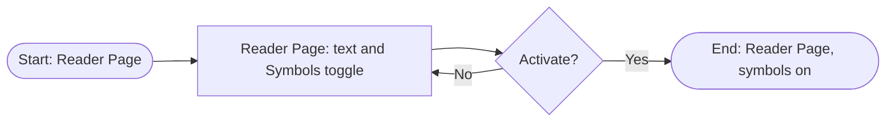
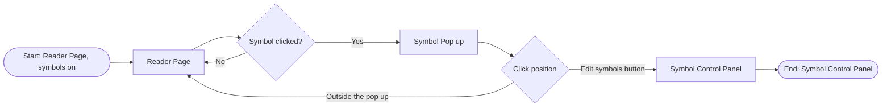
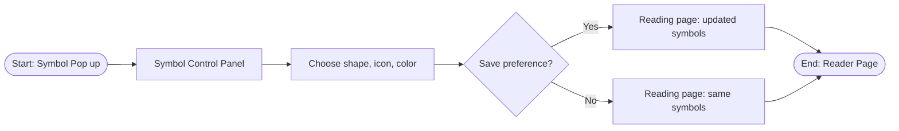

<!-- prd-progress
role: coach
pace: normal
prd-language: English
format: one PRD for the whole epic, same layout as 2.1 (Epic 2 pattern); stories 3.1 to 3.4 from EPIC 3.pdf
source: EPIC 3.pdf (story map, flows, POC references)
sections:
  metadata: done (Depends on, Book language, Book format still TBD)
  feature-name: done (story map from EPIC 3.pdf)
  problem: done
  goals: done
  success-metrics: done (demo readiness, post-launch and event tracking later)
  main-flow: done (per-story flows from EPIC 3.pdf; anti-spoiler rules decided: hidden identity, name reveal, appearance only, latest so far)
  demo-scope: in-progress (P0 = stories 3.1 to 3.4, P2 = Genmoji; demo books listed; P1 and steps TBD)
  acceptance-criteria: done (notification texts TBD)
  test-cases: done (one per acceptance criterion)
  open-questions: in-progress (draft vs PDF, color, and toggle memory decided; toggle position open, likely a grouped button)
gaps:
  - Epic owner, designer, tech lead
  - Release target
  - Depends on (which PRDs and data)
  - Book language and book format for this epic
  - Problem 2: number of concept-testing participants and date
  - Golden set: test book(s) and who labels them
  - Demo readiness metrics
  - Usability target
  - When the analysis runs
  - Story 3.2: which passage the pop up shows when a character has different descriptions, and what else it shows
  - Demo scope: P1, which Sherlock Holmes title, demo steps
  - Story 3.4: notification text when saving fails
  - Story 3.2: notification text when the pop up cannot open
  - Story 3.1: notification text when symbols are not ready, and what happens when analysis finishes
-->

# 3.1 Symbols

> **Note:** Items marked **(\*)** are suggestions or predictions (target numbers, technical decisions, additional criteria). Validate them with the team before using them as a reference.

| | |
|---|---|
| **Epic** | 3. Symbols |
| **Product** | Fiction reading app for readers with aphantasia |
| **Release target** | [TBD: release target] |
| **Platform** | iPadOS 26+ |
| **Status** | Draft |
| **Book language** | [TBD: book language for this epic] |
| **Book format** | [TBD: book format for this epic] |
| **Entity types** | Character |
| **Core technology** | NLTagger (character names) + on-device Apple Foundation Models (linking appearance descriptions to a character) |
| **Owner / Designer / Tech Lead** | [TBD] |
| **Depends on** | [TBD: which PRDs and data this epic depends on] |
| **Related features** | 2.1 Reference Passage; Epic 5 accessibility features (the Symbols setting will be one of them) |
| **Source** | EPIC 3.pdf (story map, user flows, POC screenshots) |

---

## 1. Feature Name

**Symbols**

Each character gets their own symbol. When the reader turns symbols on, the symbol is shown next to the character's name and next to the appearance descriptions that refer to that character, so the reader recognizes who is meant. The reader can tap a symbol to see who the character is, and change the symbol's shape, icon, and color.

**User story**

> As a **reader**, I need **symbols**, so that I can **recognize a character that is mentioned not only by name but also by other descriptive pronouns**.

**Stories**

| Story | Name | User story |
|---|---|---|
| **3.1** | Activate Symbols Button | As a **reader**, I need a **toggle to show or hide symbols**, so that I can **read with symbol support when I need it and read plain text when I don't**. |
| **3.2** | Access Control Panel | As a **reader**, I need to **click the character's symbol in between sentences**, so that I **know who this is and where they are mentioned**. |
| **3.3** | Customize symbols: shape, icon, color | As a **reader**, I need to **customize a character's symbol by choosing its shape, icon, and color**, so that I can **make each character easy for me to tell apart**. |
| **3.4** | Cancel and save user preference | As a **reader**, I need to **cancel or save my symbol changes**, so that I **keep control over my choices** and they stay the way I set them. |
| Not prioritized | Genmoji combine emoji | As a **reader**, I need to **combine emoji to create a Genmoji for a character**, so that I can **get a unique, expressive symbol**. |

**Entity types**

| Type | Definition | Example phrases with a symbol |
|---|---|---|
| **Character** | A person in the story, mentioned by name or by an appearance description | "Justin", "the moorland outlying farmer" |

**Relation to 2.1 Reference Passage:** Reference answers *"where was this mentioned?"* when the reader is confused about a passage. Symbols answers *"who is this?"*. Both cover characters on purpose, so less experienced readers get extra support. The Symbol Pop up (Story 3.2) also shows where the character is mentioned; this overlap with 2.1 is accepted.

---

## 2. Problem

1. **Readers cannot recognize which character is being mentioned.** Readers with aphantasia often skim descriptive passages, including moments where a character is doing something. When a later sentence refers to that character without using their name, they have difficulty recognizing who is meant.
2. **Appearance-based references are harder for them.** Some readers with aphantasia may allocate less attention to appearance-heavy descriptions. If a later reference depends on an appearance-based identifier, they may have more difficulty recognizing the intended referent. *Source: concept testing. [TBD: number of participants and date]*
3. **Readers who rarely read need extra help.** The target users include readers with aphantasia who rarely read fiction. Symbols are meant to make reading easier for them.

---

## 3. Goals

**Goals**

1. Readers **recognize at a glance** that a character mentioned by description is the same person they already know by name (for example, "the moorland outlying farmer" is Justin).
2. Readers **do not need to search the internet** to find out who is meant.
3. Readers **do not need to flip back to previous pages** to find out who is meant.

**Non-goals (this epic)**

- Places and objects (for example "Oxford Street", "the empty hut").
- Genmoji made by combining emoji (not prioritized).
- Anything in the Symbol Control Panel beyond what the user sees and does in the Story 3.2 to 3.4 flows (§5.1). This leaves out the Draw and Emoji/Genmoji tabs, the warning when a symbol looks the same as another character's, and a Characters list opened from the toolbar, all of which appear in the earlier draft or the POC.

---

## 4. Success Metrics

Metrics are split into four parts: demo readiness, usability testing, model quality (offline), and post-launch.

### 4.1 Demo readiness

[TBD: demo readiness metrics]

### 4.2 Usability test

| Metric | Definition | Target |
|---|---|---|
| Recognition without going back | Participants are shown an ambiguous sentence and asked "who is this?". **Success:** they name the correct character using the symbol, without going back to an earlier paragraph. **Failure:** they go back to an earlier paragraph, or name the wrong character. | Not set yet. Definition first. |

### 4.3 Model quality (offline, golden set)

Golden set: a test book labelled by hand, marking every appearance-description phrase and the character it refers to. The app is run on the same book and the symbols it shows are compared with the labels. [TBD: which test book(s), and who labels them]

| Metric | Definition | Target |
|---|---|---|
| Character recognition (recall) | % of appearance-description phrases in the golden set that show the correct character's symbol | ≥ 80% |
| Symbol mismatch (1 − precision) | % of symbols shown that point to the wrong character | < 10% |

These follow the usual accuracy measures in research papers: recognition is **recall**, and mismatch is **1 − precision**.

### 4.4 Post-launch (product)

_Later. To be filled after the feature flow is settled._

### 4.5 Event tracking

_Later. To be filled after the feature flow is settled._

---

## 5. Main Flow

### 5.1 User flow

Screen names "Symbol Pop up" and "Symbol Control Panel" are temporary (EPIC 3.pdf).

#### Story 3.1 Activate Symbols Button

| # | Screen | User action | App response |
|---|---|---|---|
| 1 | Reader Page | Opens a book before ever turning symbols on | Symbols are **off**. Shows only paragraphs, chapter, and pages, plus the toggle for the Symbols feature. |
| 2 | Reader Page | Doesn't turn the toggle on | Plain text stays on screen |
| 3 | Reader Page | Turns the Symbols toggle on | Symbols are shown within the passages |
| 4 | Reader Page | Opens another book | Symbols are still **on**. The choice applies to the whole app, not to one book. |

#### Main reading flow (symbols on)

| # | Screen | User action | App response |
|---|---|---|---|
| 1 | Reader Page | Reads as usual | Symbols are shown next to character names and their appearance descriptions. Each character has its own symbol. |
| 2 | Reader Page | Meets a descriptive reference (for example "the moorland outlying farmer") | The phrase shows the same symbol as the character's name (Justin) |
| 3 | Reader Page | Recognizes who is meant and keeps reading | Done |

Recognizing a character needs no tap.

#### Story 3.2 Access Control Panel

| # | Screen | User action | App response |
|---|---|---|---|
| 1 | Reader Page | Sees symbols within the passages | Symbols can be clicked |
| 2 | Reader Page | Clicks a character's symbol | Symbol Pop up opens over the page (text stays in the background). It shows information about the character, including **where the character is mentioned**: the passage where the author **describes the character's appearance** (an appearance description, not a role such as "the village doctor", and not just any mention of the name). When the same description appears more than once, the pop up shows the **latest** one. [TBD: which passage to show when the character has different descriptions, and what other information the pop up shows], and an **Edit symbol** button. |
| 3 | Symbol Pop up | Clicks outside the pop up | Pop up closes, back to the Reader Page |
| 4 | Symbol Pop up | Clicks **Edit symbol** | Symbol Control Panel opens |

POC reference (EPIC 3.pdf): the pop up shows the character's name, "Character", "Introduced in Chapter 1", a quote from that passage, and the Edit symbol button.

#### Story 3.3 Customize symbols and Story 3.4 Cancel and save

| # | Screen | User action | App response |
|---|---|---|---|
| 1 | Symbol Control Panel | Opens it from the pop up | Text stays in the background. Shows the character's name, the current symbol for that character, the list of available shapes, the list of available icons, and the fixed list of colors provided by the team. |
| 2 | Symbol Control Panel | Chooses one shape, one icon, and one color | [TBD: whether the preview updates before saving] |
| 3 | Symbol Control Panel | **Saves** (Story 3.4) | Panel closes. The reading page shows the **updated** symbols within the passages. |
| 4 | Symbol Control Panel | **Cancels** (Story 3.4) | Panel closes. The reading page shows the **same** symbols as before. |

**Symbol Control Panel contents.** The panel holds only what the user sees and does in the flows above, nothing more.

| User sees | User can do |
|---|---|
| Paragraphs, chapter, and pages in the background | |
| The character's name | |
| The current symbol for that character | |
| The list of available shapes | Choose one shape |
| The list of available icons | Choose one icon |
| A fixed list of colors provided by the team [TBD: the palette] | Choose one color |
| | Save or cancel the changes (Story 3.4) |

**Alternative flows**

- **A1. Wrong symbol:** readers usually don't notice it and get confused ("why is the symbol different?"). No correction path is defined yet. See §9.

### 5.2 System flow

Symbols are created automatically. **NLTagger** recognizes character names, and **Foundation Models** links appearance descriptions to the right character. *[TBD: when the analysis runs, for example during the background analysis after import in 1.1]*

### 5.3 Anti-spoiler rules

**Hidden identity.** When a description refers to a character whose identity the book reveals later, the description gets **its own symbol** first. Once the reader reaches the passage that reveals who it is, the description shows **the same symbol as that character**.

Example (*The Hound of the Baskervilles*): "the man on the tor" has its own symbol while Watson doesn't know who he is. When the reader reaches the passage that reveals he is Sherlock Holmes, "the man on the tor" shows Holmes's symbol.

**Name revealed later.** Until the reader reaches the passage that reveals a character's name, the pop up shows the **descriptive label** instead of the name.

Example: a girl is described in Chapter 1 as "a girl with short red hair" and named Mira in Chapter 5. A reader in Chapter 3 who taps her symbol sees "the red-haired girl" in the pop up, not "Mira".
**Appearance descriptions only.** The pop up only uses appearance descriptions. A role or job (for example "the village doctor") is not an appearance description, so it is never the passage the pop up points to.

Example: a girl is described in Chapter 1 as "a girl with short red hair" and in Chapter 4 as "the village doctor". A reader in Chapter 3 who taps her symbol sees the Chapter 1 passage.

**Latest means latest so far.** The "latest" appearance description in the pop up is the latest one the reader has **already reached**. Descriptions on pages the reader has not reached yet are never shown.

Example: a girl is described as "a girl with short red hair" in Chapter 1 and as "a tall woman with grey hair" in Chapter 9. A reader in Chapter 3 sees the Chapter 1 passage.

### 5.4 Components (MVVM) and data

_Left to the tech lead._

---

## 6. Demo Scope

### 6.1 Priorities

| Priority | Content |
|---|---|
| **P0 (required for the demo)** | Story 3.1 Activate Symbols Button; Story 3.2 Access Control Panel; Story 3.3 Customize symbols (shape, icon, color); Story 3.4 Cancel and save user preference |
| **P1 (should be in the demo)** | [TBD] |
| **P2 (after the demo)** | Genmoji combine emoji (not prioritized in EPIC 3.pdf) |

### 6.2 Demo scenario

**Demo books**

- *Moby-Dick*
- *Pride and Prejudice*
- *Anne of Green Gables*
- *Little Women*
- Sherlock Holmes [TBD: which title, for example *The Hound of the Baskervilles* used in the POC]

[TBD: demo steps, one step per behaviour (Stories 3.1 to 3.4 and the four anti-spoiler rules in §5.3), each with the book and passage where the case appears]

---

## 7. Acceptance Criteria

**Definition of Done (EPIC 3.pdf)**

- **Tech:** every flow meets the acceptance criteria.
- **Design:** everything the user sees and does is covered visually.

**Story 3.1 Activate Symbols Button**

| ID | Criteria (Given / When / Then) | Priority |
|---|---|---|
| AC-3.1-01 | **Given** the reader has never turned symbols on, **when** they open a book, **then** symbols are off and the Symbols toggle is visible. | P0 |
| AC-3.1-02 | **Given** symbols are off, **when** the reader turns the toggle on, **then** symbols are shown within the passages. | P0 |
| AC-3.1-03 | **Given** symbols are on, **when** the reader turns the toggle off, **then** only plain text is shown. | P0 |
| AC-3.1-04 | **Given** symbols are on, **when** the reader opens another book, **then** symbols are still on. | P0 |
| AC-3.1-05 | **Given** the book is still being analysed, **when** the reader turns the toggle on, **then** the passage stays as plain text and a notification tells the reader that symbols are not ready yet. [TBD: notification text, and what happens when analysis finishes] | P0 |

**Story 3.2 Access Control Panel**

| ID | Criteria (Given / When / Then) | Priority |
|---|---|---|
| AC-3.2-01 | **Given** symbols are on, **when** the reader clicks a character's symbol, **then** the Symbol Pop up opens over the page with the text still in the background. | P0 |
| AC-3.2-02 | **Given** the Symbol Pop up is open, **then** it shows information about the character, the passage where the author describes the character's appearance (the latest one the reader has already reached, §5.3), and an **Edit symbol** button. [TBD: what other information] | P0 |
| AC-3.2-03 | **Given** the character's name has not been revealed yet at the reader's position, **when** the pop up opens, **then** it shows the descriptive label (for example "the red-haired girl") instead of the name. | P0 |
| AC-3.2-04 | **Given** the Symbol Pop up is open, **when** the reader clicks outside it, **then** the pop up closes and the Reader Page is shown. | P0 |
| AC-3.2-05 | **Given** the Symbol Pop up is open, **when** the reader clicks **Edit symbol**, **then** the Symbol Control Panel opens. | P0 |
| AC-3.2-06 | **Given** the pop up cannot open (for example the character's information is not ready yet), **when** the reader clicks a symbol, **then** a notification tells the reader why. [TBD: notification text] | P0 |

**Story 3.3 Customize symbols and Story 3.4 Cancel and save**

| ID | Criteria (Given / When / Then) | Priority |
|---|---|---|
| AC-3.3-01 | **Given** the Symbol Control Panel is open, **then** it shows the character's name, the current symbol, the list of available shapes, the list of available icons, and the fixed list of colors, with the text still in the background. | P0 |
| AC-3.3-02 | **Given** the Symbol Control Panel is open, **when** the reader chooses a shape, an icon, and a color, **then** only one of each is selected at a time. | P0 |
| AC-3.4-01 | **Given** the reader has made choices, **when** they tap **Save**, **then** the panel closes and the reading page shows the updated symbol within the passages. | P0 |
| AC-3.4-02 | **Given** the reader has made choices, **when** they tap **Cancel**, **then** the panel closes and the symbols stay the same as before. | P0 |
| AC-3.4-03 | **Given** saving fails, **when** the reader taps **Save**, **then** a notification tells the reader the change was not saved, the panel closes, and the symbols stay the same as before. [TBD: notification text] | P0 |
| AC-3.4-04 | **Given** the reader saved a new symbol, **when** they close and reopen the app, **then** the saved symbol is still shown. | P0 |

---

## 8. Test Cases

| ID | Scenario | Precondition | Steps | Expected result | AC |
|---|---|---|---|---|---|
| TC-3.1-01 | First use | Symbols have never been turned on | Open a book | Plain text only; Symbols toggle visible | AC-3.1-01 |
| TC-3.1-02 | Turn symbols on | Symbols off; book fully analysed | Turn the toggle on | Symbols appear next to character names and appearance descriptions | AC-3.1-02 |
| TC-3.1-03 | Turn symbols off | Symbols on | Turn the toggle off | Only plain text | AC-3.1-03 |
| TC-3.1-04 | Setting carries over | Symbols on in book A | Close book A, open book B | Symbols on in book B | AC-3.1-04 |
| TC-3.1-05 | Analysis not finished | Book just imported, analysis running | Turn the toggle on | Text stays plain; notification shown [TBD: text] | AC-3.1-05 |
| TC-3.2-01 | Open the pop up | Symbols on | Click a character's symbol | Pop up opens over the page, text in the background | AC-3.2-01 |
| TC-3.2-02 | Latest description so far | Girl described as "a girl with short red hair" (Ch. 1) and "a tall woman with grey hair" (Ch. 9); reader in Ch. 3 | Click her symbol | Pop up shows the Ch. 1 passage and **Edit symbol**; nothing from Ch. 9 | AC-3.2-02 |
| TC-3.2-03 | Name not revealed yet | Same girl named Mira in Ch. 5; reader in Ch. 3 | Click her symbol | Pop up shows "the red-haired girl", not "Mira" | AC-3.2-03 |
| TC-3.2-04 | Close the pop up | Pop up open | Click outside the pop up | Pop up closes; Reader Page shown | AC-3.2-04 |
| TC-3.2-05 | Go to editing | Pop up open | Click **Edit symbol** | Symbol Control Panel opens | AC-3.2-05 |
| TC-3.2-06 | Pop up cannot open | Character information not ready | Click the symbol | No pop up; notification shown [TBD: text] | AC-3.2-06 |
| TC-3.3-01 | Panel contents | Panel open for one character | Look at the panel | Name, current symbol, shapes, icons, fixed color list; text in the background | AC-3.3-01 |
| TC-3.3-02 | One choice each | Panel open | Pick shape A, then shape B (same for icon and color) | Only B is selected in each list | AC-3.3-02 |
| TC-3.4-01 | Save | Panel open, new shape, icon, and color chosen | Tap **Save** | Panel closes; the character's symbol is updated in the passages | AC-3.4-01 |
| TC-3.4-02 | Cancel | Same as above | Tap **Cancel** | Panel closes; old symbol unchanged | AC-3.4-02 |
| TC-3.4-03 | Save fails | Same as above, saving forced to fail | Tap **Save** | Notification shown [TBD: text]; panel closes; old symbol unchanged | AC-3.4-03 |
| TC-3.4-04 | Saved symbol persists | A new symbol was saved | Fully close the app, reopen the book | The new symbol is still shown | AC-3.4-04 |

Not covered by acceptance criteria or test cases, by owner decision: the main reading flow (§5.1, a description shows the same symbol as the character's name) and the hidden-identity rule (§5.3).

---

## 9. Open Questions & Risks

1. **Wrong symbols go unnoticed.** With up to 10% mismatch allowed, readers will sometimes see a character's symbol on the wrong person. They usually don't notice and get confused ("why is the symbol different?"). There is no way to correct it yet. Decide whether a correction path is needed.
2. **Earlier draft vs EPIC 3.pdf.** **Decided:** the Symbol Control Panel follows what the user sees and does in the Story 3.2 to 3.4 flows. The Characters list from the toolbar, the Draw and Emoji/Genmoji tabs, and the look-alike warning are out of this epic (§3 Non-goals), even though the POC screenshot shows some of them.
3. **Color wheel or color list.** **Decided:** a color choice (a list of available colors), not a color wheel. The "Color Wheel" in the Story 3.2 flow box is replaced. The list is fixed and provided by the team; the reader cannot add colors. Still open: the palette itself (which colors and how many).
4. **Toggle details.** **Decided:** symbols are off until the reader turns them on. The choice is remembered for the whole app: once on, symbols stay on in every book until the reader turns them off. The Symbols setting will be part of the accessibility features in Epic 5. Still open: where the Symbols toggle sits. No position yet; it will probably sit inside a grouped button that collects several reading options [TBD: position and contents of the grouped button]. Also open: whether it moves to the Epic 5 accessibility settings.
5. **Pop up location with different descriptions.** **Decided:** when the same description repeats, the pop up shows the latest one. [TBD: what the pop up shows when the character has different descriptions, for example two different appearance descriptions]. Roles such as "the village doctor" do not count (§5.3). "Latest" means the latest one the reader has already reached (§5.3).
